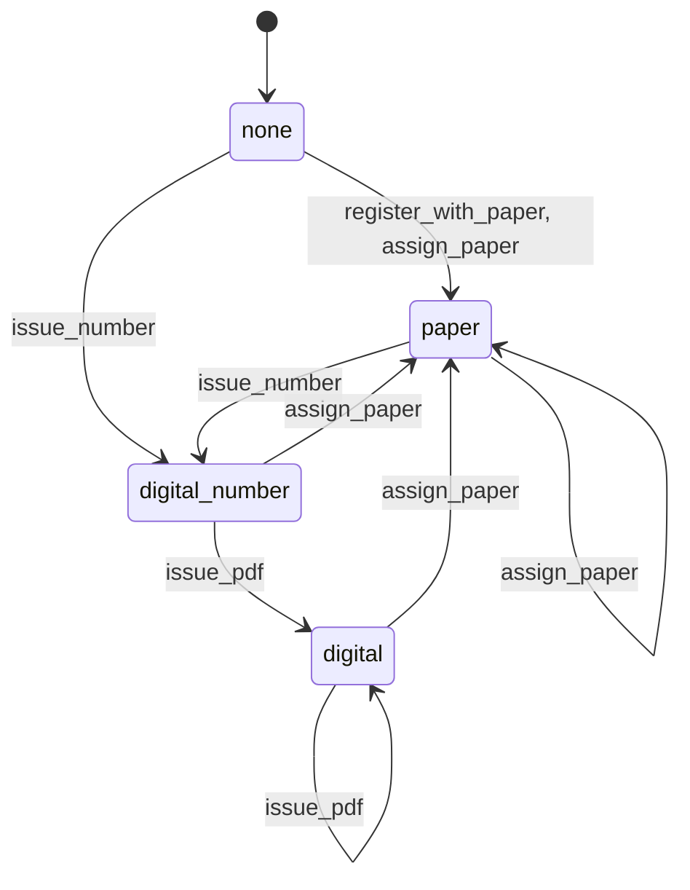

# Intygets tillstånd för en individ

Genererad av `python -m utils.certificate_lifecycle` ur `TRANSITIONS` i `app/utils/certificate_lifecycle.py`. Ändra inte för hand.

| Händelse | Skrivs av | Vem |
|---|---|---|
| `register_with_paper` | POST /api/v2/individual med pappersintyg | den som registrerar kaninen |
| `assign_paper` | `AssignPaperCertificate` (PATCH /api/individual) | manager, admin; ägare bara utan intyg |
| `issue_number` | `IssueDigitalCertificate`, `assign_certificate_number` | den som får utfärda intyg (uppfödaren, manager, admin) |
| `issue_pdf` | `generate_and_store` (POST /api/v2/certificates/issue, PATCH .../update) | den som får utfärda intyg (uppfödaren, manager, admin) |
