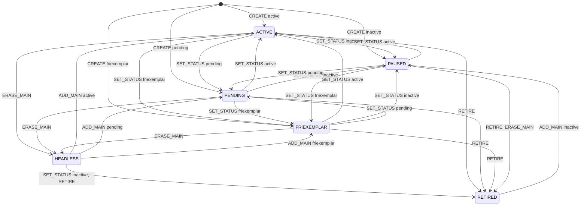

# Medlemskapets tillståndsmaskin

Genererad av `python -m utils.membership_lifecycle` ur `TRANSITIONS` i `app/utils/membership_lifecycle.py`. Ändra inte för hand. Övergångar till samma tillstånd är utelämnade.

| Händelse | Anrop | Roll |
|---|---|---|
| CREATE | POST /api/v2/memberships, godkänd ansökan, CLI `members` | admin, matrikel_admin |
| SET_STATUS | PATCH /api/v2/memberships/{id}, PATCH /api/v2/members/{id} | admin, matrikel_admin |
| RETIRE | DELETE /api/v2/memberships/{id} | admin, matrikel_admin |
| ERASE_MAIN | POST /api/v2/persons/{id}/anonymize | admin, matrikel_admin |
| ADD_MAIN | POST /api/v2/memberships/{id}/persons, POST /api/v2/memberships/{id}/main-member | admin, matrikel_admin |
