# Användarmanual – Stamboken Online

> **Gäller:** nya Stamboken (Next.js-gränssnittet) på gotlandskaninen.se/stamboken.
> **Senast kontrollerad mot gränssnittet:** 2026-10-29.
> Skärmbilderna är tagna i en lokal testmiljö med påhittade kaniner och besättningar.

Manualen är indelad efter roll. Läs del 0 först och sedan den del som gäller dig.
Varje del börjar med **Så gör du** (numrerade steg med knapparnas namn som de står
på skärmen) och slutar med **Skärmarna** (vad varje sida innehåller).

## Innehåll

- [Del 0 – Komma igång](#del-0--komma-igång)
  - [Logga in](#logga-in)
  - [Hitta i Stamboken](#hitta-i-stamboken)
  - [Testmiljön och riktiga stamboken](#testmiljön-och-riktiga-stamboken)
  - [Ordlista](#ordlista)
- [Del 1 – Uppfödare](#del-1--uppfödare)
  - Så gör du: [parning](#registrera-en-parning), [kull](#registrera-en-kull),
    [kullistan](#föra-kullistan), [registrera unge och utfärda intyg](#registrera-en-unge-och-utfärda-intyg),
    [kanin utan kull](#lägga-till-en-kanin-utan-registrerad-kull), [pappersintygets nummer](#när-pappret-och-stamboken-har-olika-individnummer),
    [kullnummer](#när-kullnumren-inte-stämmer), [foto](#ladda-upp-ett-foto),
    [redigera](#redigera-en-kanin), [död](#rapportera-en-kanin-som-död),
    [sälja](#sälja-eller-flytta-en-kanin), [provpara](#provpara),
    [besättningsuppgifter](#uppdatera-besättningsuppgifter), [profil](#uppdatera-din-profil)
  - Skärmarna: [Min besättning](#min-besättning), [Kaninens sida](#kaninens-sida),
    [Alla kaniner](#alla-kaniner), [Provparning](#provparning), [Min profil](#min-profil),
    [Verifiera intyg](#verifiera-intyg)
- [Del 2 – Genbanksansvarig](#del-2--genbanksansvarig)
  - Så gör du: [rätta en kanin](#rätta-en-kanin-i-en-annan-besättning),
    [korrigera historik](#korrigera-besättningshistorik), [ändringshistorik](#läsa-och-ångra-i-ändringshistoriken),
    [kullnummer](#numrera-om-kullar-med-registrerade-kaniner), [genetik](#använda-genetiksidan),
    [besättningar](#skapa-och-redigera-besättningar-i-din-genbank), [inkorgen](#arbeta-i-inkorgen)
  - Skärmarna: [Genetik](#genetik), [Adminpanelen för genbanksansvarig](#adminpanelen-för-genbanksansvarig),
    [Inkorg](#inkorg), [Inkorg – ärende](#inkorg--ärende)
- [Del 3 – Administratör](#del-3--administratör)
  - Så gör du: [hitta användare](#hitta-en-användare), [roller](#ge-eller-ta-bort-en-roll),
    [lösenord](#återställa-ett-lösenord), [åtkomst](#ge-tillgång-till-riktiga-stamboken),
    [inaktivera](#inaktivera-eller-aktivera-ett-konto), [ny besättning](#skapa-en-besättning),
    [ägare](#byta-ägare-på-en-besättning), [genbanksansvarig](#utse-genbanksansvarig),
    [aktivitetslogg](#söka-i-aktivitetsloggen), [massutloggning](#logga-ut-alla-användare)
  - Skärmarna: [Adminpanel](#adminpanel), [Användare](#användare), [Användare – redigera](#användare--redigera),
    [Besättningar](#besättningar), [Besättning – redigera](#besättning--redigera), [Ny besättning](#ny-besättning),
    [Genbanker](#genbanker), [Genbank – redigera](#genbank--redigera), [Utskick](#utskick), [System](#system),
    [Aktiva användare](#aktiva-användare), [Aktivitetslogg](#aktivitetslogg),
    [Demosynkronisering](#demosynkronisering), [Anropsgränser](#anropsgränser)
- [Bilagor](#bilagor): [felmeddelanden](#felmeddelanden-och-vad-de-betyder), [kontakt](#kontakt),
  [om manualen](#om-manualen)

---

## Del 0 – Komma igång

### Logga in

<!-- route: /auth/sign-in -->

Gå till gotlandskaninen.se/stamboken. Är du inte inloggad kommer du till inloggningssidan.

Har du ett föreningskonto (en adress som slutar på @gotlandskaninen.se) loggar du in med Google:

1. Klicka **Logga in med ditt föreningskonto (Google)**.
2. Välj ditt föreningskonto i Googles kontoväljare. Ett privat Gmail-konto fungerar inte.
3. Du hamnar på Min besättning.

Har du inget föreningskonto loggar du in med användarnamn och lösenord:

1. Skriv ditt **Användarnamn** och **Lösenord**. Det är samma uppgifter som i gamla Stamboken.
2. Klicka **Logga in**. Du hamnar på Min besättning.

Har du inte fått tillgång till riktiga stamboken än hamnar du i
[testmiljön](#testmiljön-och-riktiga-stamboken). Där kan du öva tills administratören
ger dig tillgång.

Glömt lösenordet till föreningskontot? Använd Googles återställning, och mejla
administratören om den inte fungerar. Glömt lösenordet till Stamboken? Klicka på länken
**administratören** under lösenordsfältet. Den öppnar ett mejl till
<admin@gotlandskaninen.se>, och du får ett nytt tillfälligt lösenord.

Felmeddelanden på sidan:

| Text | Betyder |
| --- | --- |
| Felaktigt användarnamn eller lösenord | Kontrollera stavning och versaler. |
| För många inloggningsförsök. Vänta en minut och försök igen. | Fem försök per minut är gränsen. |
| Inloggning misslyckades. Försök igen senare. | Tillfälligt fel i tjänsten. |
| Endast @gotlandskaninen.se-konton kan användas för Google-inloggning. … | Du valde ett privat Google-konto. Välj föreningskontot. |
| Ditt föreningskonto är inte kopplat till Stamboken än. Kontakta administratören. | Föreningskontot finns men har inget konto i Stamboken. Mejla <admin@gotlandskaninen.se>. |

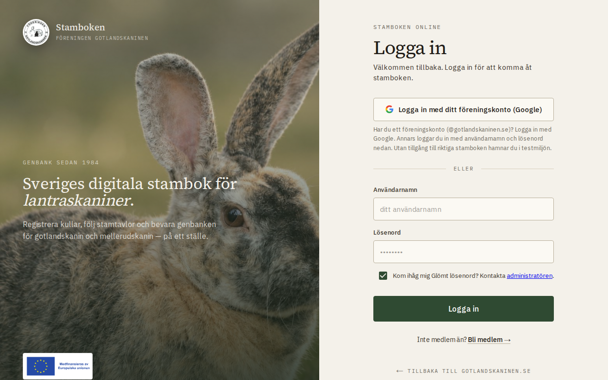

### Hitta i Stamboken

Högst upp finns ett fält med fem länkar: **Min besättning**, **Alla kaniner**,
**Genetik**, **Provparning** och **Profil**. På mobilen ligger de bakom
menyknappen (tre streck) längst till vänster. Logotypen **Stamboken** tar dig alltid
till Min besättning.

Till höger finns:

- **SV / EN** – byter språk.
- Klockan **Notiser** – meddelanden från systemet, till exempel bekräftelser och fel.
- Din avatar (initialer eller bild) – menyn med **Profil**, **Adminpanel** (om du har
  rollen), **Medlemsansökningar**, **Matrikel** och **Statistik** (om du hanterar
  medlemsregistret), **Byt till testmiljön** / **Byt till riktiga stamboken** och **Logga ut**.

Den blå rutan "Detta är nya Stamboken (beta)" stänger du med **Stäng**. Valet sparas
i webbläsaren.

### Testmiljön och riktiga stamboken

Stamboken finns i två utgåvor med samma utseende:

- **Riktiga stamboken** – det som gäller. Allt du sparar syns för alla.
- **Testmiljön** – en kopia där du kan öva. Skrivs över varje natt med riktiga
  stambokens innehåll, så inget du gör där finns kvar nästa dag. En gul rad högst upp,
  "TESTMILJÖ – här kan du öva fritt. Allt återställs varje natt.", visar att du är där.

Nya användare startar i testmiljön. När administratören gett dig tillgång till riktiga
stamboken byter du via avatarmenyn: **Byt till riktiga stamboken**, bekräfta med
**Ja, byt till riktiga stamboken**. Samma väg tillbaka: **Byt till testmiljön**.

Adminpanelen finns bara i riktiga stamboken. Öppnar du den från testmiljön får du
knappen **Byt till riktiga stamboken**.

### Ordlista

**Genbank** – hela populationen av en ras i bevarandeprogrammet. Föreningen driver två:
gotlandskanin (besättningsnummer som börjar på G) och mellerudskanin (M).

**Besättning** – din del av genbanken: dina registrerade kaniner och dina ungar.
Varje besättning har ett **besättningsnummer**, till exempel G1274. Det är samma som
ditt medlemsnummer med rasens bokstav framför.

**Individnummer** – kaninens unika nummer, till exempel G1274-2301. Första delen är
besättningen där kaninen föddes, sedan två siffror för födelseår, kullnummer och
kaninens plats i kullen.

**Kullnummer** – kullens ordningsnummer i besättningen under ett år. Första kullen
som föds under året är kull 1. Kullnumret ingår i ungarnas individnummer, så kullar
ska registreras i den ordning de föds.

**Kullista** – listan över ungarna i en kull innan de registrerats. Här för du kön,
färg och vad som hänt med varje unge.

**Registrerad kanin** – en unge som skrivits in i stamboken med intyg (papper eller
digitalt) och därmed fått sitt individnummer. **Oregistrerad unge** – en rad i kullistan
som ännu inte skrivits in.

**Intyg** – beviset på att kaninen är registrerad. **Pappersintyg** är det tryckta
dokument som skickats med posten. **Digitalt intyg** är en signerad PDF som Stamboken
utfärdar; den har en QR-kod som vem som helst kan skanna för att kontrollera äktheten.

**GX1 och MX1** – "besättningarna" för kaniner som sålts ut ur genbanken, till exempel
till någon som håller kanin som sällskapsdjur. GX1 för gotlandskanin, MX1 för mellerudskanin.

**Aktiv kanin** – registrerad, levande och årsrapporterad de senaste 13 månaderna i en
aktiv besättning. **Inaktiv** – allt annat som inte är dött.

**Årsrapport** – den årliga bekräftelsen att kaninen finns kvar hos dig. Årsrapporten
i nya Stamboken är inte klar än; knappen **Årsrapportera** visar "Kommer snart".
Tills dess rapporterar du som tidigare.

**Uppfödare** (besättningsägare), **genbanksansvarig** och **administratör** – rollerna
som manualens tre delar handlar om. Dessutom finns **granskare**, som får se en genbank
utan att ändra, **skötare**, som får sköta en annan medlems besättning, och
**matrikeladministratör**, som hanterar medlemsregistret.

---

## Del 1 – Uppfödare

Du som äger en besättning gör allt i del 1 under **Min besättning** och på kaninernas
egna sidor. Allt fungerar på mobilen, och bilderna visar mobilvyn där det är den vanligaste.

### Registrera en parning

En parning registreras när honan parats. Då räknar Stamboken dräktigheten och
påminner dig när kullen borde ha fötts.

1. Öppna **Min besättning** och fliken **Kullar och parningar**.
2. Klicka **Ny parning**.
3. Välj **Mor** (dina honor) och **Far** (hanar i hela genbanken). Skriv början
   av namnet eller numret och välj i listan.
4. Ange **Parningsdatum**. Dagens datum är förvalt. Skriv gärna en rad i
   **Parningsanteckningar**.
5. Vill du först se avkommans inavelsgrad: klicka **Provpara först**. Formuläret sparas
   så länge och finns kvar när du kommer tillbaka.
6. Klicka **Registrera parning**. Bekräftelsen "Parning registrerad!" visas och kortet
   hamnar under **Pågående parningar** med en stapel "dag N av 31".

Får du "Parningen är redan registrerad" finns samma par med samma datum redan.
"Honan är redan dräktig under detta datum" betyder att honan har en annan parning
vars dräktighet överlappar; registrera födseln på den eller ta bort den först.

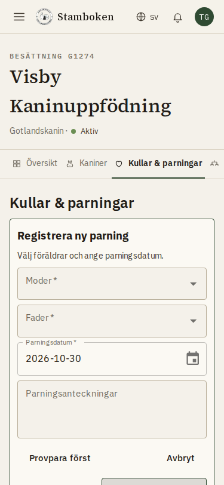

### Registrera en kull

Det finns två vägar. Har du registrerat parningen använder du **Registrera födsel**
på parningens kort. Annars registrerar du kullen direkt med **+ Ny kull**; Stamboken
skapar då parningen åt dig med parningsdatum 31 dagar före födseln.

**Från en registrerad parning**

1. Öppna **Min besättning**, fliken **Kullar och parningar**, och fäll ut parningens kort
   med pilen **Detaljer**.
2. Klicka **Registrera födsel**.
3. Fyll i **Födelsedatum**, **Antal födda** och, om du vet det, **Antal vid 6 veckor**.
4. Klicka **Spara**. Bekräftelsen "Kull registrerad!" visas.

**Direkt, utan parning**

1. Öppna **Min besättning** och fliken **Kullar och parningar**.
2. Klicka **+ Ny kull**.
3. Välj **Mor** och **Far**.
4. Fyll i **Födelsedatum**, **Antal födda** och gärna **Antal vid 6 veckor** och
   **Anteckningar**. **Antal vid 6 veckor** kan du fylla i senare med **Redigera** på
   kortet, men det måste finnas innan intyg kan utfärdas.
5. Klicka **Registrera kull**. Bekräftelsen "Kull registrerad!" visas och kortet
   hamnar under rätt år med märket **Kull N**.

När kullen registrerats skapar Stamboken en rad i kullistan för varje född unge.

Formuläret sparas i webbläsaren medan du skriver, så du kan stänga sidan och fortsätta
senare. Knappen **Registrera kull** är grå tills mor, far, datum och antal är ifyllda.

När en unge i kullen har fått intyg kan bara genbanksansvarig ändra kullens föräldrar och födelsedatum. Antal födda och anteckningar kan du fortfarande ändra själv.

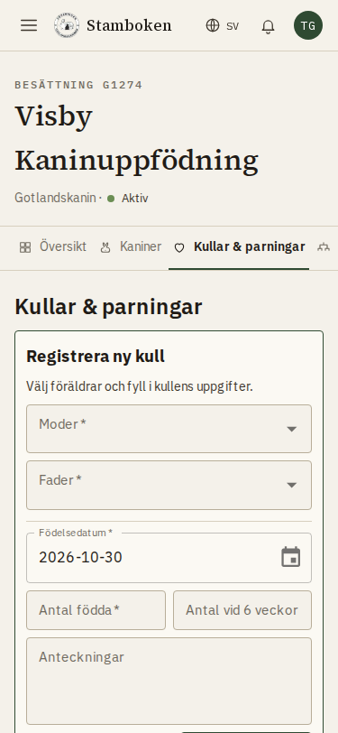

### Föra kullistan

Kullistan är ungarnas lista från födsel till registrering. Fäll ut kullens kort med
**Detaljer** så ligger den under rubriken **Kullista** med antalet
"(tillagda av födda)".

- **Lägga till ungar** till en äldre kull utan lista: skriv antal i fältet **Antal** och
  klicka **+ Lägg till ungar**. Texten "N kvar av M rapporterade" visar hur många
  platser som återstår. Högst nio ungar kan registreras per kull.
- **Fylla i uppgifter**: klicka pennan **Redigera ungens uppgifter**. I dialogen
  **Redigera unge** finns **Namn/märkning**, **Kön** (Okänt, Hona, Hane),
  **Färg (observerad)**, **Anteckningar** och **Öde**. Klicka **Spara**.
- **Markera öde** direkt i listan: rullgardinen **Öde** har valen **Obestämd**,
  **Behålls oreg.**, **Såld utan intyg** (såld som sällskapsdjur utan intyg, kan inte
  registreras senare), **Slaktad** och **Död**. Ungar med Slaktad eller Död kan inte
  registreras.
- **Ändra ordning**: dra i handtaget ⋮⋮. Ordningen styr vilket individnummer ungen
  får; numret står som "(förslag)" tills ungen registreras.
- **Ta bort en unge**: öppna pennan och klicka **Ta bort ungen**, bekräfta med
  **Ja, ta bort**. Du har sex sekunder på dig att klicka **Ångra** i meddelandet
  "Ungen togs bort".

Märket till höger om rubriken visar om kullen är gammal nog: **Registrering öppnar om N
dagar** eller **6 veckor passerade — kan registreras**. Gränsen är 42 dagar efter
födseln.

Under **Att göra** på fliken **Översikt** påminner Stamboken om kullar som passerat
sex veckor utan att alla ungar registrerats eller fått ett öde.

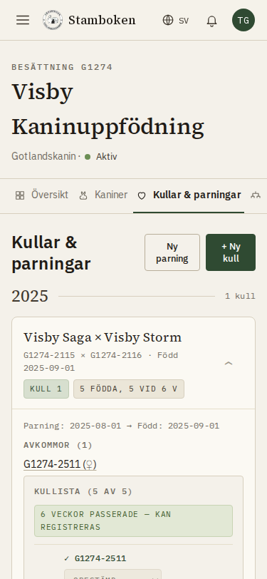

### Registrera en unge och utfärda intyg

Från sex veckors ålder registrerar du ungen, det vill säga skriver in den i stamboken
så att den får sitt individnummer. Samtidigt väljer du intyg; utan intyg går ungen inte
att registrera. **Digitalt intyg utfärdas härifrån**, från ungens rad i kullistan, eller
med **+ Lägg till kanin** för en kanin vars kull inte finns i Stamboken (se
[Lägga till en kanin utan registrerad kull](#lägga-till-en-kanin-utan-registrerad-kull)).
Knappen **Registrera kanin** på kullens kort och **Skapa genbanksintyg** på översikten
kan inte utfärda digitala intyg.

1. Öppna **Min besättning**, fliken **Kullar och parningar**, och fäll ut kullens kort
   med **Detaljer**.
2. I kullistan: klicka **Registrera** på ungens rad. Dialogen **Registrera kanin —
   G1274-2531** öppnas med ungens föreslagna individnummer i rubriken.
3. Välj **Kön** (Hona eller Hane) och **Färg** ur genbankens färglista. Saknas färgen
   i listan kontaktar du genbanksansvarig. Fyll gärna i **Namn**; **Färganteckning**,
   **Ögonfärg**, **Klofärg**, **Bukfärg** och **Avvikande hårlag** är frivilliga.
4. Välj **Intyg**. Intyg krävs; **Digitalt** är förvalt.
   - **Digitalt** – Stamboken utfärdar en signerad PDF direkt.
   - **Papper** – skriv numret från det tryckta intyget i **Intygsnummer** och
     individnumret som står på pappret i **Individnummer på pappret**. Först då visar
     rubriken Stambokens individnummer. Är de olika, se
     [När pappret och Stamboken har olika individnummer](#när-pappret-och-stamboken-har-olika-individnummer).
5. Saknar kullen uppgift om antal levande vid sex veckor visas fältet **Levande i
   kullen efter 6 veckor**. Fyll i det; uppgiften sparas på kullen.
6. Klicka **Registrera**. Rutan "Namn registrerad som G1274-2531" visas.
7. Klicka **Visa intyg** för att öppna PDF:en i en ny flik, **Visa kanin** för kaninens
   sida eller **Registrera en till i kullen** för nästa unge.

Intyget går att verifiera av vem som helst genom QR-koden på PDF:en, se
[Verifiera intyg](#verifiera-intyg).

Meddelanden som stoppar registreringen:

| Text | Betyder |
| --- | --- |
| Kan registreras om N dag(ar) | Kullen är yngre än 42 dagar. |
| Fyll i hur många kaniner som var levande efter 6 veckor innan du kan utfärda intyg. | Fyll i fältet i steg 5 eller **Antal vid 6 veckor** på kullen. |
| Kullen har fler levande ungar i listan än antalet levande vid 6 veckor… | Markera de ungar som dog med öde **Död** först. Knappen **Välj kaniner att markera som döda** hjälper till. |
| Endast N intyg kan utfärdas i denna kull | Antalet intyg begränsas av antalet levande vid sex veckor. |
| Kullen är full — max 9 kaniner per kull. | Fler ungar än nio kan inte registreras i samma kull. |
| Intyget kunde inte skapas: … | Kaninen är registrerad men intyget misslyckades. Försök igen senare eller kontakta genbanksansvarig. |

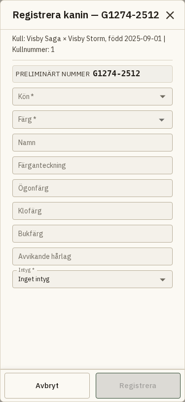

### Lägga till en kanin utan registrerad kull

Registrerar du inte parningar och kullar kan du lägga till en enda kanin, till exempel
när den ska säljas. Stamboken skapar då kullen åt dig, och väljer du digitalt intyg
utfärdas det direkt.

1. Öppna **Min besättning** och fliken **Kaniner**.
2. Klicka **+ Lägg till kanin**. Dialogen **Lägg till kanin** öppnas.
3. Välj **Mor** (honor i din besättning) och **Far** (hanar i hela genbanken). Fyll i
   **Födelsedatum**, **Antal födda** och **Levande i kullen efter 6 veckor**. Rubriken
   visar sedan kaninens individnummer, till exempel **Registrera kanin — G1274-2531**.
   Finns kullen redan, med samma mor, far och födelsedatum, står det "Kullen finns redan
   (kull N)" och kaninen läggs till i den.
4. Välj **Kön** och **Färg**. Fyll gärna i **Namn**; övriga fält är frivilliga.
5. Välj **Intyg**. **Digitalt** är förvalt och utfärdas direkt. Väljer du **Papper**
   skriver du numret från det tryckta intyget i **Intygsnummer** och individnumret som
   står på pappret i **Individnummer på pappret**.
6. Klicka **Registrera**. Rutan "Namn registrerad som G1274-2531" visas.
7. Klicka **Visa intyg** för att öppna PDF:en, **Visa kanin** för kaninens sida eller
   **Lägg till en till i kullen** för ett syskon.

Kullen får parningsdatum 31 dagar före födseln och årets nästa kullnummer. Den syns
sedan under **Kullar och parningar** som andra kullar.

Meddelanden som stoppar registreringen:

| Text | Betyder |
| --- | --- |
| Kullen är född före en kull som redan har kullnummer det året… | Kullnumren följer födelsedatumen. Registrera kullen med **+ Ny kull** och numrera om, se [När kullnumren inte stämmer](#när-kullnumren-inte-stämmer). |
| Honan har redan en kull registrerad inom 35 dagar | Honan har en annan kull nära det datumet. Kontrollera datumet, eller registrera kaninen från den kullen under **Kullar och parningar**. |
| Fadern måste vara registrerad i samma genbank som modern. | Välj en hane av samma ras. |
| Modern finns inte i en besättning där du får registrera kaniner. | Honan har sålts eller finns i en annan besättning. |
| Kaninen måste vara minst 42 dagar gammal för att registreras. | Vänta tills kullen är sex veckor. |

### När pappret och Stamboken har olika individnummer

Stamboken räknar fram individnumret ur besättningen, kullens födelseår, kullnumret och
platsen i kullen. Ett pappersintyg skrivs för hand och kan ha en annan siffra. Skiljer
sig numret på pappret från Stambokens visas rutan **Individnumret på pappret stämmer
inte med Stamboken** när du klickar **Registrera**. Inget sparas förrän du väljer.

Rutan visar vad pappret säger, vad Stamboken säger och varför, till exempel vilken
kull som redan har kullsiffran. Inget val är förvalt: ett kullnummer följer ordningen
kullarna lades in, så vid en bortglömd kull är det ofta pappret som har rätt.

- **Pappret rättas** – kaninen registreras med Stambokens nummer. Stryk numret på
  pappret och skriv det rätta. Valet och numret du skrev in loggas för
  kaninen, så att det går att se i efterhand vad som hände.
- **Pappret stämmer** – inget sparas. Stamboken visar vad du behöver göra: en länk till
  det du kan rätta själv (till exempel kullens födelsedatum eller en kull som saknas) och,
  när kullar måste numreras om eller flyttas, ett färdigt **Meddelande till
  genbanksansvarig** som du kopierar med **Kopiera meddelandet**. Skriv i meddelandet
  varför pappret stämmer; utan det kan genbanksansvarig inte hjälpa. Du kan registrera
  kaninen igen när det är rättat.

Är besättningen eller året på pappret ett annat än kullens, eller är kullen född före en
kull som redan har nummer, går bara **Pappret stämmer**.

### När kullnumren inte stämmer

Kullnumren följer födelsedatumen. Registrerar du en kull som fötts före en redan
numrerad kull visas dialogen **Kullnumren stämmer inte** när du försöker registrera
en unge. Tabellen visar **Kullnummer**, **Mor**, **Födelsedatum** och
**Kullnummer (ny)**.

1. Kontrollera att födelsedatumen är rätt. Är de fel: klicka **Avbryt**, rätta datumet
   med **Redigera** på kortet och försök igen.
2. Är datumen rätt: klicka **Numrera om kullar automatiskt**. Därefter öppnas
   registreringsdialogen igen.

Påverkar omnumreringen kullar där kaniner redan registrerats får du
"Omnumrering som påverkar registrerade kaniner kräver genbanksansvarig". Kontakta
då genbanksansvarig, se [del 2](#numrera-om-kullar-med-registrerade-kaniner).

### Ladda upp ett foto

1. Öppna kaninens sida (klicka kaninen under **Kaniner** eller i **Alla kaniner**).
2. Klicka kameraknappen **Ladda upp foto** nere i bildens hörn. Välj en bild i JPEG,
   PNG eller WebP, högst 10 MB.
3. Beskär bilden i rutan **Beskär foto**: dra bilden och använd reglaget **Zoom**.
4. Klicka **Använd**. Bekräftelsen "Foto uppladdat!" visas.

Bilden skalas ned till högst 1600 pixlar och sparas som JPEG. Tappar du nätet mitt i
sparas bilden i webbläsaren och laddas upp när nätet är tillbaka.

### Redigera en kanin

Du kan ändra färguppgifterna och anteckningarna på dina kaniner. Nummer, kön,
föräldrar och födelsedatum rättas av genbanksansvarig.

1. Öppna kaninens sida och klicka **Redigera**.
2. Ändra i **Färg**, **Ögonfärg**, **Klofärg**, **Bukfärg**, **Hårlag**,
   **Färganteckning** och **Anteckningar**.
3. Klicka **Spara** i fältet "Osparade ändringar" längst ned. Bekräftelsen
   "G1274-2117 har uppdaterats." visas.

Vill du ångra: klicka **Avsluta** och sedan **Kasta bort** i frågan "Kasta bort
ändringar?". Utkast sparas i webbläsaren, så en påbörjad redigering öppnas igen
nästa gång du besöker sidan.

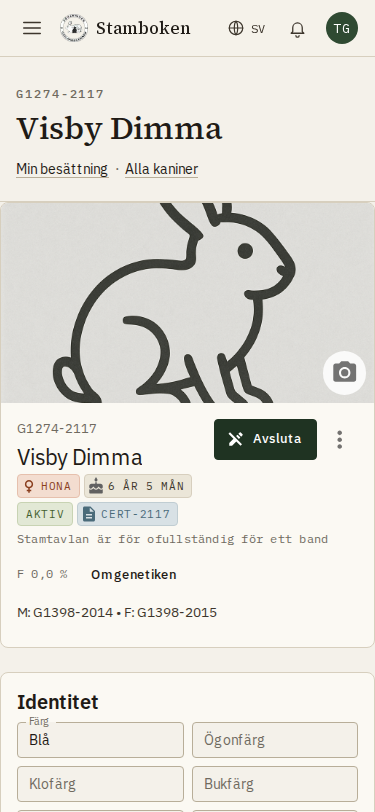

### Rapportera en kanin som död

1. Öppna kaninens sida, klicka **Fler åtgärder** (tre prickar) och välj
   **Rapportera död**.
2. Ange **Dödsdatum** (dagens datum är förvalt) och gärna **Dödsorsak**.
3. Kryssa i **Kaninen har slaktats (t.ex. för kött, pga platsbrist)** om det gäller.
4. Klicka **Bekräfta dödsrapportering**. Bekräftelsen "Namn har rapporterats som
   död." visas och kaninens status blir Död eller Slaktad.

Blev det fel: **Fler åtgärder** → **Ångra dödsrapportering**. Kaninen blir levande
igen direkt, utan fråga.

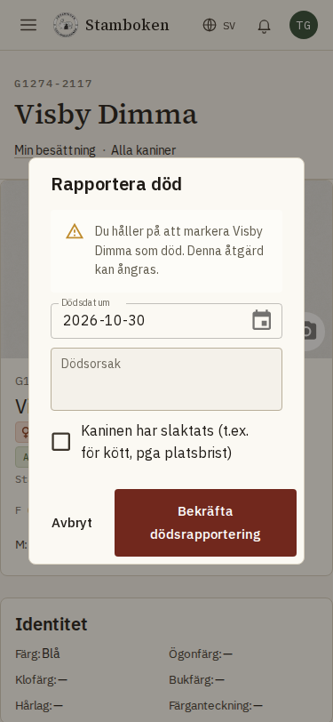

### Sälja eller flytta en kanin

När en kanin byter besättning registrerar säljaren försäljningen. Kaninen försvinner
från din besättning och dyker upp hos köparen. Efter försäljningen kan du inte längre
ändra kaninens uppgifter eller utfärda intyg för den. Samma väg används när kaninen
flyttar utan att säljas.

1. Öppna kaninens sida, klicka **Fler åtgärder** och välj **Sälj individ**.
   Dialogen **Sälj Namn** öppnas.
2. Välj **Ny besättning**. Skriv besättningsnummer eller namn och välj i listan.
   Har du sålt kaninen till någon utanför genbanken väljer du **GX1** (gotlandskanin)
   eller **MX1** (mellerudskanin), som ligger först i listan under "Utanför genbanken".
   En kanin utan intyg kan bara säljas utanför genbanken, till GX1/MX1.
3. Kontrollera **Säljdatum**. Dagens datum är förvalt. Datumet får inte ligga
   i framtiden och inte före "Tidigast …" som står under fältet (43 dagar efter
   födseln, eller dagen efter senaste försäljningen).
4. Läs rutan **Från / Till / Datum** och kryssa i **Jag har tagit del av informationen
   och vill ta bort kaninen från min besättning.**
5. Klicka **Bekräfta försäljning**. Bekräftelsen "Namn är såld till G1398 – …" visas.

**Ångra en försäljning.** Blev det fel kan du själv ångra inom sju dagar, så länge
inget annat registrerats på kaninen efteråt. Direkt efter försäljningen finns knappen
**Ångra försäljning** i rutan högst upp på sidan; senare hittar du den under
**Fler åtgärder**. Skriv en **Anledning** (inte köparens namn eller kontaktuppgifter)
och klicka **Ångra försäljning**. Bekräftelsen "Försäljningen är ångrad." visas.
Efter sju dagar hjälper genbanksansvarig dig.

Menyvalet **Sälj individ** är grått när du inte får sälja: kaninen är död, du är
skötare och inte ägare, eller kaninen står redan i GX1/MX1.

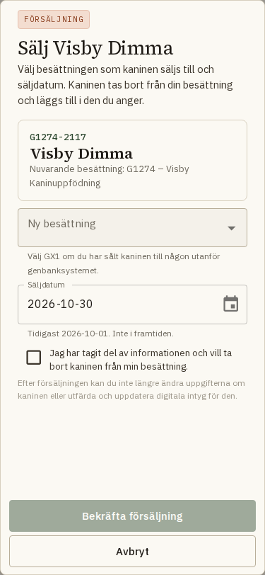

### Provpara

Innan du parar kan du se vilken inavelsgrad avkomman skulle få.

1. Klicka **Provparning** i menyn.
2. Välj **Hona** och **Hane** genom att skriva namn eller nummer. Har du fler kandidater:
   **Lägg till en hane till** (upp till tio).
3. Resultatet räknas ut direkt, ett kort per hane: avkommans **F** i procent, omdömet
   **Bra**, **Utred närmare** eller **Hög inavel**, en varning om djuren är nära släkt,
   och listan **Gemensamma förfäder**. **Visa släktträd** ritar den tänkta avkommans
   stamtavla med gemensamma förfäder markerade.

Är honan eller hanen ännu inte registrerad klickar du **Honan är inte registrerad än**
respektive **Hanen är inte registrerad än** och väljer djurets mor och far i stället.

Länken till sidan innehåller ditt val, så du kan skicka den till någon annan.
Från kaninens sida kommer du hit med **Fler åtgärder** → **Provpara**.

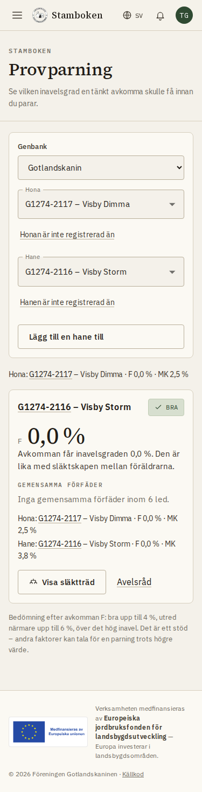

### Uppdatera besättningsuppgifter

Kontaktuppgifterna på Min besättning ser andra uppfödare. Du väljer själv vad som visas.

1. Öppna **Min besättning**, fliken **Översikt**, och klicka **Redigera** vid
   **Besättningsuppgifter**.
2. Fyll i **Kontaktperson**, **E-post**, **Mobil**, **Fast telefon**, **Hemsida**
   och **Adress**.
3. Välj för varje uppgift vem som ser den: **Endast genbanksansvarig** eller
   **Inloggade besättningar**.
4. Klicka **Klar**. Bekräftelsen "Kontaktinformation sparad" visas.

Ändringar här når inte föreningens medlemsmatrikel. Har du flyttat eller bytt e-post
ändrar du det också under [Min profil](#min-profil) eller meddelar kassören.

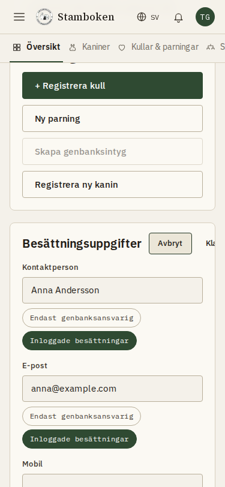

### Uppdatera din profil

Under **Profil** finns ditt konto och, om ditt konto är kopplat till en medlemspost,
medlemskapets uppgifter.

- **Profilbild**: klicka **Ladda upp bild**, välj en bild (minst 128 × 128 pixlar,
  högst 5 MB) och klicka **Spara**. Har du Google-konto kan du i stället slå på
  **Använd Google-profilbild**.
- **Kontaktuppgifter**: fyll i **Telefon**, **E-post**, **Gatuadress**, **Postnummer**
  och **Postort**, klicka **Spara**. Uppgifterna används i medlemsmatrikeln och för
  föreningens utskick.
- **Publicering i Koharen**: slå på eller av **Namn**, **Telefon**, **E-post** och
  **Adress** för den tryckta medlemsmatrikeln, klicka **Spara**.
- **Personer i medlemskapet**: huvudmedlemmen lägger till familjemedlemmar och skötare
  med **Lägg till person** (**Förnamn**, **Efternamn**, **Roll**), ger dem rätt att
  sköta en besättning med **Ge åtkomst**, förnyar en skötares tidsbegränsade åtkomst
  med **Förnya** och drar tillbaka den med **Återkalla**.

Bara huvudmedlemmen kan ändra medlemskapets uppgifter; familjemedlemmar och skötare
ser dem och får texten "Endast huvudmedlemmen kan ändra medlemskapets uppgifter."

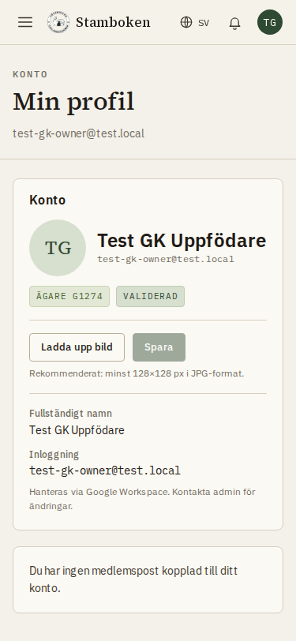

### Skärmarna – uppfödare

#### Min besättning

<!-- route: /stamboken/min-besattning -->

Din besättnings startsida. Rubriken visar besättningsnummer, namn, ras och om
besättningen är aktiv. Äger du flera besättningar väljer du mellan dem med knapparna
under rubriken. Sidan har fyra flikar.

**Översikt**

- Fyra siffror: **Aktiva kaniner**, **Avelsdjur** (aktiva, okastrerade honor och
  hanar), **Utfärdade intyg** och **Kullar i år**.
- **Pågående dräktigheter** – parningar utan registrerad födsel, med stapel
  "dag N av 31" och beräknat datum. **Alla parningar →** öppnar fliken Kullar och parningar.
- **Senaste kaninerna** – de fem senast registrerade. **Alla kaniner →** öppnar fliken
  Kaniner.
- **Att göra** – påminnelser: kullar som passerat sex veckor (märke **Kullista**) och
  parningar som gått mer än 35 dagar utan födsel (märke **Parning**).
- **Snabbåtgärder** – **+ Registrera kull**, **Ny parning**, **Skapa genbanksintyg**
  (inte klar än) och **Registrera ny kanin** (leder till kullistan).
- **Besättningsuppgifter** – kontaktuppgifter med knappen **Redigera**.

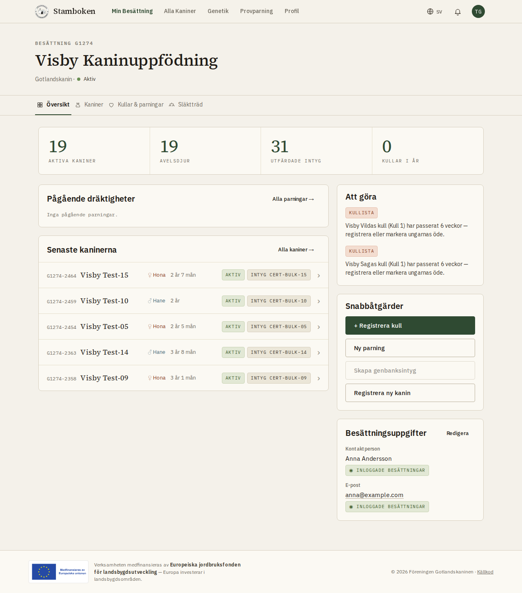

**Kaniner**

Alla dina kaniner som kort eller lista (**Kort** / **Lista**). Sök i **Sök nummer eller
namn**. Filtren **Aktiva (N)**, **Alla (N)** och **Med intyg (N)** visar antalet i
varje grupp. På varje kort står nummer, namn, kön, ålder, status (Aktiv, Inaktiv, Såld,
Död), intyg (märket **✓ Intyg** för digitalt, **Intyg** för papper), **Köpt** från
annan besättning och föräldrarnas nummer. Klicka kortet för kaninens sida.
**+ Lägg till kanin** registrerar en kanin vars kull inte finns i Stamboken, se
[Lägga till en kanin utan registrerad kull](#lägga-till-en-kanin-utan-registrerad-kull).

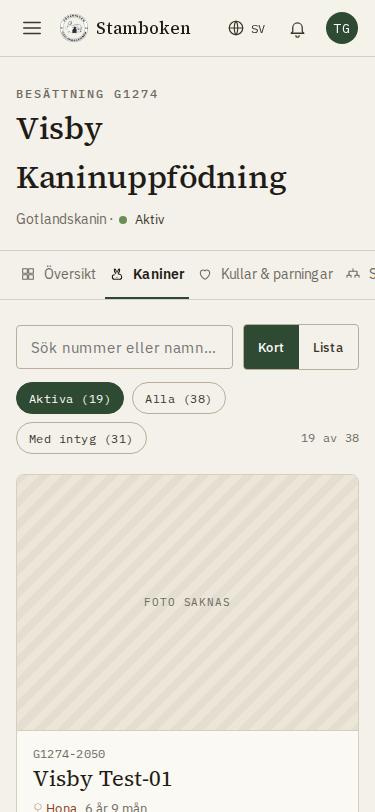

**Kullar och parningar**

Knapparna **Ny parning** och **+ Ny kull** öppnar formulären ovanför listan. Första
gången visas guiden **Så fungerar kullistan**; **Jag vet hur det fungerar** döljer den.

Listan börjar med **Pågående parningar** och fortsätter år för år, nyaste kullen först.
Varje kort visar föräldrarna, "Född datum" eller "Parning datum" och märkena
**Kull N**, **N födda, N vid 6 v** och **N dagars dräktighet**. Pilen **Detaljer** fäller
ut kortet med avkommor, kullistan och knapparna **Registrera födsel** (bara parningar),
**Registrera kanin**, **Redigera** och **Ta bort**. Ta bort går bara när inga kaniner
registrerats i kullen; annars står det "Kan inte ta bort — N registrerade individer".

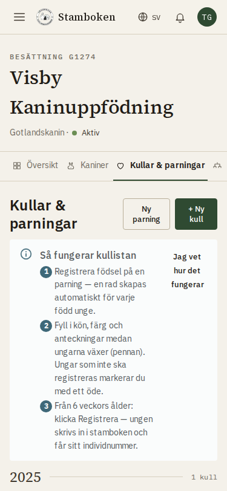

**Släktträd**

Välj en kanin i listan **Välj kanin** så visas föräldrar och far- och morföräldrar.
Länken **Fullständig stamtavla med inavelskoefficient finns på individsidan.** leder
vidare.

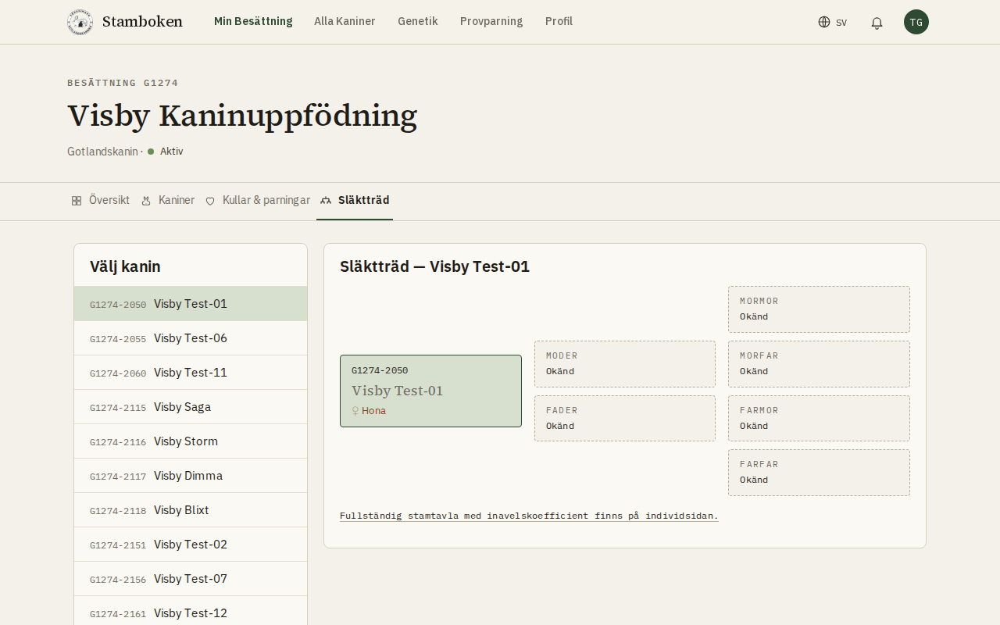

#### Kaninens sida

<!-- route: /stamboken/individ/[number] -->

Allt om en kanin. Adressen är /stamboken/individ/ följt av individnumret.

- **Kortet** till vänster (överst på mobilen): foto med kameraknappen **Ladda upp
  foto**, nummer och namn, knappen **Redigera**, menyn **Fler åtgärder** (**Redigera**,
  **Provpara**, **Rapportera död** / **Ångra dödsrapportering**, **Sälj individ**,
  **Årsrapportera** – kommer snart), märken för kön, ålder, status, intyg, kastrering
  och **Köpt**, genetikbandet A–E med **F** (inavelsgrad) och knappen **Om genetiken**,
  samt föräldrarnas nummer (M och F).
- **Identitet** – färg, ögonfärg, klofärg, bukfärg, hårlag och färganteckning.
- **Släktträd** – tre generationer med länkar till varje förfader; okända visas som
  "Okänd". Under trädet "Kullstorlek: N (vid 6v: M)".
- **Hälsa & Mått** – senaste vikt och hull om sådana registrerats.
- **Besättningshistorik** – var kaninen funnits, med **Född här**, **Flyttad hit** och
  antal årsrapporter. **Visa allt** listar varje händelse med datum; där finns också
  **Ångra** på händelser du själv får ångra.
- **Anteckningar** – fritext och eventuell dödsorsak.
- **Ändringshistorik** – visas bara för genbanksansvarig och administratör.

Sidan visar bara kaniner i genbanker du har tillgång till; annars får du "Sidan kunde
inte hittas".

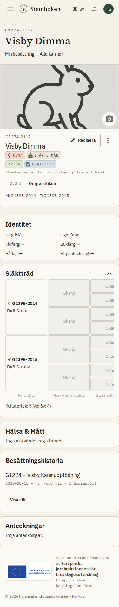

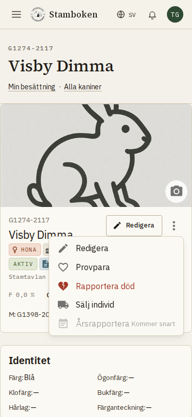

#### Alla kaniner

<!-- route: /stamboken/alla-kaniner -->

Sök bland alla kaniner i genbankerna du har tillgång till. Välj ras med **Alla**,
**Gotlandskanin** eller **Mellerudskanin**, sök i sökfältet och filtrera på **Status**
(Aktiv, Inaktiv, Död, Slaktad, Avlivad, Försvunnen) och **Kön**. På datorn visas en
tabell med kolumnerna **Individnummer**, **Namn**, **Kön**, **Födelsedatum**, **Status**,
**Besättning**, **Kullstorlek**, **Mor**, **Far** och **Färg**; **Kolumner** väljer
vilka som syns. På mobilen är det en lista med **Visa fler** längst ned. Klicka en rad
för kaninens sida.

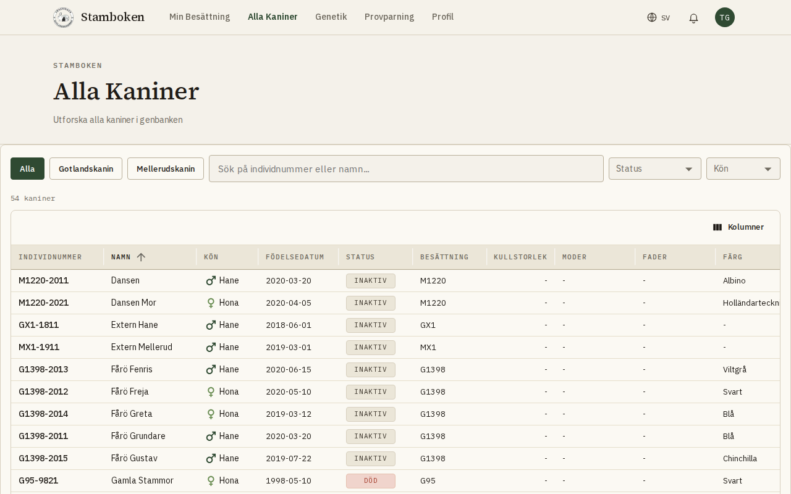

#### Provparning

<!-- route: /stamboken/provparning -->

Formuläret **Välj djur** (**Genbank**, **Hona**, **Hane**, **Lägg till en hane till**)
och ett resultatkort per hane. Under korten står gränserna: "Bedömning efter
avkomman F: bra upp till N %, utred närmare upp till M %, över det hög inavel." Länken
**Avelsråd** öppnar föreningens avelsråd. Se [Provpara](#provpara).

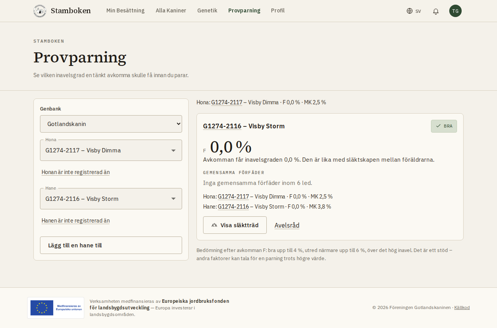

#### Min profil

<!-- route: /stamboken/profil -->

Korten **Konto** (bild, namn, inloggning, roller, **Validerad** / **Inte validerad**),
**Medlemskap** (medlemsnummer, medlem sedan, huvudmedlem, din roll, besättningar),
**Kontaktuppgifter**, **Publicering i Koharen** och **Personer i medlemskapet**.
Saknar kontot medlemspost visas bara **Konto** och texten "Du har ingen medlemspost
kopplad till ditt konto." Se [Uppdatera din profil](#uppdatera-din-profil).

Är du inte validerad visas "För att bli validerad: Du måste genomgå kursen för att få
full åtkomst till systemet." med länken **Gå kursen nu**. Med Google kommer du inte in
alls förrän du är validerad; inloggningssidan visar då adressen till kursen.

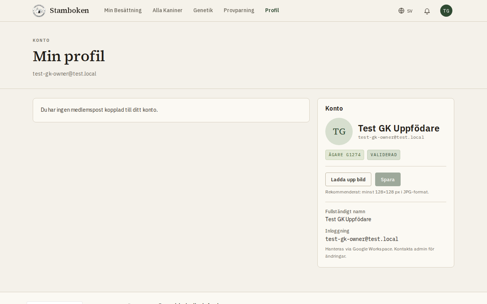

#### Verifiera intyg

<!-- route: /stamboken/verifiera/[uuid] -->

Sidan som QR-koden på ett digitalt intyg leder till. Den kräver ingen inloggning och
visar ett av tre besked:

- **Äkta genbanksintyg** – intyget är utfärdat i Stamboken och signerat av föreningen.
  Kortet visar **Individnummer**, namn, **Ras**, **Intygsnummer**, **Utfärdat av** och
  **Datum**. **Visa kaninens sida i Stamboken →** kräver inloggning.
- **Äkta, men ersatt** – ett nyare intyg har utfärdats för kaninen. Be säljaren om
  den senaste versionen.
- **Intyget hittades inte** – länken matchar inget intyg. Skanna igen eller kontakta
  föreningen med **Kontakta Föreningen Gotlandskaninen**.

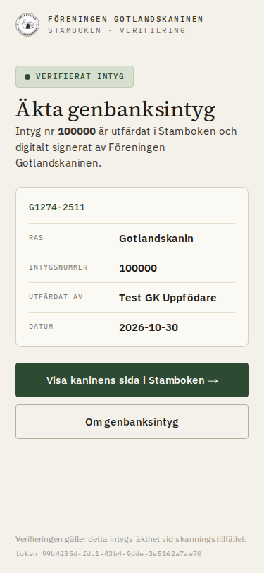

---

## Del 2 – Genbanksansvarig

Som genbanksansvarig har du allt i del 1 för alla besättningar i din genbank, plus
rättelser, ändringshistorik, genetiksidan och delar av adminpanelen.

### Rätta en kanin i en annan besättning

1. Sök upp kaninen i **Alla kaniner** och öppna dess sida.
2. Klicka **Redigera**, ändra och klicka **Spara**.

Samma knappar som uppfödaren har: **Fler åtgärder** ger dig **Rapportera död** och
**Sälj individ** för alla kaniner i din genbank, även de i GX1/MX1.

### Korrigera besättningshistorik

När en flytt registrerats fel eller saknas rättar du historiken på kaninens sida.

1. Öppna kaninens sida och klicka **Visa allt** under **Besättningshistorik**.
   Kryssrutan **Visa ångrade** visar även ångrade händelser.
2. **Ångra en händelse**: klicka **Ångra** på raden, skriv **Anledning** och bekräfta
   med **Ångra**. Hör raden till en större åtgärd finns **Ångra hela åtgärden**.
   En födelserad kan inte ångras; genbanksbyten ångras bara av administratör.
3. **Lägg till eller ersätt händelser**: klicka **Korrigera historik**. Kryssa i
   **Händelser att ångra**, lägg till **Nya händelser (i tidsordning)** med
   **Lägg till händelse** (**Datum**, **Besättning**, **Typ**: Flytt, Korrigering,
   Årsrapport, Född, och **Anteckning**), skriv **Anledning** om något ångras och
   klicka **Spara korrigering**. Bekräftelsen "Historiken är korrigerad." visas.

Skriv aldrig köparens namn eller kontaktuppgifter i anledningen; Stamboken stoppar
text som innehåller e-postadress eller telefonnummer.

### Läsa och ångra i ändringshistoriken

Längst ned på kaninens sida finns **Ändringshistorik**: varje ändring med tidpunkt,
vem som gjorde den och vilka fält som ändrades (gammalt värde överstruket, nytt
värde bredvid). Poster från gamla Stamboken är märkta "Gamla Stamboken".

- **Ångra** på en post tar tillbaka just de fält som ändrades då. Bekräfta i rutan
  "Ångra ändring?".
- **Återställ** sätter hela posten till läget före ändringen. Bekräfta i rutan
  "Återställ till före denna ändring?".

Ungarnas ändringar ser du på samma sätt i dialogen **Redigera unge** under
**Ändringshistorik (N)**.

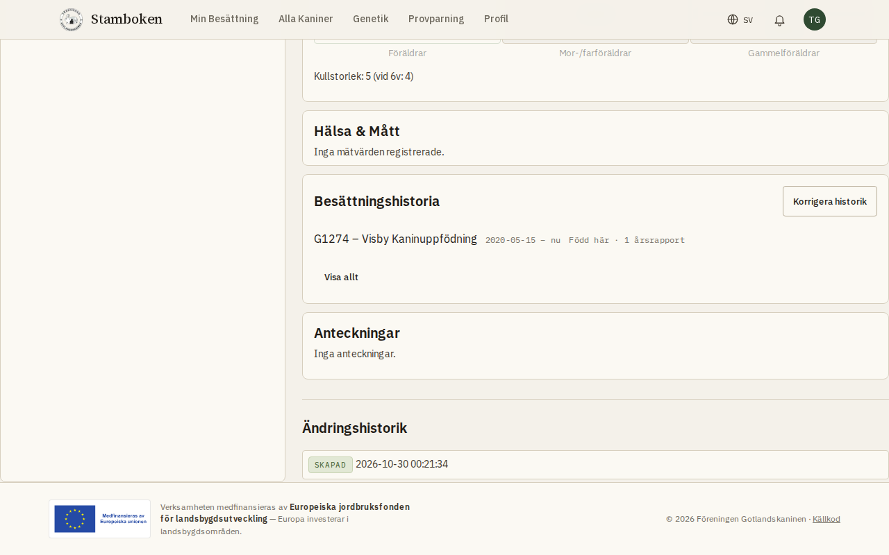

### Numrera om kullar med registrerade kaniner

En uppfödare som får "Omnumrering som påverkar registrerade kaniner kräver
genbanksansvarig" behöver din hjälp. Öppna samma kull under **Kullar och parningar** på
uppfödarens besättning (välj besättningen via **Alla kaniner** eller adressen
/stamboken/min-besattning?herd=G1274), klicka **Registrera kanin** så att dialogen
**Kullnumren stämmer inte** öppnas, och klicka **Numrera om kullar automatiskt**.
Kontrollera sedan att individnumren på de berörda kaninerna stämmer med eventuella
pappersintyg; de byts ut för hand.

### Använda genetiksidan

**Genetik** i menyn visar populationsgenetiken för din genbank. Sidan räknar om vid
första anropet och kan ta upp till en minut.

1. Välj **Genbank** om du ansvarar för flera.
2. **Översikt** – nyckeltalen **Aktiva individer**, **Effektiv pop.storlek (Ne)**,
   **Founder-ekvivalenter (FE)** och **Genomsnittlig MK**, diagrammet **Founder-bidrag
   (topp 10)**, **Populationssammanfattning**, **Genetiska trender** över åren och
   tabellen **Founder-status** med statusarna Förlorad, Kritisk, Varning, Bevaka och Ok.
3. **Prioriteringar** – individerna sorterade efter bevarandevärde: **Kritisk**,
   **Viktig** eller **Normal**, med **Genetiskt värde**, **Genomunikhet** och **Skäl**.
   Knapparna **Kritisk (N)**, **Viktig (N)** och **Normal (N)** slår av och på nivåerna.
4. **Parningsförslag** – ange **Max antal par**, **Max inavel (F)** och **Max per hane**
   och klicka **Beräkna**. Tabellen visar paren med **Förväntad F**, **ΔGD**, **MSI**
   (1 = utmärkt, 6 = dålig) och **Skäl**.

Panelen **Förklaringar** på varje flik förklarar förkortningarna. Frågetecknen vid
rubrikerna ger samma text som verktygstips.

### Skapa och redigera besättningar i din genbank

Via avatarmenyn **Adminpanel** når du **Besättningar i Gotlandskanin** (eller din
genbank) och **Genbanker**. Här skapar du nya besättningar och rättar
kontaktuppgifter; stegen är samma som för administratör, se
[Skapa en besättning](#skapa-en-besättning) och [Besättning – redigera](#besättning--redigera).
Ägare kopplas av administratör.

### Arbeta i inkorgen

Medlemmarna fotograferar sina pappersintyg och bevis och laddar upp fotona. Varje
uppladdning blir ett ärende i **Inkorg**. Inkorgen är för administratörer,
genbanksansvariga och genbankshjälpare, och alla tre ser hela kön.

1. Öppna **Inkorg** i menyn. Klicka **Jag tar den** på ett ärende som ingen har tagit,
   eller öppna ärendet och ta det där. Har någon annan ärendet klickar du **Ta över**.
2. Välj ett dokument i listan till vänster. Vrid fotot med **Vrid vänster** eller
   **Vrid höger** tills intyget står rätt; vridningen sparas och används för kopian.
   Zoom, **Kontrast** och **Förstärk blyerts** ändrar bara hur fotot visas. Ange **Typ**
   (Intyg, Bevis, Årsblankett eller Annat) och **Format**.
3. Ett intyg: välj **Ny kanin** eller **Pappersintyg på en kanin som finns** och skriv av
   fälten. Under **Mor** och **Far** visar Stamboken registrets uppgifter, så att du kan
   jämföra dem med fotot. Klicka **Spara och nästa**. Ett fel visas vid fältet det gäller.
   Stämmer inte individnumret på pappret med Stambokens öppnas samma ruta som för
   uppfödaren, se [När pappret och Stamboken har olika individnummer](#när-pappret-och-stamboken-har-olika-individnummer).
   Stämmer pappret lämnar du ärendet till genbanksansvarig.
4. Dölj säljaren och köparen. En svart ruta täcker intygets nedre tredjedel. Dra rutan
   eller dess hörn, eller välj den och använd piltangenterna (Skift ändrar storleken,
   Delete tar bort den). **Lägg till ruta** ger fler. Klicka **Bekräfta maskningen och
   nästa**. Visar intyget ingen säljare eller köpare tar du bort rutorna och klickar
   **Bekräfta: inget att dölja**. Kopian läggs på kaninen som pappersintyg.
5. Visar intyget en försäljning registrerar du den innan du bekräftar maskningen: öppna
   **Visar intyget en försäljning?** och fyll i **Individnummer**, **Köparens besättning**
   eller **Köparen är utanför föreningen** (sparas på GX1 eller MX1) och **Säljdatum**.
   Utan bevis märks ärendet "bevis saknas".
6. Ett bevis: välj typen **Bevis** och fyll i försäljningen. Beviset blir klart med den.
7. Ett foto som inte ska sparas: **Avfärda**. **Hoppa över** går till nästa dokument utan
   att spara.
8. När alla dokument är klara eller avfärdade blir ärendet klart, och den som skickade
   in får besked.

Går ärendet inte att avsluta väljer du **Väntar på förälder** (ange förälderns
individnummer; ärendet blir taget igen när föräldern läggs in), **Ofullständig** (skriv
vad som saknas), **Lämna till genbanksansvarig** (för en korrigering eller ett beslut),
**Dubblett** (ange numret på det andra ärendet) eller **Skräp**. **Arbeta vidare** tar
upp ett väntande ärende igen. Genbanksansvarig och administratör kan också tilldela
ärenden och **Öppna igen** ett stängt ärende.

En genbankshjälpare sparar bara det en uppfödare får spara: en ny kanin, pappersintyget
på en kanin som saknar intyg och en försäljning med datum efter kaninens senaste
händelse. En korrigering lämnar hjälparen till genbanksansvarig.

### Skärmarna – genbanksansvarig

#### Genetik

<!-- route: /stamboken/genetik -->

Rubriken **Genetik** med rullgardinen **Genbank** och flikarna **Översikt**,
**Prioriteringar** och **Parningsförslag**. Uppfödare utan ansvar för någon genbank ser
sidan men får ingen genbank att välja. Se [Använda genetiksidan](#använda-genetiksidan).

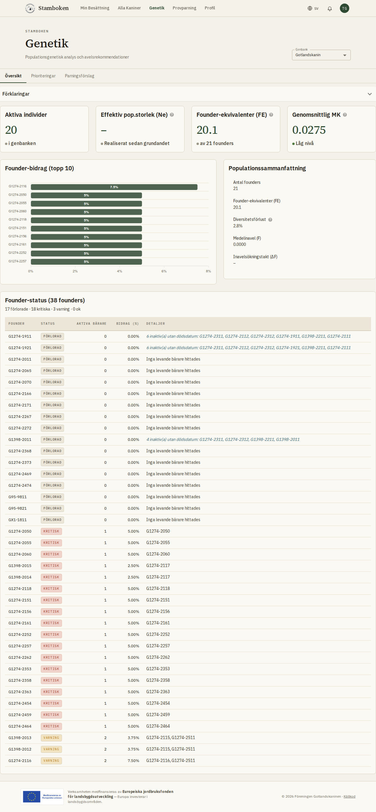

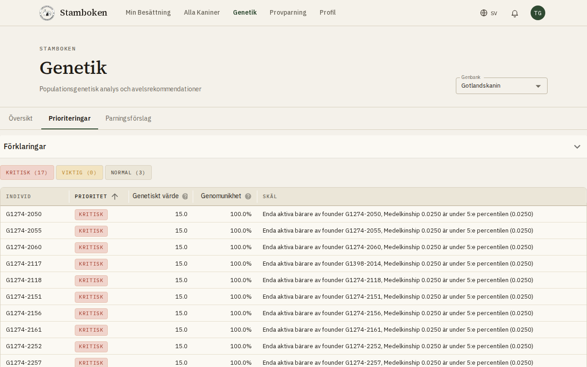

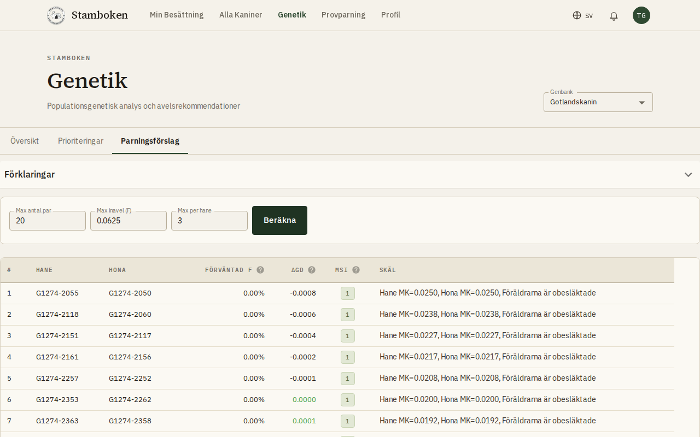

#### Adminpanelen för genbanksansvarig

Samma panel som administratörens men med färre flikar: **Översikt**, **Besättningar i
din genbank**, **Genbanker** och **Utskick**. Rollraden lyder "Inloggad som genbanksansvarig ·
Gotlandskanin". Besättningslistan visar bara din genbank och saknar filter; på
genbankssidan kan du bara ändra **Namn**. Flikarna **Användare** och **System** finns
bara för administratör.

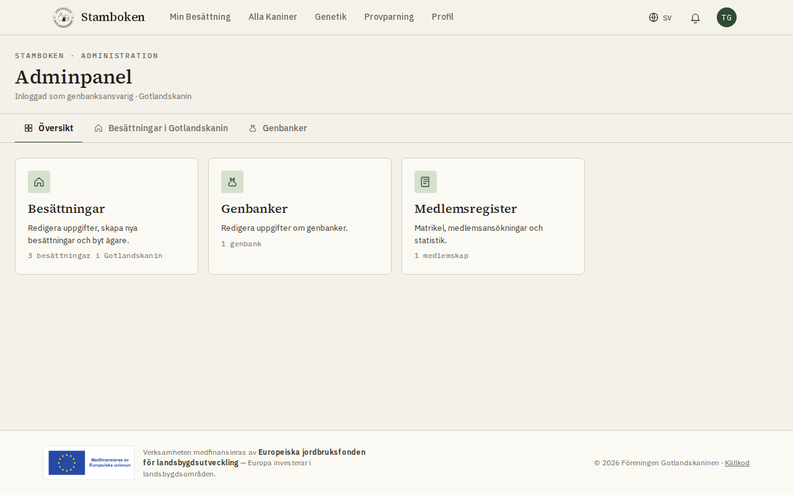

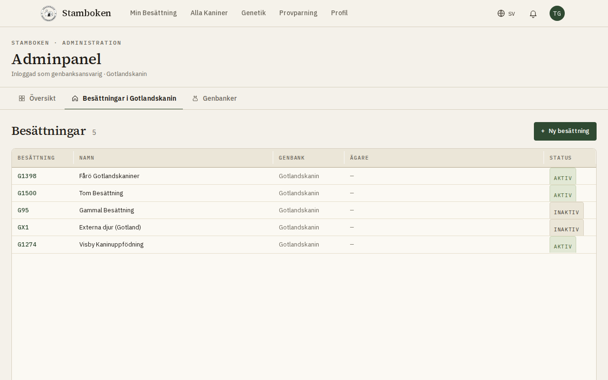

#### Inkorg

<!-- route: /stamboken/inkorg -->

Överst antalet ärenden per läge: **Öppna**, varje läge som har ärenden och **Alla**.
Filtren **Mina**, **Otagna**, **Handläggare**, **Genbank**, **Besättning** och **Typ**
ligger i adressen, så en filtrerad lista går att länka; **Rensa** tar bort dem. Tabellen
visar **Ärende** (med hur många dokument som är klara och märkena "bevis saknas" och
"står still"), **Besättning**, **Inskickat av**, **Typ**, **Läge**, **Handläggare** och
**Väntat**, äldst först. **Jag tar den** finns på ärenden som ingen har tagit.
Genbanksansvarig och administratör väljer en person och klickar **Tilldela**, eller
tilldelar alla öppna ärenden i en besättning under **Tilldela en hel besättning**.
Personlistorna visar dig och dem som har ärenden i listan; administratören ser också alla
genbanksansvariga och genbankshjälpare. På en telefon blir varje rad ett kort. Den som
inte arbetar i kön får "sidan finns inte". Se [Arbeta i inkorgen](#arbeta-i-inkorgen).

#### Inkorg – ärende

<!-- route: /stamboken/inkorg/[id] -->

Tre kolumner på en dator, under varandra på en telefon. Till vänster dokumenten med sin
status (Att lägga in, Väntar på förälder, Inlagt, maskning kvar, Klart eller Avfärdat),
ärendets läge, handläggare, avsändare och meddelande, knapparna som ärendets läge och din
roll tillåter, och **Historik**, som är hopfälld tills du öppnar den. I mitten fotot med
verktygen, varningar som "kan vara oskarp" och "samma bild i ärende 12", och **Typ**,
**Format** och **Avfärda**. Till höger formuläret för dokumentet: intyget, försäljningen
eller maskningen. Har du inte ärendet står det vem som har det, med **Jag tar den** eller
**Ta över**; du kan bara spara när ärendet är ditt och taget.

---

## Del 3 – Administratör

Adminpanelen öppnas från avatarmenyn **Adminpanel** och finns bara i riktiga stamboken.
Flikarna är **Översikt**, **Användare**, **Besättningar**, **Genbanker** och **System**.
Ändringar sparas när du klickar **Spara** eller slår om ett reglage. Det kommer inget
bekräftelsemeddelande, utan listan visas igen. Fel visas som en röd ruta högst
upp på sidan.

### Hitta en användare

1. Klicka fliken **Användare**.
2. Skriv i sökfältet (användarnamn, e-post eller namn) och klicka **Filtrera**.
   Rullgardinerna **Roll**, **Konto**, **Riktiga stamboken** och **Webbkurs** avgränsar
   listan.
3. Klicka användarnamnet för att öppna kontot.

Kolumnen **Status och åtkomst** visar märkena **Webbkurs** (validerad),
**Riktiga stamboken**, **Google** och **Inaktiv**.

### Ge eller ta bort en roll

1. Öppna användaren och gå till kortet **Roller**.
2. Välj **Roll**: Administratör, Matrikeladministratör, Genbanksansvarig, Granskare
   eller Besättningsägare. För Genbanksansvarig och Granskare väljer du **Genbank**;
   för Besättningsägare söker du besättningen i **Besättning**.
3. Klicka **Lägg till roll**.
4. Ta bort en roll med **Ta bort** på raden.

Tar du bort din egen administratörsroll frågar Stamboken "Ta bort din
administratörsroll?" och loggar ut dig ur panelen. Den sista administratörsrollen går
inte att ta bort.

### Återställa ett lösenord

1. Öppna användaren och klicka **Återställ lösenord** i kortet **Lösenord**.
2. Det nya lösenordet visas en enda gång. Klicka **Kopiera** och skicka det via en
   säker kanal, till exempel Signal eller telefon, aldrig sms eller e-post.
3. Klicka **Klar**.

Högst tio återställningar per timme och administratör.

### Ge tillgång till riktiga stamboken

I kortet **Status och åtkomst** på användarens sida:

- **Tillgång till den riktiga stamboken i den nya versionen** – slå på när medlemmen
  ska lämna testmiljön. Användaren byter sedan själv via avatarmenyn.
- **Webbkurs genomförd (validerad)** – krävs för att logga in med Google. Stängs den av
  kommer kontot inte in med Google längre; lösenordsinloggning påverkas inte.

Reglagen sparas direkt.

### Inaktivera eller aktivera ett konto

1. Öppna användaren och slå av **Kontot är aktivt** i kortet **Status och åtkomst**.
2. Bekräfta "Inaktivera kontot?" med **Inaktivera**. Alla användarens sessioner
   avslutas.

Aktivera igen med samma reglage och **Aktivera**. Ett konto kan inte raderas härifrån.

### Skapa en besättning

1. Klicka fliken **Besättningar** och sedan **Ny besättning**.
2. Välj **Genbank** och skriv **Besättningsnummer** med enbart siffror; bokstaven G
   eller M läggs till automatiskt. Numret väljer du själv, vanligen medlemsnumret.
3. Fyll i **Besättningsnamn**, **Startdatum** och om **Besättningen är aktiv**.
4. Under **Kontaktperson**: **Namn**, **E-post**, **Mobiltelefon**, **Fast
   telefonnummer**, **Hemsida** och **Gatuadress**, var och en med **Synlighet**
   (Inte offentligt, Synligt för inloggade, Synligt för alla).
5. Klicka **Skapa besättning**.

"Besättningsnumret finns redan. Välj ett annat nummer." betyder att numret är upptaget.
Koppla sedan ägaren, se nästa avsnitt.

### Byta ägare på en besättning

Ägarskap är rollen Besättningsägare på användaren, inte en inställning på besättningen.

1. Öppna besättningen under **Besättningar**. Under **Ägare** står nuvarande ägare som
   länkar.
2. Klicka ägaren som ska tas bort, och på användarens sida **Ta bort** vid rollen
   **Besättningsägare G1274**.
3. Öppna den nya ägaren under **Användare**, välj **Roll** Besättningsägare, sök
   besättningen i **Besättning** och klicka **Lägg till roll**.

En besättning kan ha flera ägare.

### Utse genbanksansvarig

1. Klicka fliken **Genbanker** och **Redigera** vid genbanken.
2. Sök användaren i **Ny genbanksansvarig** och klicka **Lägg till genbanksansvarig**.
3. Ta bort ansvar med **Ta bort ansvar** på raden.

Samma sak går att göra från användarens sida med rollen Genbanksansvarig.

### Söka i aktivitetsloggen

1. Klicka fliken **System** och kortet **Aktivitetslogg**.
2. Filtrera på **Område** (Kaniner, Parningar, Ungar, Besättningar, Användare …),
   **Postens id**, **Utförd av**, **Från**, **Till** och **Åtgärd** (Skapad, Ändrad,
   Borttagen, Systemhändelse, Gallring) och klicka **Filtrera**.
3. Klicka en rad för tabellen **Fält / Före / Efter**. **Visa rådata** visar hela
   posten före och efter.

### Logga ut alla användare

Använd detta om du misstänker att någon obehörig kommit åt ett konto.

1. Klicka fliken **System** och kortet **Aktiva användare**.
2. Klicka **Logga ut alla användare** under **Massutloggning**.
3. Skriv LOGGA UT ALLA i fältet och klicka **Logga ut alla**. Alla loggas ut, du också,
   och händelsen loggas som "Massutloggning — alla sessioner".

### Skärmarna – administratör

#### Adminpanel

<!-- route: /stamboken/admin -->

Startsidan med ett kort per avsnitt och antal: **Användare**, **Besättningar**,
**Genbanker**, **Medlemsregister** (leder till matrikeln under /medlem) och **System**.
Rollraden visar "Inloggad som administratör". Uppfödare som skriver adressen själva
får "Sidan kunde inte hittas".

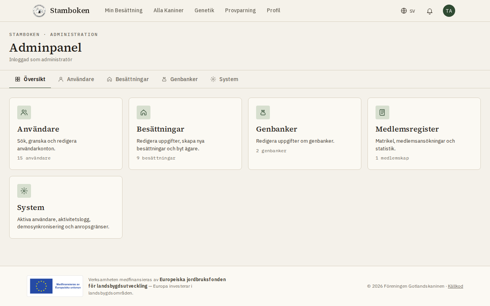

#### Användare

<!-- route: /stamboken/admin/anvandare -->

Sökfält, filtren **Roll**, **Konto**, **Riktiga stamboken** och **Webbkurs**, knappen
**Filtrera** och tabellen **Användarnamn**, **Namn**, **E-post**, **Roller**, **Status
och åtkomst** och **Senast aktiv**. Sidstorlek väljs längst ned. Nya konton skapas inte
här; de kommer från medlemsansökningarna.

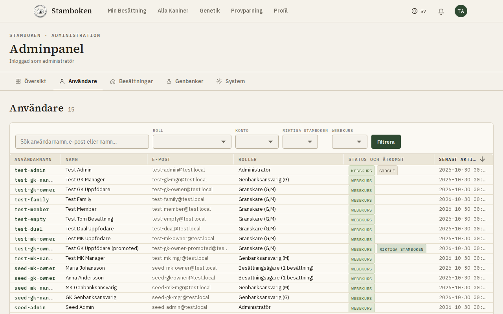

#### Användare – redigera

<!-- route: /stamboken/admin/anvandare/[userId] -->

Korten **Profil** (**Användarnamn** låst, **Fullständigt namn**, **E-post**, **Spara**),
**Roller**, **Lösenord**, **Status och åtkomst**, **Google-konto länkat** (om det finns)
och **Senaste aktivitet** (de tio senaste ändringarna användaren gjort). En gul ruta
varnar om en annan administratör ändrat kontot de senaste fem minuterna.

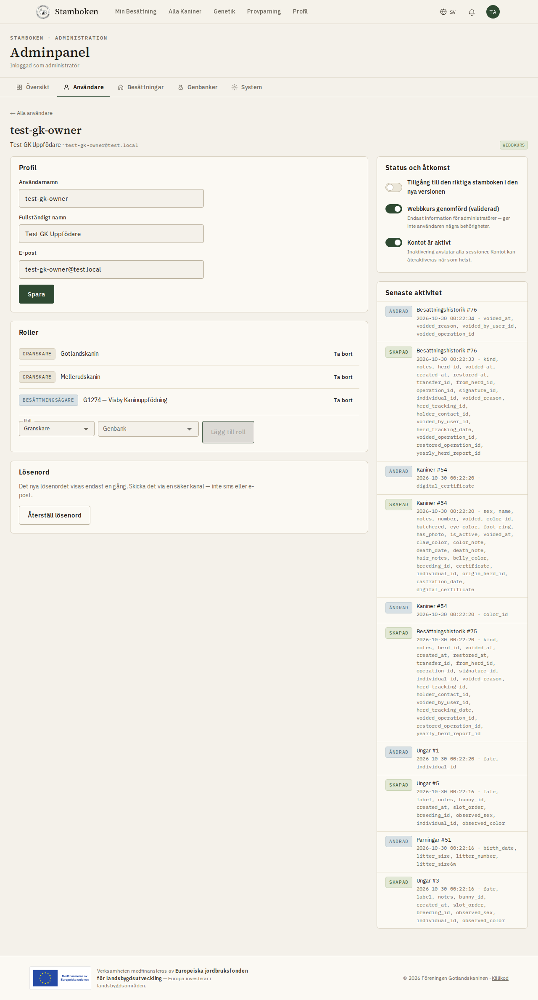

#### Besättningar

<!-- route: /stamboken/admin/besattningar -->

Knappen **Ny besättning**, sökfält, filtren **Genbank**, **Status** och **Ägare**, och
tabellen **Besättning**, **Namn**, **Genbank**, **Ägare**, **Status**. Klicka
besättningsnumret för att redigera.

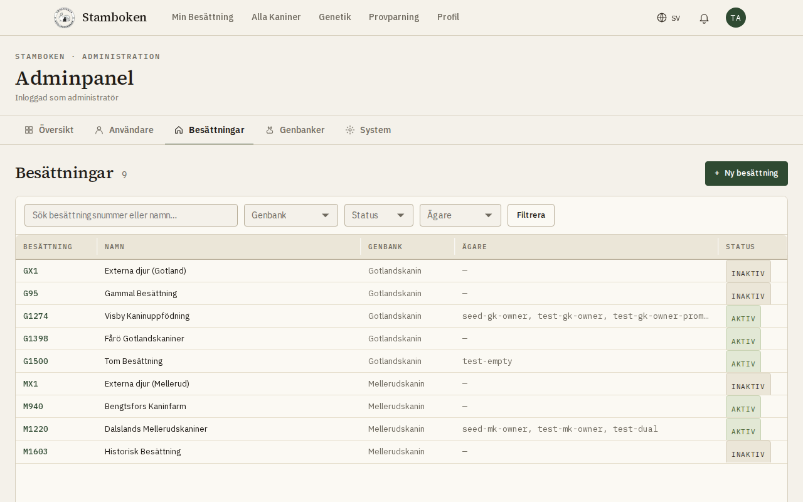

#### Besättning – redigera

<!-- route: /stamboken/admin/besattningar/[herdId] -->

Kontaktpersonens **Namn**, **E-post**, **Mobiltelefon**, **Fast telefonnummer**,
**Gatuadress**, **Postnummer**, **Postort**, **Hemsida**, reglaget **Besättningen är
aktiv** och **Spara**. Under **Ägare** länkar till ägarnas användarsidor.
Besättningsnummer och namn kan inte ändras; en inaktiverad besättning behåller sin
historik och kan inte tas bort.

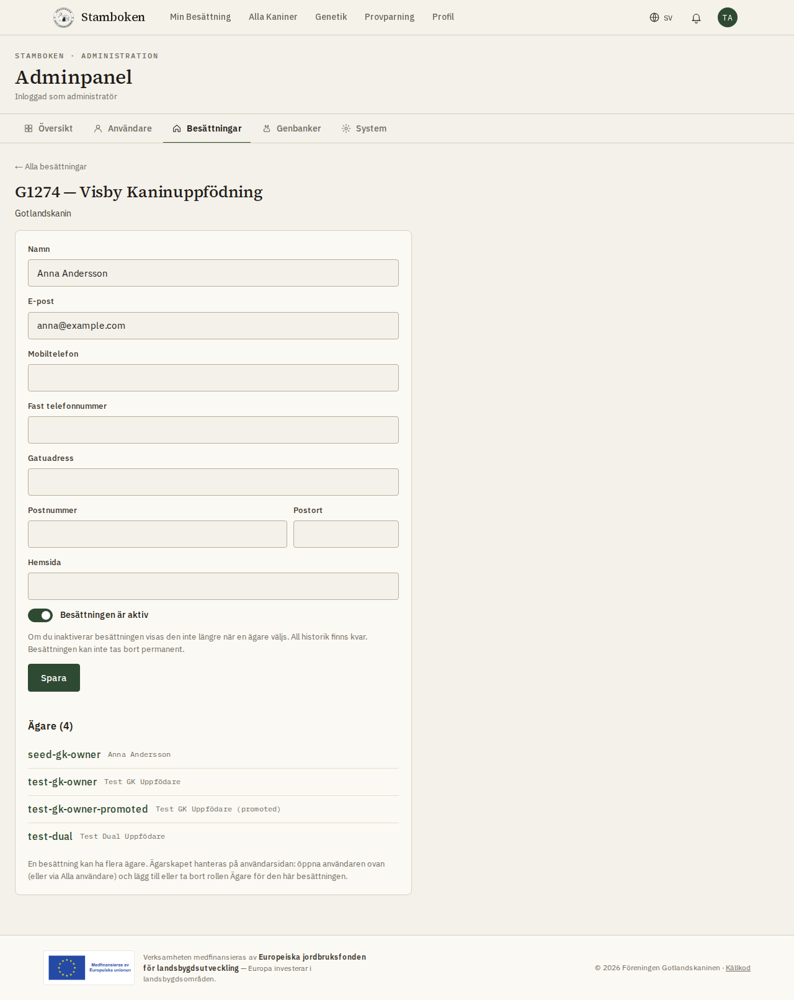

#### Ny besättning

<!-- route: /stamboken/admin/besattningar/ny -->

Formuläret i [Skapa en besättning](#skapa-en-besättning). **Skapa besättning** är grå
tills genbank och nummer är ifyllda.

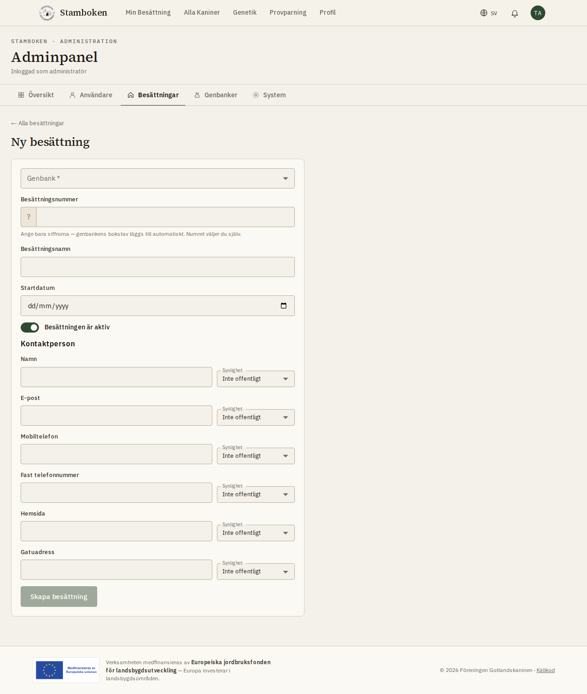

#### Genbanker

<!-- route: /stamboken/admin/genbanker -->

Ett kort per genbank med antal aktiva besättningar och knappen **Redigera**.

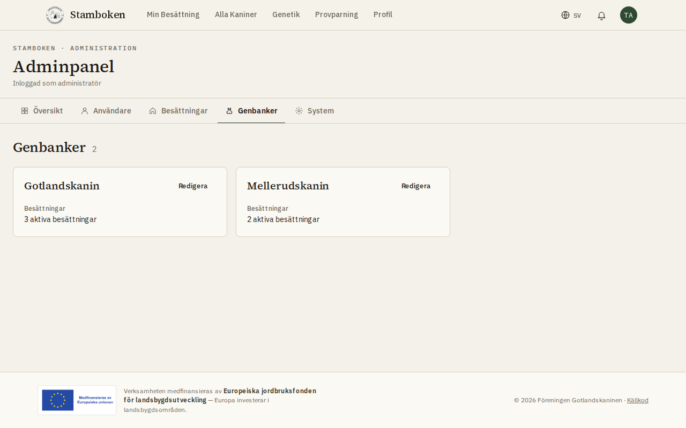

#### Genbank – redigera

<!-- route: /stamboken/admin/genbanker/[gbId] -->

Fältet **Namn** med **Spara**, listan **Genbanksansvariga** med **Ta bort ansvar**,
sökfältet **Ny genbanksansvarig** och **Lägg till genbanksansvarig**.

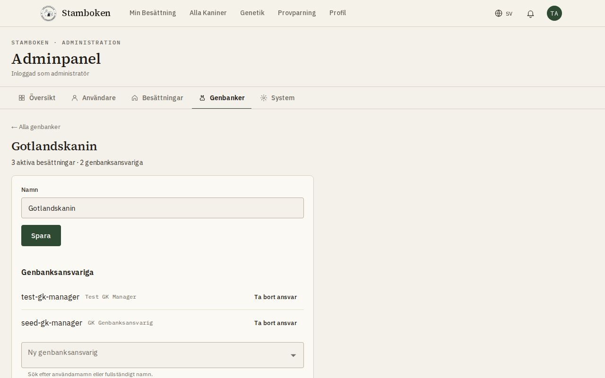

#### Utskick

<!-- route: /stamboken/admin/utskick -->

Status för utgående e-post. Överst står larmen när något är fel ("Reläet tar inte emot
e-post från servern" och "Kön står still"), **Senaste utskick** och, när utskicken är
pausade, **Pausad till**. Filtren **Status** (Köad, Skickas, Skickad, Misslyckades,
Studsade, Spärrad, Loggad, Stoppad), **Typ**, **Från** och **Till** ligger i adressen,
så en filtrerad lista går att länka. Tabellen visar **Skapad**, **Typ**, **Mottagare**
(namn, aldrig adress), **Status**, **Försök** och **Senaste fel**, med **Föregående** och
**Nästa** för fler rader. På en telefon blir varje rad ett kort. **Försök igen** finns
på misslyckade och studsade utskick och **Stoppa** på köade. Har utskicket hunnit
ändra status visas felet från servern. Genbanksansvariga ser bara sin genbanks utskick.

#### System

<!-- route: /stamboken/admin/system -->

Korten **Aktiva användare**, **Aktivitetslogg**, **Demosynkronisering** och
**Anropsgränser**. Undersidorna har raden **Systemsidor** för att hoppa mellan dem.

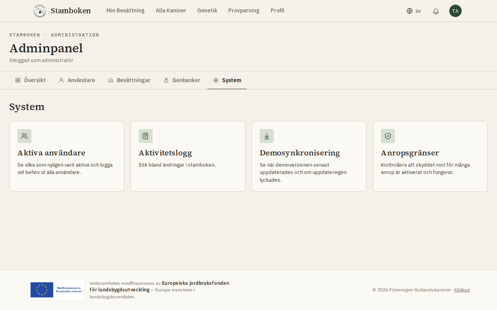

#### Aktiva användare

<!-- route: /stamboken/admin/system/online -->

Vilka som varit aktiva de senaste **1 min**, **5 min** eller **15 min**; uppdateras
var 30:e sekund. Under listan **Massutloggning** med knappen **Logga ut alla användare**.

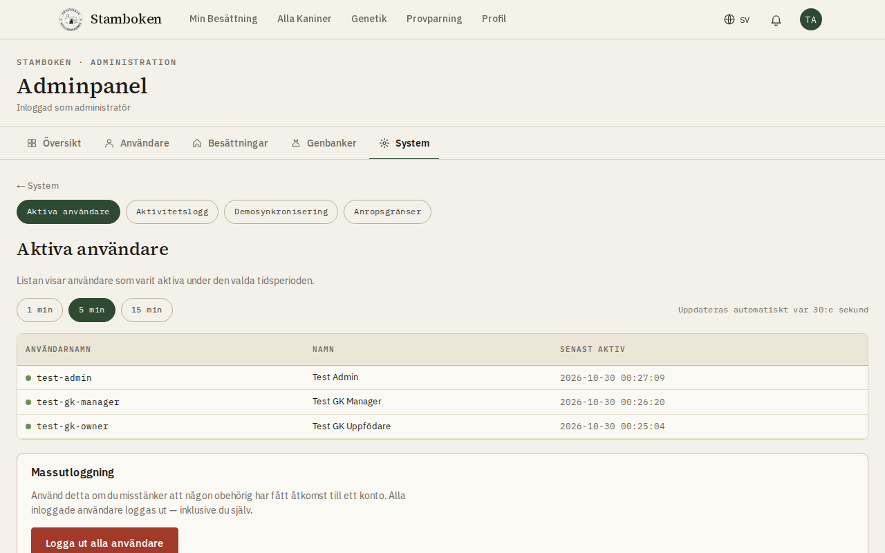

#### Aktivitetslogg

<!-- route: /stamboken/admin/system/audit -->

Alla ändringar i databasen med filter och detaljer per rad, se
[Söka i aktivitetsloggen](#söka-i-aktivitetsloggen). Kan loggen inte läsas visas
"Kunde inte läsa aktivitetsloggen just nu." med **Försök igen**.

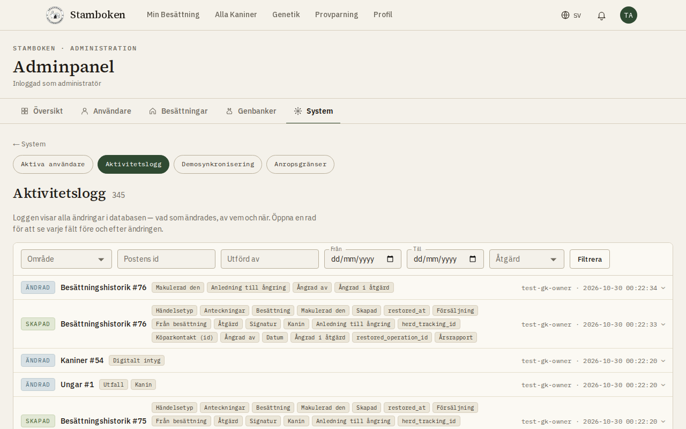

#### Demosynkronisering

<!-- route: /stamboken/admin/system/synk -->

Status för nattens kopiering till testmiljön: **Startad**, **Avslutad**, **Resultat**
och **Synkroniserade användare**. Bara läsning; synkroniseringen startar automatiskt.

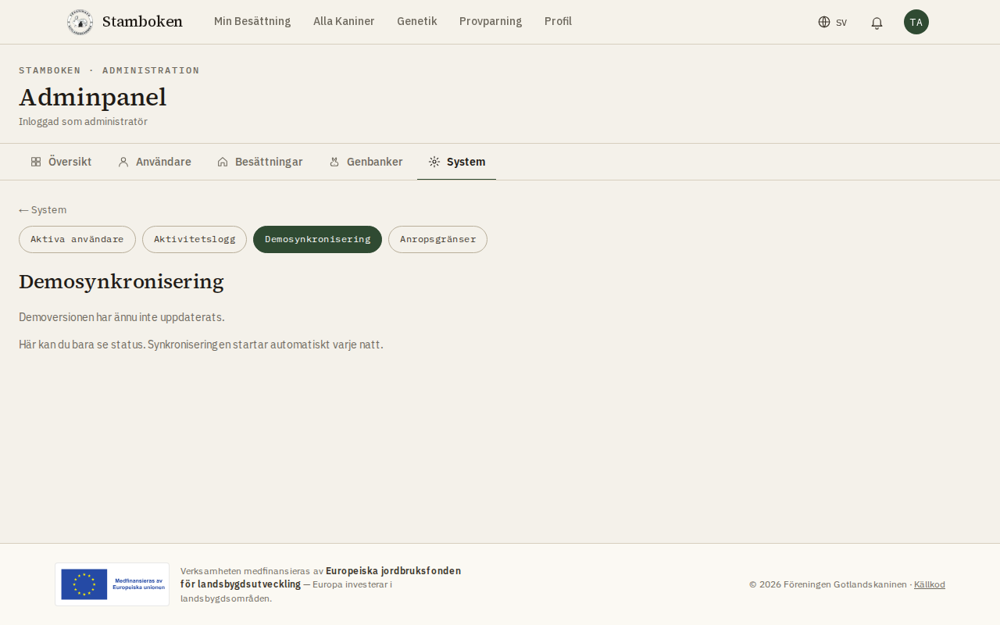

#### Anropsgränser

<!-- route: /stamboken/admin/system/ratelimit -->

Om skyddet mot för många anrop är på, vilken lagring som används och gränserna per
funktion (inloggning, lösenordsåterställning, redigera kanin med flera). Bara läsning.

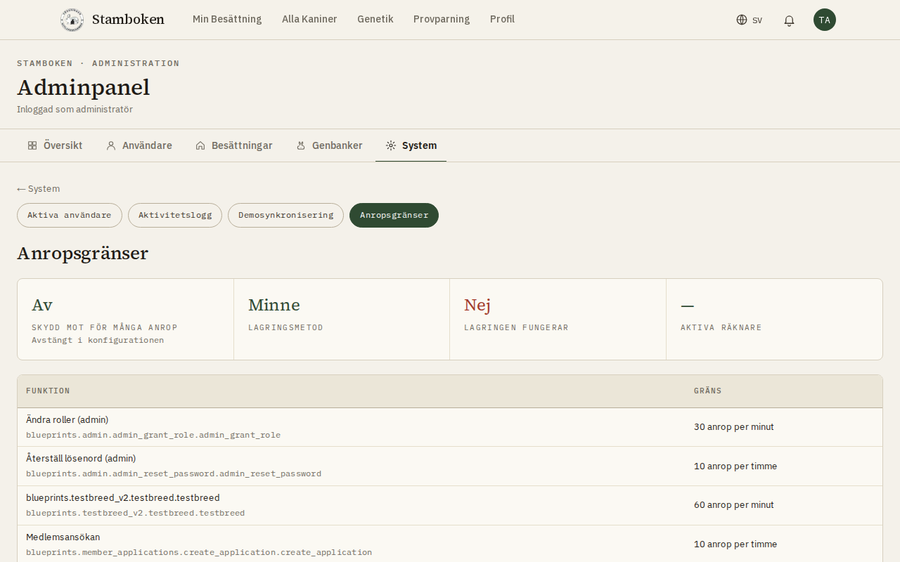

---

## Bilagor

### Felmeddelanden och vad de betyder

| Text | Var | Gör så här |
| --- | --- | --- |
| Sessionen har gått ut | Överallt | Klicka **Logga in igen**. |
| Ditt konto finns inte i testmiljön ännu | Testmiljön | Kontot är nyare än nattens kopia. Vänta till i morgon eller byt till riktiga stamboken. |
| Du har inte behörighet | Parning, kull | Du äger inte besättningen. Kontakta genbanksansvarig. |
| Parningen är redan registrerad | Ny parning | Samma par och datum finns redan. |
| Honan är redan dräktig under detta datum | Ny parning, ny kull | Registrera födsel på den tidigare parningen eller ta bort den. |
| Födseln är redan registrerad | Registrera födsel | Kullen finns redan på kortet. |
| Måste registreras i ordning | Registrera kanin | Registrera ungarna i kullistans ordning. |
| Datumet får inte vara tidigare än … | Sälj individ | Kaninen är yngre än 43 dagar eller såldes nyligen. |
| Försäljningen registrerades för mer än 7 dagar sedan | Ångra försäljning | Kontakta genbanksansvarig. |
| Texten innehåller en e-postadress eller ett telefonnummer | Ångra, korrigera | Ta bort personuppgiften ur anledningen. |
| Kunde inte ladda kaniner. Försök igen senare. | Alla kaniner | Tillfälligt fel; ladda om sidan. |
| Kunde inte hämta genetikdata. Kontrollera att du har behörighet. | Genetik | Du är inte genbanksansvarig för vald genbank. |

### Kontakt

Frågor om stamboken, roller och lösenord: <admin@gotlandskaninen.se>.
Frågor om registrering, färger och intyg: din genbanksansvarig.

### Om manualen

Manualen beskriver gränssnittet som det ser ut i källkoden; varje sida i Stamboken har
ett avsnitt här, och ett skript i kodrepot stoppar ändringar som lägger till en sida
utan avsnitt. Stegen i [Registrera en kull](#registrera-en-kull), [Registrera en unge
och utfärda intyg](#registrera-en-unge-och-utfärda-intyg) och [Sälja eller flytta en
kanin](#sälja-eller-flytta-en-kanin) körs som automatiska tester mot en testdatabas.
Hur skärmbilder och tester uppdateras står i `docs/manual/README.md`.
