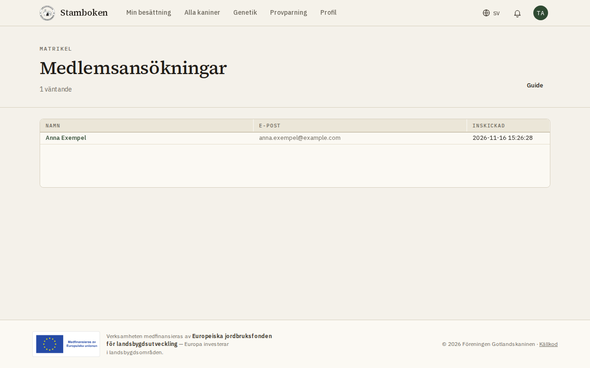
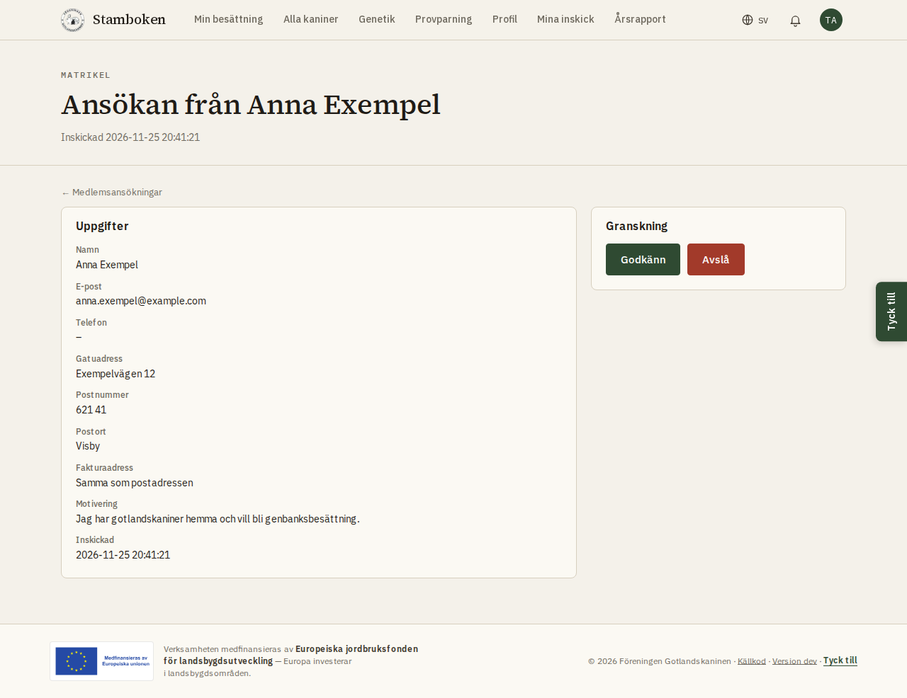
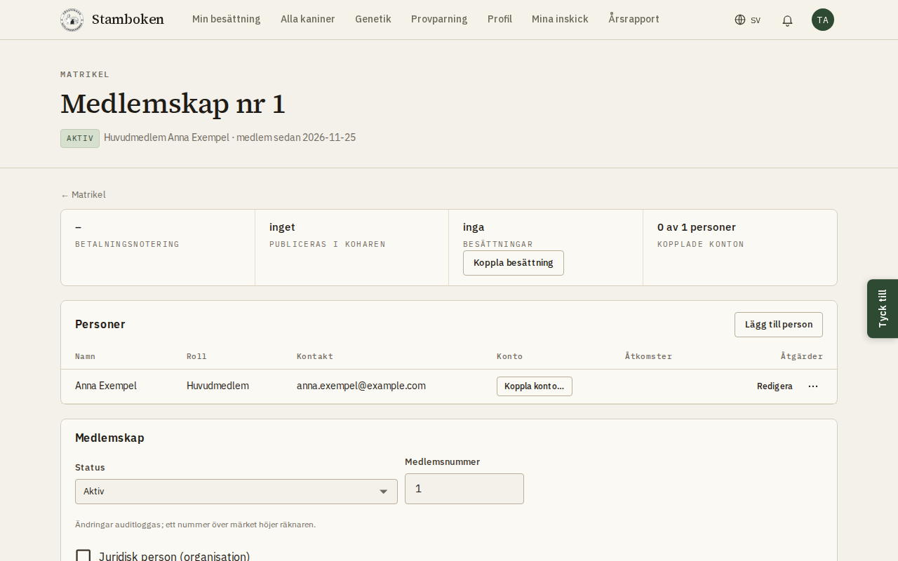
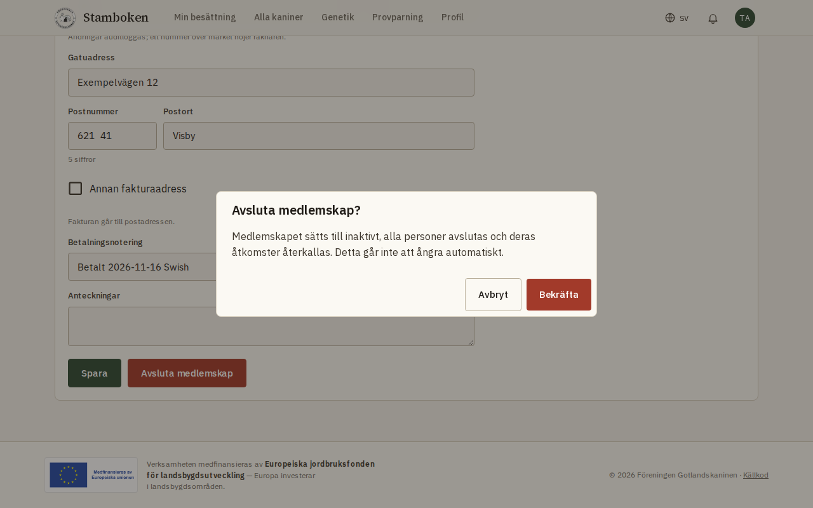

# Guide för matrikeln

Den här guiden är för dig som sköter föreningens medlemsregister i Stamboken:
ansökningar, medlemskap, adresser, avgifter och export. Den syns bara för
matrikeladministratörer och administratörer. Allt annat i Stamboken beskrivs i
[manualen](https://gotlandskaninen.se/stamboken-online/manual).

Bilderna är tagna med påhittade personer.

## Innan du börjar

- **Rollen.** Du behöver rollen **Matrikeladministratör**. Den ger
  administratören dig under **Ge eller ta bort en roll** i adminpanelen. En
  roll kan bara ges till ett konto som loggar in med föreningskontot, alltså
  Google med en adress som slutar på @gotlandskaninen.se.
- **Logga in med föreningskontot.** Klicka **Logga in med ditt föreningskonto
  (Google)** och välj föreningskontot. Ett konto med en roll kan inte logga in
  med kod eller lösenord.
- **Riktiga stamboken.** När du loggar in hamnar du i riktiga stamboken, om
  ditt konto har tillgång till den. Ser du en gul rad överst med "TESTMILJÖ" är
  du i testmiljön: ändra inget där, utan be administratören om tillgång till
  riktiga stamboken. Vill du öva väljer du **Byt till testmiljön** i menyn
  under din bild. Allt du gör i testmiljön försvinner nästa natt.
- **Hitta sidorna.** Klicka på din bild uppe till höger. Längre ner i menyn
  finns **Medlemsansökningar**, **Matrikel** och **Statistik**. Står
  det en siffra efter Medlemsansökningar väntar så många ansökningar. Överst på
  de tre sidorna finns länken **Guide** hit.

## Ansökningar

<!-- route: /medlem/ansokningar -->

Den som vill bli medlem fyller i ansökan på
[gotlandskaninen.se/ansok](https://gotlandskaninen.se/ansok) och får där veta
hur stor medlemsavgiften är och hur den betalas. Ansökan hamnar sedan under
**Medlemsansökningar**, med namn, e-post och när den skickades in.

När en ansökan kommer in mejlar Stamboken:

- **den som ansöker** ett kvitto: att ansökan har kommit in, hur
  medlemsavgiften betalas och att ansökan behandlas när avgiften har kommit in.
- **varje matrikeladministratör** att en ny ansökan väntar, med en länk till
  listan. Administratörer utan rollen Matrikeladministratör får inget mejl.

### Läsa en ansökan

<!-- route: /medlem/ansokningar/[id] -->

Klicka på namnet. Under **Uppgifter** står allt den sökande fyllt i: namn,
e-post, telefon, adress, fakturaadress om den är en annan, och vad hen har
berättat om sig själv. Under **Granskning** finns knapparna **Godkänn** och
**Avslå**.

### Godkänna en ansökan

Godkänn ansökan när medlemsavgiften har kommit in. Stamboken kontrollerar inte
betalningen, det gör du.

1. Klicka **Godkänn**.
2. Stamboken frågar "Godkänna ansökan?". Klicka **Godkänn** igen.

Medlemskapet skapas med status Aktiv, nästa lediga medlemsnummer och dagens
datum som medlem sedan. Det går inte att ångra. Stamboken mejlar den nya
medlemmen att ansökan är godkänd, att medlemsavgiften har kommit in och vilket
medlemsnummer hen har fått. Mejlet säger också att mer information kommer i
ett välkomstbrev med Postnord. Skriv sedan in betalningen i medlemskapets
**Betalningsnotering** (se [Notera betald avgift](#notera-betald-avgift)).

Den nya medlemmen är huvudmedlem. Med e-postadressen i ansökan kan hen logga in
i Stamboken med en kod och skapa sitt konto (se [E-postadressen är
inloggningsadressen](#e-postadressen-är-inloggningsadressen)).

Kan en annan person redan logga in med e-postadressen i ansökan går ansökan
inte att godkänna. Stamboken visar då "En annan medlem kan redan logga in med
e-postadressen i ansökan", och inget medlemskap skapas. Har en annan aktiv
person i matrikeln samma adress utan att logga in med den, till exempel en
familjemedlem utan konto, godkänns ansökan. Stamboken visar då en varning.
Kontrollera att personen inte redan är medlem.

### Avslå en ansökan

Klicka **Avslå**, skriv en **Motivering för avslag** (minst tre tecken) och
klicka **Avslå**. Den som ansökte får inget besked från Stamboken, så meddela
hen själv.

En ansökan som inte har lett till ett medlemskap, alltså en avslagen eller en som
fortfarande väntar, tas bort automatiskt när det har gått ett år sedan den
skickades in. Den nattliga rensningen kan ta bort den redan dagen före årsdagen,
så en väntande ansökan behöver godkännas senast två dagar före.

## Matrikeln

<!-- route: /medlem/matrikel -->

**Matrikel** listar alla medlemskap med kolumnerna **Nr**, **Status**, **G**,
**M**, **Huvudmedlem**, **Kontakt**, **Adress** och **Personer**. Under **G**
och **M** står medlemskapets aktiva besättningar i genbanken för gotlandskanin
och för mellerudskanin. För en organisation står organisationens namn under
**Huvudmedlem**. **Personer** räknar dem som inte är avslutade.

- **Söka:** skriv namn, e-post eller medlemsnummer i sökrutan och klicka
  **Filtrera**.
- **Status:** välj en status i listan och klicka **Filtrera**. **Alla** visar
  alla.
- **Aktiv besättning:** välj **G – Gotlandskanin** eller **M –
  Mellerudskanin** och klicka **Filtrera**. Då visas bara medlemskap med en
  aktiv besättning i den genbanken. **Alla** visar alla.
- **Bläddra:** **Föregående** och **Nästa** längst ner.
- **Öppna ett medlemskap:** klicka på raden.

Ett medlemskap är ett hushåll. Det har en huvudmedlem och kan ha
familjemedlemmar och skötare. Adressen hör till medlemskapet, inte till
personen.

Ett medlemskap kan också vara en organisation, till exempel en förening eller
ett företag. Då är rutan **Juridisk person (organisation)** ikryssad, och
huvudmedlemmen heter **Kontaktperson**. Kontaktpersonens namn får vara tomt.
Organisationens namn står som rubrik på medlemskapets sida.

Statusarna:

| Status | Betyder |
|---|---|
| Aktiv | Medlem. |
| Inaktiv | Inte medlem. Status Inaktiv avslutar inte personerna; det gör **Avsluta medlemskap**. |
| Väntar | Inlagt men ännu inte aktivt. |
| Friexemplar | Får Koharen utan att vara medlem, till exempel tidningsutbyten. Räknas inte i medlemsantalen. |

### Lägga in ett medlemskap utan ansökan

Använd det här för den som har blivit medlem på annat sätt än via
ansökningsformuläret.

1. Klicka **Nytt medlemskap** uppe till höger.
2. Är medlemmen en organisation, kryssa i **Juridisk person (organisation)**.
   Fyll i **Organisationsnamn** och vid behov **Organisationsnummer** (format
   NNNNNN-NNNN). Namnfälten heter då **Kontaktpersonens förnamn** och
   **Kontaktpersonens efternamn**, och de får vara tomma.
3. Fyll i **Förnamn** och **Efternamn** (måste fyllas i), och gärna **E-post**,
   **Telefon**, **Gatuadress**, **Postnummer** och **Postort**.
4. Välj **Status**.
5. Låt **Tilldela medlemsnummer automatiskt** vara ikryssad så får medlemskapet
   nästa lediga nummer. Kryssar du ur den får medlemskapet inget nummer. Ett
   nummer kan du skriva in senare på medlemskapets sida. Lägger du in ett
   friexemplar, kryssa ur rutan: då får det nummer 0 i exporten, som i den
   gamla matrikelfilen.
6. Klicka **Skapa**.

Personen blir huvudmedlem i det nya medlemskapet, eller kontaktperson om det
är en organisation. Adressen i **E-post** blir hens inloggningsadress, utom
för ett friexemplar (se [E-postadressen är
inloggningsadressen](#e-postadressen-är-inloggningsadressen)).

## Ett medlemskap

<!-- route: /medlem/matrikel/[id] -->

Överst på medlemskapets sida står status, huvudmedlem och sedan när hushållet
är medlem. Raden under visar **Betalningsnotering**, vad som får **Publiceras i
Koharen**, hushållets **Besättningar** och hur många personer som har ett
konto i Stamboken (**Kopplade konton**).

Varje besättning står med nummer, namn och om den är aktiv eller inaktiv, till
exempel "G1274 — Namn · aktiv". Är du administratör, eller genbanksansvarig för
besättningens genbank, kan du klicka på den och komma till besättningens sida i
adminpanelen. Under besättningarna finns knappen **Koppla besättning** (se
[Koppla en besättning](#koppla-en-besättning)).

Därunder finns **Personer**, **Medlemskap** och **Historik**. **Historik** visar
de tio senaste ändringarna av medlemskapet och dess personer: när, vem och vad.
Administratören når hela listan med **Visa hela historiken**.

### Ändra adress

1. Skriv den nya adressen i **Gatuadress**, **Postnummer** och **Postort** under
   **Medlemskap**. Postnumret ska vara fem siffror.
2. Klicka **Spara**.

Ska fakturan till en annan mottagare, till exempel en djurpark eller ett
företag, kryssa i **Annan fakturaadress** och fyll i **Fakturamottagare**,
**Fakturaadress**, **Fakturapostnummer**, **Fakturapostort** och vid behov
**E-post för faktura** och **Fakturareferens**. Kryssar du ur rutan och sparar
tas fakturaadressen bort, och fakturan går till postadressen.

Är huvudmedlemmens konto kopplat till medlemskapet (se [Koppla ett
konto](#koppla-ett-konto)) kan huvudmedlemmen själv ändra hushållets adress
under **Profil** i Stamboken. Ändringen syns då här. Andra personer i hushållet
kan bara läsa uppgifterna.

### Notera betald avgift

**Betalningsnotering** är ett fritt textfält, som kolumnen för betalning i den
gamla matrikelfilen. Skriv till exempel "Betalt 2026-11-16 Swish" och klicka
**Spara**. Noteringen syns överst på medlemskapets sida och följer med i
exporten.

Stamboken har inget eget fält för om avgiften är betald eller inte. Det är bara
den här texten. Skriv alltid med året: adresslistan till tryckeriet sätter
"Betala nu" när det senaste året i noteringen är före i år.

**Anteckningar** är för annat du vill komma ihåg om medlemskapet.

### Status och medlemsnummer

Under **Medlemskap** kan du byta **Status** och skriva in eller ändra
**Medlemsnummer**. Klicka **Spara**. Alla ändringar sparas i en logg. Skriver
du ett nummer som är högre än något som har delats ut, fortsätter nästa
automatiska nummer efter det. Ge inte ett nummer som har använts tidigare:
Stamboken kontrollerar bara att inget annat medlemskap har numret just nu.

Under **Medlemskap** finns också rutan **Juridisk person (organisation)**.
Kryssa i den för en organisation och fyll i **Organisationsnamn** och vid
behov **Organisationsnummer**. Kryssar du ur rutan måste kontaktpersonen ha
förnamn och efternamn under **Personer** innan du kan spara.

### Personer i medlemskapet

Under **Personer** står hushållets personer med roll, kontakt, konto och
åtkomster till besättningar.

- **Lägga till en familjemedlem:** klicka **Lägg till person**, fyll i
  **Förnamn** och **Efternamn**, gärna **E-post** och **Telefon**, välj **Roll**
  (**Familjemedlem** eller **Skötare**) och klicka **Spara**. Har personen en
  e-postadress mejlar Stamboken hen att hen har lagts in, vem som är
  huvudmedlem och var föreningens dataskyddspolicy finns.
- **Ändra en person:** klicka **Redigera** på personens rad. Där kan du också
  byta **Roll** mellan **Familjemedlem** och **Skötare**, och rutan säger vad
  rollen innebär. Huvudmedlem byts med **Gör till huvudmedlem**. Ska du ändra
  **E-post**, läs först [E-postadressen är
  inloggningsadressen](#e-postadressen-är-inloggningsadressen).
- **Fler åtgärder:** klicka **⋯** på personens rad:
  - **Ge åtkomst** låter personen sköta en av hushållets besättningar i
    Stamboken. Välj **Besättning** och vid behov **Giltig till**. Lämnas datumet
    tomt gäller åtkomsten tills vidare för en familjemedlem och ett år för en
    skötare.
  - **Gör till huvudmedlem** byter huvudmedlem i hushållet.
  - **Avsluta** avslutar personen i medlemskapet och drar in hens åtkomster.
    Raden finns kvar i historiken. Hushållets huvudmedlem går inte att
    avsluta; byt huvudmedlem först.
  - **Återaktivera** finns för en avslutad person som inte är anonymiserad,
    när medlemskapet inte är inaktivt. Personen blir aktiv igen med den
    roll som står på raden, men åtkomsterna kommer inte tillbaka. Har personen ett
    kopplat konto kopplar du bort det först. En huvudmedlem går bara att
    återaktivera när hushållet inte har någon annan aktiv huvudmedlem.
  - **Anonymisera** ersätter personens namn med en platshållare, tar bort
    kontaktuppgifterna och drar in åtkomsterna. Personens konto töms: namn,
    e-post, Google-uppgifter, profilbild och roller tas bort, och kontot kan inte
    längre logga in. Har kontot rollen administratör, matrikeladministratör eller
    genbanksansvarig går det inte att anonymisera personen förrän rollen är
    borttagen. Ansökningar med personens namn
    och e-post anonymiseras också, och en sådan ansökan som väntar avslås.
    Intyg och bevis i inkorgen som är kopplade till personen förlorar sina
    original. Ett inskick som inkorgen har kopplat till personen som avsändare,
    och som inte har använts på någon kanin, försvinner helt med meddelande och
    bilagor. Delar familjen e-postadress kan det gälla mejl som en annan
    familjemedlem har skickat. Är ingen i hushållet kvar
    efteråt töms hushållets adress, fakturaadress och anteckningar direkt, även
    om medlemskapet redan är avslutat. Inget av det går att ångra.
- **Åtkomster:** i kolumnen **Åtkomster** drar **Återkalla** in en åtkomst, och
  **Förnya** förlänger en skötares tidsbegränsade åtkomst.

### E-postadressen är inloggningsadressen

Huvudmedlemmen och den som har ett konto i Stamboken kan logga in med en kod
som skickas till e-postadressen i matrikeln. Därför är adressen under
**E-post** också personens inloggningsadress. Inloggning med kod fungerar inte
för en person som är avslutad, eller vars medlemskap är inaktivt eller ett
friexemplar.

- Ändrar du adressen gäller den nya genast, och den gamla slutar fungera för
  inloggning.
- Byter du till en annan adress gör det personens oanvända koder ogiltiga.
  Har personen ett konto kopplat till sin rad loggas kontot också ut överallt
  där det är inloggat, också ett konto som loggar in med föreningskontot. Det
  gäller inte en avslutad person och inte ett friexemplar. Ändrar du bara stora
  eller små bokstäver händer inget av det. Vill du logga ut ett konto i de
  fallen ber du administratören om **Logga ut överallt**.
- En adress kan bara vara inloggningsadress för en person. Kan en annan person
  redan logga in med adressen går ändringen inte att spara. Stamboken visar då
  "En annan medlem kan redan logga in med e-postadressen". Samma slags besked
  kan komma när du lägger in ett nytt medlemskap, byter huvudmedlem eller
  kopplar ett konto.

### Koppla ett konto

En person i matrikeln och ett konto i Stamboken är två olika saker. Klicka
**Koppla konto…** på personens rad. I rutan **Koppla användarkonto** söker du
fram kontot under **Sök användare** och klickar **Koppla konto**. Då ser
personen medlemskapet under **Profil**. Är personen huvudmedlem kan hen där
också ändra hushållets adress och vad som får publiceras i Koharen. Andra
personer i hushållet kan bara läsa. **Koppla bort** tar bort kopplingen.

En huvudmedlem som skapar sitt konto efter att ha loggat in med en kod kopplas
till sin rad i matrikeln av sig själv.

### Koppla en besättning

Med **Koppla besättning** knyter du en besättning till medlemskapet. Knappen
finns under **Besättningar** överst på medlemskapets sida.

1. Klicka **Koppla besättning** och välj **Genbank**.
2. Välj besättningen i listan. Du kan skriva en del av numret i **Filtrera på
   besättningsnummer**. En besättning som redan är kopplad till ett medlemskap
   går inte att välja.
3. Klicka **Visa vad kopplingen ger**. Stamboken visar vad som händer:
   - **Åtkomst som tillkommer:** till exempel att huvudmedlemmens konto blir
     besättningens innehavare och får ändra, sälja och flytta kaniner.
   - **Åtkomst som finns kvar:** konton som redan har en gammal ägarroll eller
     ett aktivt skötartillstånd på besättningen.
   - **Kontaktuppgifter:** vad som händer med besättningens namn, e-post,
     mobil och adress när de jämförs med matrikeln.
4. Läs igenom och klicka **Koppla**. Stamboken visar "Besättning kopplad".

Är medlemskapet inte aktivt börjar åtkomsten först när det blir aktivt. Har
något ändrats medan du läste visar Stamboken "Underlaget har ändrats. Granska
den nya förhandsvisningen innan du kopplar." Läs igen och klicka **Koppla**.

### Avsluta ett medlemskap

Klicka **Avsluta medlemskap** under **Medlemskap** och sedan **Bekräfta**.
Medlemskapet blir inaktivt, alla personer i det avslutas och deras åtkomster
dras in. Ett avslutat medlemskap kan inte göras aktivt igen. Kommer medlemmen
tillbaka lägger du in ett nytt medlemskap och låter Stamboken tilldela nästa
nummer automatiskt. Ett medlemsnummer som har använts ska inte ges till någon
annan.

### Anonymisering efter 12 månader

Stamboken anonymiserar personer automatiskt: namnen ersätts med en platshållare
och kontaktuppgifterna tas bort. Personens konto töms på samma sätt som vid
**Anonymisera**. Intyg och bevis i inkorgen som är kopplade
till personen förlorar sina original. Tiden räknas från när personerna avslutades, alltså från
**Avsluta medlemskap**, **Avsluta** eller **Anonymisera**. Att bara välja status
Inaktiv avslutar ingen, och då börjar ingen tid räknas.

- **Ett avslutat medlemskap** anonymiseras när det har gått 12 månader sedan den
  sista personen i det avslutades. Alla personer anonymiseras då samtidigt, och
  hushållets adress, fakturaadress och anteckningar töms. Medlemsnumret står
  kvar på medlemskapet.
- **En familjemedlem eller skötare** som har tagits bort ur ett medlemskap där
  någon annan fortfarande är kvar anonymiseras 12 månader efter att hen togs
  bort. Hushållets adress står kvar.

Stamboken hoppar över ett avslutat medlemskap där någon av personerna har
rollen administratör, matrikeladministratör eller genbanksansvarig eller äger
en aktiv besättning, eller där en av hushållets besättningar fortfarande är
aktiv. En borttagen person hoppas över om hens eget konto har en sådan roll
eller äger en aktiv besättning. Ett undantag som kommer från ett konto gäller
bara så länge kontot är kopplat till personen och har kvar rollen eller den
aktiva besättningen. När undantaget upphör anonymiseras uppgifterna vid nästa
nattliga körning. Systemansvarig kan bedöma fallen medan undantaget gäller.

Besättningens egna kontaktuppgifter tas inte bort av den här regeln.

## Statistik

<!-- route: /medlem/statistik -->

**Statistik** visar hur många medlemskap och personer som finns, uppdelat på
aktiva, inaktiva och väntande, hur många friexemplar som går ut och hur många
medlemskap som är nya i år. Friexemplar ingår inte i de andra talen.

## Exportera

Knapparna finns överst i **Matrikel** och på **Statistik**. Alla laddar ner en
CSV-fil som går att öppna i Excel.

- **Exportera MATR** ger aktiva medlemskap och friexemplar med samma kolumner
  som den gamla matrikelfilen: en rad per person, med adress, betalningsnotering
  och anteckningar på huvudmedlemmens rad och fakturaadressen sist.
  Friexemplar utan medlemsnummer får nummer 0, men ett friexemplar som har
  fått ett nummer står med det numret. Filen har ingen kolumn för status, så
  kontrollera status i matrikeln innan du följer upp avgifter. Använd filen för
  avgiftsuppföljning. Den finns kvar under en övergångstid.
- **Exportera adresslista** ger listan till tryckeriet för Koharen: en rad per
  hushåll med medlemsnummer, huvudmedlemmens namn, adress och postadress,
  sorterad på postnummer. För en organisation står organisationsnamnet och c/o
  kontaktpersonen. Aktiva medlemskap och friexemplar ingår, men inte de
  som saknar adress. Kryssa i **Med Betala nu** till årets två första nummer.
  Då står "Betala nu" hos dem vars betalningsnotering har ett år före i år.
- **Exportera Koharen** ger Koharens lista över aktiva besättningar: en rad
  per aktiv besättning vars innehavare har svarat ja. Raden har besättningens
  nummer, innehavarens namn och det innehavaren har sagt ja till av telefon,
  e-post samt postnummer och ort. Gatuadressen står aldrig med. Den som har
  svarat nej eller aldrig har svarat står inte med. Huvudmedlemmen svarar under
  **Profil** eller på blanketten, och svaret syns som **Publiceras i Koharen**
  på medlemskapets sida.

Filerna innehåller personuppgifter. Spara dem inte där andra kommer åt dem, och
ta bort dem när du inte behöver dem längre. Varje uttag av MATR, adresslistan
och Koharens lista loggas med vem som tog ut den och när. I testmiljön går de
inte att ta ut.
