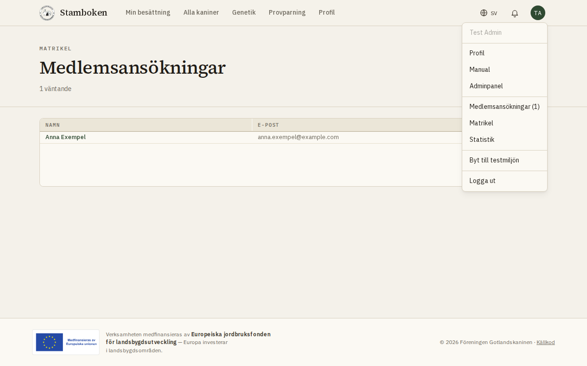
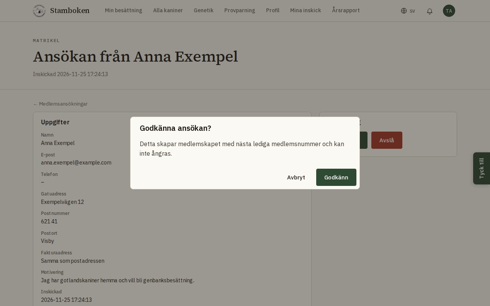
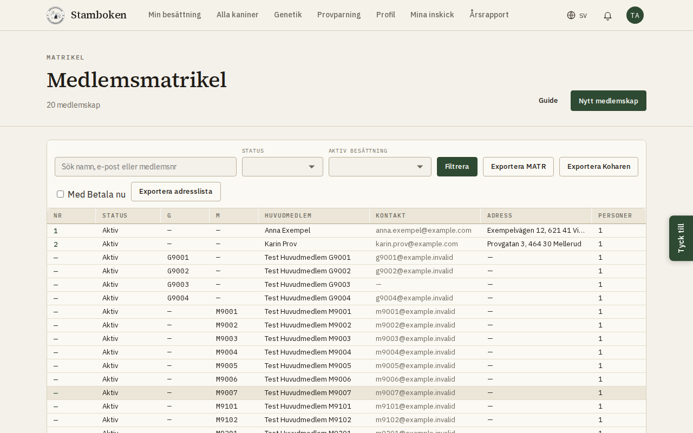
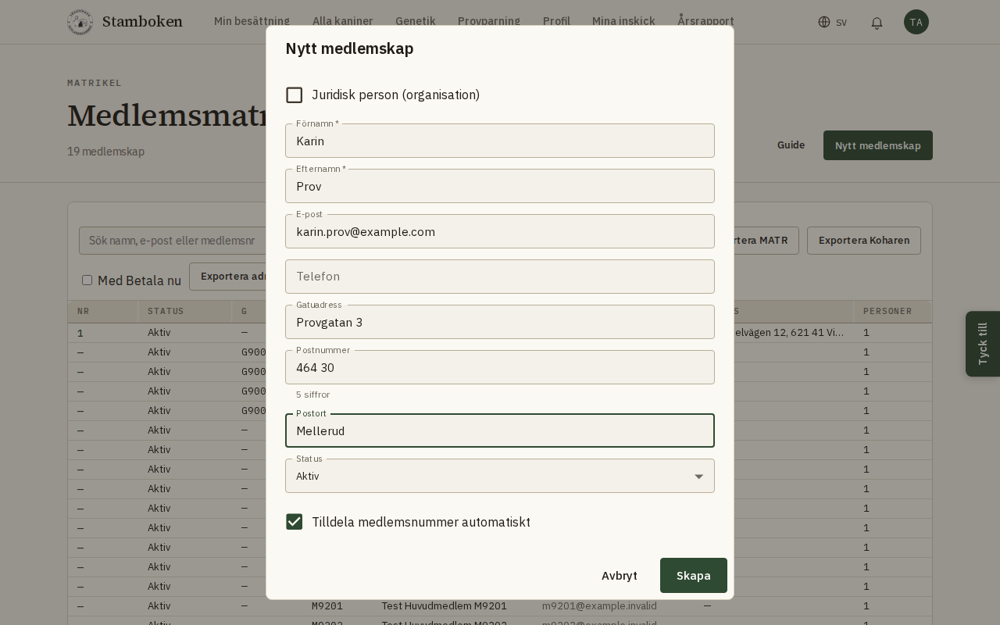
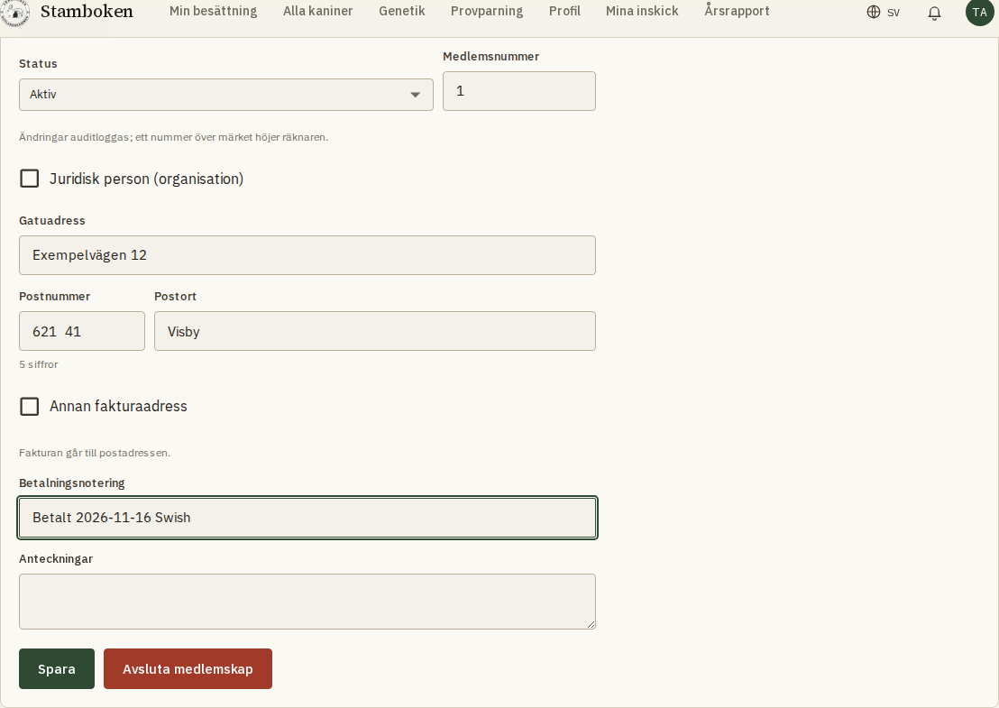
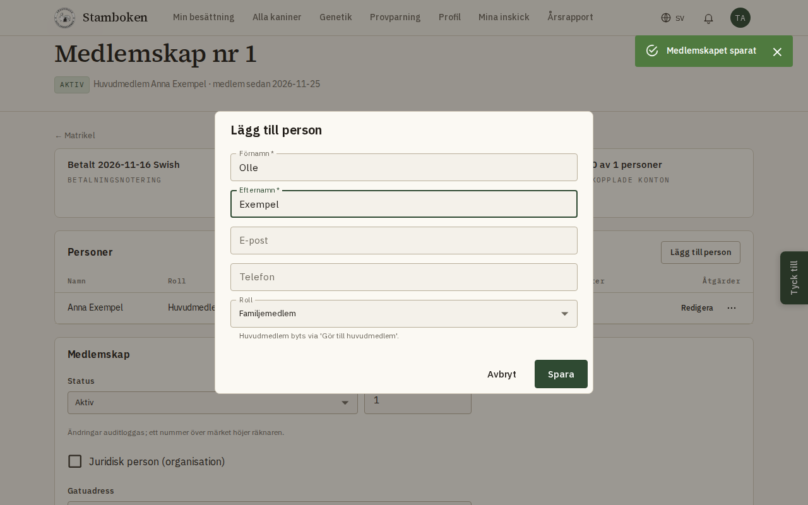
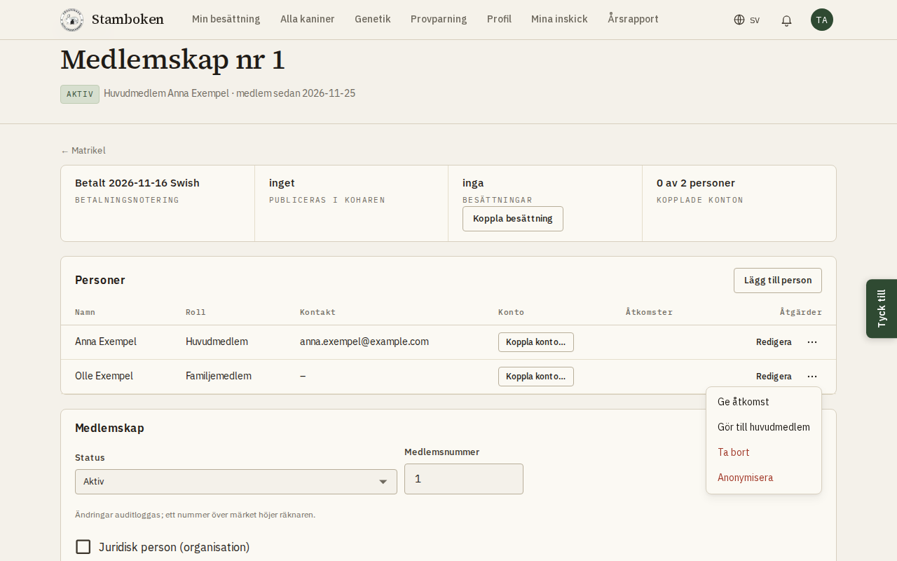
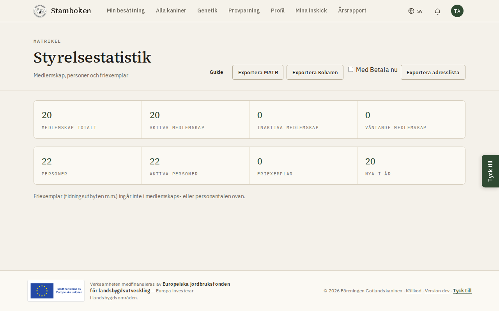

# Guide för matrikeln

Den här guiden är för dig som sköter föreningens medlemsregister i Stamboken:
ansökningar, medlemskap, adresser, avgifter och export. Den syns bara för
matrikeladministratörer och administratörer. Allt annat i Stamboken beskrivs i
[manualen](https://gotlandskaninen.se/stamboken-online/manual).

Bilderna är tagna med påhittade personer.

## Innan du börjar

- **Rollen.** Du behöver rollen **Matrikeladministratör**. Den ger
  administratören dig under **Ge eller ta bort en roll** i adminpanelen.
- **Riktiga stamboken.** Utan tillgång till riktiga stamboken hamnar du i
  testmiljön. Där kan du öva, men allt du gör där försvinner nästa natt. Be
  administratören om tillgång.
- **Hitta sidorna.** Klicka på din bild uppe till höger. Under **Profil** och
  **Manual** finns **Medlemsansökningar**, **Matrikel** och **Statistik**. Står
  det en siffra efter Medlemsansökningar väntar så många ansökningar. Överst på
  de tre sidorna finns länken **Guide** hit.

## Ansökningar

<!-- route: /medlem/ansokningar -->

Den som vill bli medlem fyller i ansökan på
[gotlandskaninen.se/ansok](https://gotlandskaninen.se/ansok) och får där veta
hur stor årsavgiften är och hur den betalas. Ansökan hamnar sedan under
**Medlemsansökningar**, med namn, e-post och när den skickades in.

Stamboken skickar inga mejl om ansökningar än, varken till dig eller till den
som ansöker. Titta därför i listan då och då.

### Läsa en ansökan

<!-- route: /medlem/ansokningar/[id] -->

Klicka på namnet. Under **Uppgifter** står allt den sökande fyllt i: namn,
e-post, telefon, adress, fakturaadress om den är en annan, och vad hen har
berättat om sig själv. Under **Granskning** finns knapparna **Godkänn** och
**Avslå**.

### Godkänna en ansökan

Godkänn ansökan när årsavgiften har kommit in. Stamboken kontrollerar inte
betalningen, det gör du.

1. Klicka **Godkänn**.
2. Stamboken frågar "Godkänna ansökan?". Klicka **Godkänn** igen.

Medlemskapet skapas med status Aktiv, nästa lediga medlemsnummer och dagens
datum som medlem sedan. Det går inte att ångra. Skriv sedan in betalningen i
medlemskapets **Betalningsnotering** (se [Notera betald
avgift](#notera-betald-avgift)) och meddela den nya medlemmen själv, eftersom
Stamboken inte gör det än.

Används e-postadressen redan av en annan aktiv person i matrikeln visar
Stamboken en varning efter godkännandet. Kontrollera då att personen inte redan
är medlem.

### Avslå en ansökan

Klicka **Avslå**, skriv en **Motivering för avslag** (minst tre tecken) och
klicka **Avslå**. Den som ansökte får inget besked från Stamboken, så meddela
hen själv.

## Matrikeln

<!-- route: /medlem/matrikel -->

**Matrikel** listar alla medlemskap: nummer, status, huvudmedlem, kontakt,
adress och hur många personer som ingår.

- **Söka:** skriv namn, e-post eller medlemsnummer i sökrutan och klicka
  **Filtrera**.
- **Status:** välj en status i listan och klicka **Filtrera**. **Alla** visar
  alla.
- **Bläddra:** **Föregående** och **Nästa** längst ner.
- **Öppna ett medlemskap:** klicka på raden.

Ett medlemskap är ett hushåll. Det har en huvudmedlem och kan ha
familjemedlemmar och skötare. Adressen hör till medlemskapet, inte till
personen.

Statusarna:

| Status | Betyder |
|---|---|
| Aktiv | Medlem. |
| Inaktiv | Medlemskapet är avslutat. |
| Väntar | Inlagt men ännu inte aktivt. |
| Friexemplar | Får Koharen utan att vara medlem, till exempel tidningsutbyten. Räknas inte i medlemsantalen. |

### Lägga in ett medlemskap utan ansökan

Använd det här för den som har blivit medlem på annat sätt än via
ansökningsformuläret.

1. Klicka **Nytt medlemskap** uppe till höger.
2. Fyll i **Förnamn** och **Efternamn** (måste fyllas i), och gärna **E-post**,
   **Telefon**, **Gatuadress**, **Postnummer** och **Postort**.
3. Välj **Status**.
4. Låt **Tilldela medlemsnummer automatiskt** vara ikryssad så får medlemskapet
   nästa lediga nummer. Kryssar du ur den får medlemskapet inget nummer. Ett
   nummer kan du skriva in senare på medlemskapets sida.
5. Klicka **Skapa**.

Personen blir huvudmedlem i det nya medlemskapet.

## Ett medlemskap

<!-- route: /medlem/matrikel/[id] -->

Överst på medlemskapets sida står status, huvudmedlem och sedan när hushållet
är medlem. Raden under visar **Betalningsnotering**, vad som får **Publiceras i
Koharen**, hushållets **Besättningar** och hur många personer som har ett
konto i Stamboken (**Kopplade konton**).

Därunder finns **Personer** och **Medlemskap**.

### Ändra adress

1. Skriv den nya adressen i **Gatuadress**, **Postnummer** och **Postort** under
   **Medlemskap**. Postnumret ska vara fem siffror.
2. Klicka **Spara**.

Ska fakturan till en annan mottagare, till exempel en djurpark eller ett
företag, kryssa i **Annan fakturaadress** och fyll i **Fakturamottagare**,
**Fakturaadress**, **Fakturapostnummer**, **Fakturapostort** och vid behov
**E-post för faktura** och **Fakturareferens**. Kryssar du ur rutan och sparar
tas fakturaadressen bort, och fakturan går till postadressen.

Är huvudmedlemmens konto kopplat till medlemskapet (se [Koppla ett
konto](#koppla-ett-konto)) kan huvudmedlemmen själv ändra hushållets adress
under **Profil** i Stamboken. Ändringen syns då här. Andra personer i hushållet
kan bara läsa uppgifterna.

### Notera betald avgift

**Betalningsnotering** är ett fritt textfält, som kolumnen för betalning i den
gamla matrikelfilen. Skriv till exempel "Betalt 2026-11-16 Swish" och klicka
**Spara**. Noteringen syns överst på medlemskapets sida och följer med i
exporten.

Stamboken har inget eget fält för om avgiften är betald eller inte. Det är bara
den här texten.

**Anteckningar** är för annat du vill komma ihåg om medlemskapet.

### Status och medlemsnummer

Under **Medlemskap** kan du byta **Status** och skriva in eller ändra
**Medlemsnummer**. Klicka **Spara**. Alla ändringar sparas i en logg. Skriver
du ett nummer som är högre än något som har delats ut, fortsätter nästa
automatiska nummer efter det.

### Personer i medlemskapet

Under **Personer** står hushållets personer med roll, kontakt, konto och
åtkomster till besättningar.

- **Lägga till en familjemedlem:** klicka **Lägg till person**, fyll i
  **Förnamn** och **Efternamn**, gärna **E-post** och **Telefon**, välj **Roll**
  (**Familjemedlem** eller **Skötare**) och klicka **Spara**.
- **Ändra en person:** klicka **Redigera** på personens rad.
- **Fler åtgärder:** klicka **⋯** på personens rad:
  - **Ge åtkomst** låter personen sköta en av hushållets besättningar i
    Stamboken. Välj **Besättning** och vid behov **Giltig till**. Lämnas datumet
    tomt gäller åtkomsten tills vidare för en familjemedlem och ett år för en
    skötare.
  - **Gör till huvudmedlem** byter huvudmedlem i hushållet.
  - **Ta bort** avslutar personen i medlemskapet och drar in hens åtkomster.
  - **Anonymisera** ersätter personens namn med en platshållare, tar bort
    kontaktuppgifterna och drar in åtkomsterna. Det går inte att ångra.
- **Åtkomster:** i kolumnen **Åtkomster** drar **Återkalla** in en åtkomst, och
  **Förnya** förlänger en skötares tidsbegränsade åtkomst.

### Koppla ett konto

En person i matrikeln och ett konto i Stamboken är två olika saker. Klicka
**Koppla konto…** på personens rad, sök fram kontot och klicka **Koppla konto**.
Då ser personen medlemskapet under **Profil**. Är personen huvudmedlem kan hen
där också ändra hushållets adress och vad som får publiceras i Koharen. Andra
personer i hushållet kan bara läsa. **Koppla bort** tar bort kopplingen.

### Avsluta ett medlemskap

Klicka **Avsluta medlemskap** under **Medlemskap** och sedan **Bekräfta**.
Medlemskapet blir inaktivt, alla personer i det avslutas och deras åtkomster
dras in. Ett avslutat medlemskap kan inte göras aktivt igen. Kommer medlemmen
tillbaka lägger du in ett nytt medlemskap.

> **Beslutat men inte infört än:** avslutade medlemskap ska anonymiseras
> automatiskt 12 månader efter att de avslutades, och en borttagen
> familjemedlem 12 månader efter att hen togs bort. Efter det går
> medlemsnumret inte längre att koppla till någon person. Guiden uppdateras
> när regeln gäller.

## Statistik

<!-- route: /medlem/statistik -->

**Statistik** visar hur många medlemskap och personer som finns, uppdelat på
aktiva, inaktiva och väntande, hur många friexemplar som går ut och hur många
medlemskap som är nya i år. Friexemplar ingår inte i de andra talen.

## Exportera

Knapparna finns överst i **Matrikel** och på **Statistik**. Båda laddar ner en
CSV-fil som går att öppna i Excel.

- **Exportera MATR** ger aktiva medlemskap och friexemplar med samma kolumner
  som den gamla matrikelfilen: en rad per person, med adress, betalningsnotering
  och anteckningar på huvudmedlemmens rad och fakturaadressen sist.
  Friexemplar får nummer 0. Använd den som adresslista för Koharen och för
  avgiftsuppföljning.
- **Exportera Koharen** ger personerna i aktiva medlemskap, med bara de
  uppgifter hushållet har sagt ja till att publicera: namn, telefon, e-post och
  adress. Valet gäller hela hushållet och görs av huvudmedlemmen under
  **Profil**, och syns som **Publiceras i Koharen** på medlemskapets sida. Har
  hushållet inte svarat är uppgifterna tomma och det står "ej angivet". Filen är
  underlaget till medlemsförteckningen i Koharen.

Filerna innehåller personuppgifter. Spara dem inte där andra kommer åt dem, och
ta bort dem när du inte behöver dem längre.
