# Användarmanual – Stamboken Online

> **Gäller:** nya Stamboken på föreningens webbplats.
> **Senast kontrollerad mot gränssnittet:** 2026-11-25.
> Skärmbilderna är tagna i en lokal testmiljö med påhittade kaniner och besättningar.

Är du ny i Stamboken, börja med sidan [Kom igång](https://gotlandskaninen.se/stamboken-online/kom-igang).
Manualen är indelad efter roll. Läs del 0 först och sedan den del som gäller dig.
Varje del börjar med **Så gör du** (numrerade steg med knapparnas namn som de står
på skärmen) och slutar med **Skärmarna** (vad varje sida innehåller).

## Innehåll

- [Del 0 – Komma igång](#del-0--komma-igång)
  - [Logga in](#logga-in)
  - [Hitta i Stamboken](#hitta-i-stamboken), [Tyck till](#tyck-till)
  - [Testmiljön och riktiga stamboken](#testmiljön-och-riktiga-stamboken)
  - [Ordlista](#ordlista)
- [Del 1 – Uppfödare](#del-1--uppfödare)
  - Så gör du: [parning](#registrera-en-parning), [kull](#registrera-en-kull),
    [kullistan](#föra-kullistan), [registrera unge och utfärda intyg](#registrera-en-unge-och-utfärda-intyg),
    [kanin utan kull](#lägga-till-en-kanin-utan-registrerad-kull), [pappersintygets nummer](#när-pappret-och-stamboken-har-olika-individnummer),
    [kullnummer](#när-kullnumren-inte-stämmer), [foto](#ladda-upp-ett-foto), [ladda upp intyg](#ladda-upp-intyg),
    [redigera](#redigera-en-kanin), [död](#rapportera-en-kanin-som-död),
    [sälja](#sälja-eller-flytta-en-kanin), [provpara](#provpara),
    [besättningsuppgifter](#uppdatera-besättningsuppgifter), [profil](#uppdatera-din-profil)
  - Skärmarna: [Min besättning](#min-besättning), [Kaninens sida](#kaninens-sida),
    [Alla kaniner](#alla-kaniner), [Provparning](#provparning), [Färgatlas](#färgatlas), [Min profil](#min-profil),
    [Mina inskick](#mina-inskick), [Ladda upp intyg](#ladda-upp-intyg-skärmen),
    [Årsrapport](#årsrapport), [Årsrapport för en besättning](#årsrapport-för-en-besättning),
    [Status för årsrapporten](#status-för-årsrapporten), [Notiser](#notiser),
    [Kontrollera köparens e-postadress](#kontrollera-köparens-e-postadress),
    [Verifiera intyg](#verifiera-intyg), [Ta bort köparens uppgifter](#ta-bort-köparens-uppgifter)
- [Del 2 – Genbanksansvarig](#del-2--genbanksansvarig)
  - Så gör du: [rätta en kanin](#rätta-en-kanin-i-en-annan-besättning),
    [korrigera historik](#korrigera-besättningshistorik), [ändringshistorik](#läsa-och-ångra-i-ändringshistoriken),
    [kullnummer](#numrera-om-kullar-med-registrerade-kaniner), [genetik](#använda-genetiksidan),
    [besättningar](#skapa-och-redigera-besättningar-i-din-genbank), [inkorgen](#arbeta-i-inkorgen)
  - Skärmarna: [Genetik](#genetik), [Adminpanelen för genbanksansvarig](#adminpanelen-för-genbanksansvarig),
    [Inkorg](#inkorg), [Inkorg – ärende](#inkorg--ärende)
- [Del 3 – Administratör](#del-3--administratör)
  - Så gör du: [hitta användare](#hitta-en-användare), [roller](#ge-eller-ta-bort-en-roll),
    [lösenord](#återställa-ett-lösenord), [åtkomst](#ge-tillgång-till-riktiga-stamboken),
    [inaktivera](#inaktivera-eller-aktivera-ett-konto), [radera](#radera-kontots-uppgifter),
    [ny besättning](#skapa-en-besättning),
    [ägare](#byta-ägare-på-en-besättning), [genbanksansvarig](#utse-genbanksansvarig),
    [aktivitetslogg](#söka-i-aktivitetsloggen), [massutloggning](#logga-ut-alla-användare)
  - Skärmarna: [Adminpanel](#adminpanel), [Användare](#användare), [Användare – redigera](#användare--redigera),
    [Besättningar](#besättningar), [Besättning – redigera](#besättning--redigera), [Ny besättning](#ny-besättning),
    [Genbanker](#genbanker), [Genbank – redigera](#genbank--redigera), [Utskick](#utskick), [System](#system),
    [Aktiva användare](#aktiva-användare), [Aktivitetslogg](#aktivitetslogg),
    [Demosynkronisering](#demosynkronisering), [Anropsgränser](#anropsgränser)
- [Bilagor](#bilagor): [felmeddelanden](#felmeddelanden-och-vad-de-betyder), [kontakt](#kontakt),
  [vad är på gång](#vad-är-på-gång), [om manualen](#om-manualen)

---

## Del 0 – Komma igång

### Logga in

<!-- route: /auth/sign-in -->

Klicka på **Stamboken** uppe till höger på föreningens webbplats och sedan på
**Logga in i Stamboken**. Är du inte inloggad kommer du till inloggningssidan.
Där finns tre sätt att logga in:

- **Med en kod i ett mejl.** Du skriver den e-postadress som står i föreningens
  matrikel och får en kod dit. Det fungerar för den som står med en egen
  e-postadress i matrikeln: huvudmedlemmen, familjemedlemmar och skötare.
- **Med föreningskontot (Google)**, om du har en adress som slutar på
  @gotlandskaninen.se.
- **Med användarnamn och lösenord**, samma uppgifter som i gamla Stamboken.

Är du genbanksansvarig, genbankshjälpare, matrikeladministratör eller
administratör loggar du in med föreningskontot. Kod och lösenord fungerar inte
för de kontona.

Du hamnar på Min besättning i riktiga stamboken. Saknar ditt konto tillgång
till riktiga stamboken hamnar du i [testmiljön](#testmiljön-och-riktiga-stamboken):
mejla då <admin@gotlandskaninen.se>.

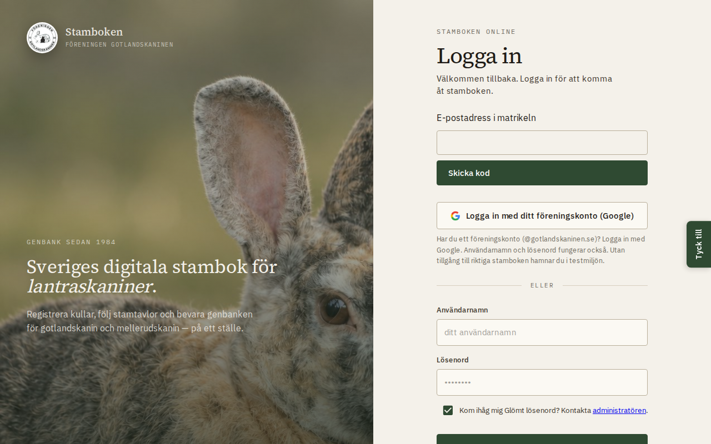

#### Logga in med kod

1. Skriv din adress i fältet **E-postadress i matrikeln** och klicka **Skicka kod**.
2. Finns adressen i matrikeln får du ett mejl med en kod på åtta siffror. Det
   brukar komma inom en minut. Sidan visar samma besked vare sig adressen finns
   eller inte.
3. Skriv koden i fältet **Engångskod** och klicka **Logga in med kod**. Koden
   gäller i tio minuter och bara i webbläsaren där du bad om den.

Saknar matrikeln din adress, eller är du familjemedlem eller skötare och har
någon annan i matrikeln samma adress, kommer inget mejl. Mejla då
<admin@gotlandskaninen.se>.

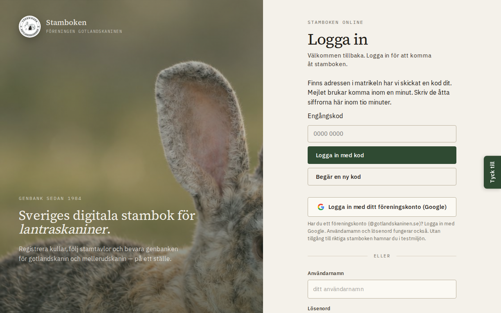

Kom inget mejl? Titta i skräpposten. Klicka sedan **Begär en ny kod** och
kontrollera att adressen är rätt stavad. Du kan få fem koder per dygn. Är ett
annat konto redan inloggat i webbläsaren frågar sidan om du vill byta konto:
klicka **Byt konto och logga in**.

#### Logga in med länken i mejlet

<!-- route: /auth/kod -->

Mejlet med koden har också en länk. Öppna den i samma webbläsare som du bad om
koden i. Sidan **Logga in med länk** visar vem du loggar in som, och du klickar
**Logga in här**. I en annan webbläsare eller på en annan dator fungerar länken
inte. Skriv då koden på inloggningssidan i stället.

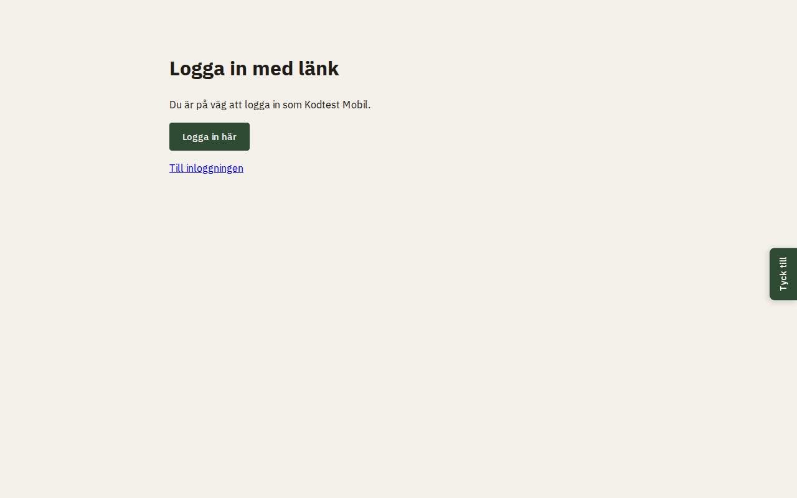

#### Skapa ditt konto första gången

<!-- route: /auth/skapa-konto -->

Har du inget konto i Stamboken kommer du efter koden till sidan
**Skapa mitt konto**:

1. Läs **Regler för ditt konto** på sidan.
2. Kryssa i rutan **Jag har läst reglerna och följer dem.**
3. Klicka **Skapa mitt konto**. Du hamnar på Min besättning.

Du har 15 minuter på dig efter koden. Har tiden gått ut går du till
inloggningen och ber om en ny kod. Reglerna kan du läsa igen när du vill på
sidan [Regler för ditt konto](https://gotlandskaninen.se/kontoregler).

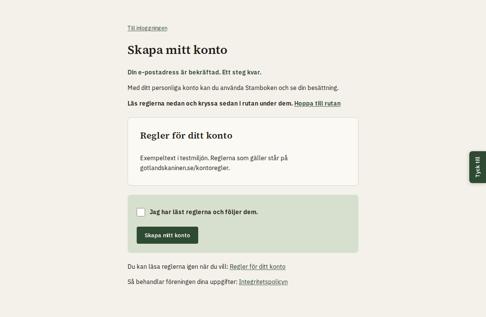

#### Med föreningskontot eller lösenord

1. Klicka **Logga in med ditt föreningskonto (Google)** och välj föreningskontot
   i Googles kontoväljare. Ett privat Gmail-konto fungerar inte.
2. Eller skriv ditt **Användarnamn** och **Lösenord** och klicka **Logga in**.

Glömt lösenordet till föreningskontot? Använd Googles återställning, och mejla
administratören om den inte fungerar. Glömt lösenordet till Stamboken? Logga in
med en kod i stället, eller klicka på länken **administratören** under
lösenordsfältet. Den öppnar ett mejl till <admin@gotlandskaninen.se>, och du
får ett nytt tillfälligt lösenord.

Under formuläret leder länken **Kom igång** till introduktionen för nya användare och
**Bli medlem** till ansökan om medlemskap.

#### Felmeddelanden vid inloggning

| Text | Betyder |
| --- | --- |
| Koden kunde inte godkännas. … | Fel siffror, koden är äldre än tio minuter, eller du använder en annan webbläsare än den där du bad om koden. |
| Länken fungerar bara i webbläsaren där du bad om koden. … | Skriv koden på inloggningssidan i stället, eller be om en ny. |
| Ett annat konto är inloggat i den här webbläsaren. Vill du byta konto? | Klicka **Byt konto och logga in**, eller gå tillbaka med **Till inloggningen**. |
| Tiden för att skapa kontot har gått ut. … | Mer än 15 minuter har gått sedan koden. Be om en ny kod. |
| Reglerna har uppdaterats. … | Reglerna ändrades medan du läste. Läs dem igen och kryssa i rutan. |
| Det finns redan ett konto som kan vara ditt. … | Logga in med det kontot, eller mejla <admin@gotlandskaninen.se>. |
| Tjänsten är tillfälligt otillgänglig. Försök igen senare. | Tillfälligt fel i tjänsten. |
| Felaktigt användarnamn eller lösenord | Kontrollera stavning och versaler. Är du genbanksansvarig, genbankshjälpare, matrikeladministratör eller administratör fungerar bara föreningskontot. |
| För många inloggningsförsök. Vänta en minut och försök igen. | Fem försök per minut är gränsen. |
| Inloggning misslyckades. Försök igen senare. | Tillfälligt fel i tjänsten. |
| Endast @gotlandskaninen.se-konton kan användas för Google-inloggning. … | Du valde ett privat Google-konto. Välj föreningskontot. |
| Ditt föreningskonto är inte kopplat till Stamboken än. Kontakta administratören. | Föreningskontot finns men har inget konto i Stamboken. Mejla <admin@gotlandskaninen.se>. |

### Hitta i Stamboken

Högst upp finns menyn med länkarna **Min besättning**, **Alla kaniner**, **Genetik**,
**Provparning**, **Profil**, **Mina inskick** och **Årsrapport**. Arbetar du med
inläsningen av intyg finns också **Inkorg**. Under **Resurser** finns
**Färgatlas** och **Avelsråd**. På mobilen ligger länkarna bakom
menyknappen (tre streck) längst till vänster, och där finns också **Tyck till**.
Logotypen **Stamboken** tar dig alltid till Min besättning.

Till höger finns:

- **SV / EN** – byter språk.
- Klockan **Notiser** – meddelanden från systemet medan du arbetar, till exempel
  bekräftelser och fel.
- Din avatar (initialer eller bild) – menyn med **Profil**, **Notiser** (sidan med dina
  notiser, se [Notiser](#notiser)), **Manual** (den här manualen), **Tyck till**,
  **Adminpanel** (om du har rollen), **Medlemsansökningar**, **Matrikel** och **Statistik**
  (om du hanterar medlemsregistret), **Byt till testmiljön** / **Byt till riktiga
  stamboken** och **Logga ut**.

Har du olästa notiser står antalet vid **Notiser** i avatarmenyn och vid **Mina inskick**
(eller **Inkorg**) i menyn.

Den blå rutan "Detta är nya Stamboken (beta)" stänger du med **Stäng**. Valet sparas
i webbläsaren.

#### Tyck till

Fungerar något inte, eller saknar du något? Klicka **Tyck till**. Fliken **Tyck till**
sitter på högra kanten av varje sida. Samma val finns i avatarmenyn, i mobilens meny,
i den blå rutan och längst ned på sidan.

1. Välj under **Vad gäller det?**: **Något fungerar inte** eller **Jag önskar något**.
2. Skriv i rutan **Beskriv med egna ord**.
3. Vill du visa vad du menar: klicka **Peka på sidan**, tryck på det som är fel och
   klicka **Använd**. Då tar Stamboken en bild av sidan. Med **Bifoga bild** lägger du
   till en egen bild. Du kan skicka högst fyra bilder. Bilderna mejlas bara till
   föreningen och läggs aldrig ut öppet.
4. Välj under **Vem får läsa det du skriver?**:
   - **Bara föreningen** – de som utvecklar Stamboken läser den.
   - **Alla** – texten läggs ut öppet på GitHub, utan ditt namn. Skriv inte andras
     namn eller individnummer.
5. Vill du ha svar: kryssa i **Skicka med mina kontaktuppgifter, jag vill ha svar**.
   Föreningen svarar då till adressen på ditt konto.
6. Klicka **Skicka**. Rutan "Tack! Vi har fått din synpunkt." visas. Valde du **Alla**
   finns där en länk till texten på GitHub.

Är du inte inloggad finns inget val om vem som får läsa. Det du skriver går bara till
föreningen. Skriv **Din e-postadress**, så att föreningen kan svara dig.

### Testmiljön och riktiga stamboken

Stamboken finns i två utgåvor med samma utseende:

- **Riktiga stamboken** – det som gäller. Allt du sparar syns för alla.
- **Testmiljön** – en kopia där du kan öva. Skrivs över varje natt med riktiga
  stambokens innehåll, så inget du gör där finns kvar nästa dag. En gul rad högst upp,
  "TESTMILJÖ – här kan du öva fritt. Allt återställs varje natt.", visar att du är där.

När du loggar in hamnar du i riktiga stamboken. Vill du prova något utan att
ändra på riktigt byter du till testmiljön i avatarmenyn: **Byt till testmiljön**,
bekräfta med **Ja, byt till testmiljön**. Där kan du klicka runt fritt. Samma väg
tillbaka: **Byt till riktiga stamboken**.

Ett konto som skapats i dag finns i testmiljön först efter nattens kopia.

Intyg som du laddar upp i testmiljön stannar där och läses inte in i Stamboken, och
**Mina inskick** i testmiljön visar inte det du har skickat in i riktiga stamboken. Båda
sidorna säger det överst.

Adminpanelen finns bara i riktiga stamboken. Öppnar du den från testmiljön får du
knappen **Byt till riktiga stamboken**.

### Ordlista

**Genbank** – hela populationen av en ras i bevarandeprogrammet. Föreningen driver två:
gotlandskanin (besättningsnummer som börjar på G) och mellerudskanin (M).

**Besättning** – din del av genbanken: dina registrerade kaniner och dina ungar.
Varje besättning har ett **besättningsnummer**, till exempel G1274. Det är samma som
ditt medlemsnummer med rasens bokstav framför.

**Individnummer** – kaninens unika nummer, till exempel G1274-2301. Första delen är
besättningen där kaninen föddes, sedan två siffror för födelseår, kullnummer och
kaninens plats i kullen.

**Kullnummer** – kullens ordningsnummer i besättningen under ett år. Första kullen
som föds under året är kull 1. Kullnumret ingår i ungarnas individnummer, så kullar
ska registreras i den ordning de föds.

**Kullista** – listan över ungarna i en kull innan de registrerats. Här för du kön,
färg och vad som hänt med varje unge.

**Registrerad kanin** – en unge som skrivits in i stamboken med intyg (papper eller
digitalt) och därmed fått sitt individnummer. **Oregistrerad unge** – en rad i kullistan
som ännu inte skrivits in.

**Intyg** – beviset på att kaninen är registrerad. **Pappersintyg** är det tryckta
dokument som skickats med posten. **Digitalt intyg** är en signerad PDF som Stamboken
utfärdar; den har en QR-kod som vem som helst kan skanna för att kontrollera äktheten.

**GX1 och MX1** – "besättningarna" för kaniner som sålts ut ur genbanken, till exempel
till någon som håller kanin som sällskapsdjur. GX1 för gotlandskanin, MX1 för mellerudskanin.

**Aktiv kanin** – registrerad, levande och årsrapporterad de senaste 13 månaderna i en
aktiv besättning. **Inaktiv** – allt annat som inte är dött.

**Årsrapport** – den årliga bekräftelsen att kaninen finns kvar hos dig. När föreningen
öppnar en runda gör du den under **Årsrapport** i menyn, se [Årsrapport](#årsrapport),
eller på pappersblanketten.
Menyvalet **Årsrapportera** på kaninens sida är grått och visar "Kommer snart".

**Päls** – **Normal** eller **Rex**. Du väljer päls när du registrerar en kanin, och
**Normal** är förvalt. **Hårlag** (i registreringen **Avvikande hårlag**) är ett eget
fritextfält och används inte för valet.

**Uppfödare** (besättningsägare), **genbanksansvarig** och **administratör** – rollerna
som manualens tre delar handlar om. Dessutom kan ett konto ha **läsrätt** till en genbank
och se allt i den utan att ändra. Det finns också **skötare**, som får sköta en annan
medlems besättning, och **matrikeladministratör**, som hanterar medlemsregistret.
Matrikeladministratören har en egen guide inne i medlemsregistret (**Guide** överst på
sidorna), som bara syns för den rollen.

---

## Del 1 – Uppfödare

Du som äger en besättning gör allt i del 1 under **Min besättning** och på kaninernas
egna sidor. Allt fungerar på mobilen, och bilderna visar mobilvyn där det är den vanligaste.

### Registrera en parning

En parning registreras när honan parats. Då räknar Stamboken dräktigheten och
påminner dig när kullen borde ha fötts.

1. Öppna **Min besättning** och fliken **Kullar och parningar**.
2. Klicka **Ny parning**.
3. Välj **Mor** (dina honor) och **Far** (hanar i hela genbanken). Skriv början
   av namnet eller numret och välj i listan.
4. Ange **Parningsdatum**. Dagens datum är förvalt. Skriv gärna en rad i
   **Parningsanteckningar**.
5. Vill du först se avkommans inavelsgrad: klicka **Provpara först**. Formuläret sparas
   så länge och finns kvar när du kommer tillbaka.
6. Klicka **Registrera parning**. Bekräftelsen "Parning registrerad!" visas och kortet
   hamnar under **Pågående parningar** med en stapel "dag N av 31".

Får du "Parningen är redan registrerad" finns samma par med samma datum redan.
"Honan är redan dräktig under detta datum" betyder att honan har en annan parning
vars dräktighet överlappar; registrera födseln på den eller ta bort den först.

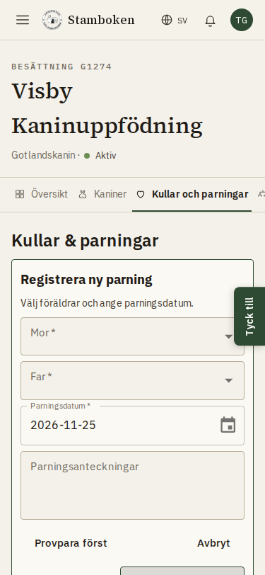

### Registrera en kull

Det finns två vägar. Har du registrerat parningen använder du **Registrera födsel**
på parningens kort. Annars registrerar du kullen direkt med **+ Ny kull**; Stamboken
skapar då parningen åt dig med parningsdatum 31 dagar före födseln.

**Från en registrerad parning**

1. Öppna **Min besättning**, fliken **Kullar och parningar**, och fäll ut parningens kort
   med pilen **Detaljer**.
2. Klicka **Registrera födsel**.
3. Fyll i **Födelsedatum**, **Antal födda** och, om du vet det, **Antal vid 6 veckor**.
4. Klicka **Spara**. Bekräftelsen "Kull registrerad!" visas.

**Direkt, utan parning**

1. Öppna **Min besättning** och fliken **Kullar och parningar**.
2. Klicka **+ Ny kull**.
3. Välj **Mor** och **Far**.
4. Fyll i **Födelsedatum**, **Antal födda** och gärna **Antal vid 6 veckor** och
   **Anteckningar**. **Antal vid 6 veckor** kan du fylla i senare med **Redigera** på
   kortet, men det måste finnas innan intyg kan utfärdas.
5. Klicka **Registrera kull**. Bekräftelsen "Kull registrerad!" visas och kortet
   hamnar under rätt år med märket **Kull N**.

När kullen registrerats skapar Stamboken en rad i kullistan för varje född unge.

Formuläret sparas i webbläsaren medan du skriver, så du kan stänga sidan och fortsätta
senare. Knappen **Registrera kull** är grå tills mor, far, datum och antal är ifyllda.

När en unge i kullen har fått intyg kan bara genbanksansvarig ändra kullens föräldrar och födelsedatum. Antal födda och anteckningar kan du fortfarande ändra själv.

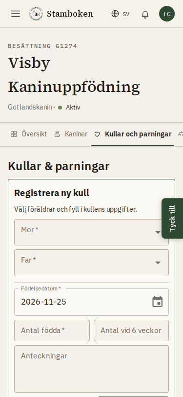

### Föra kullistan

Kullistan är ungarnas lista från födsel till registrering. Fäll ut kullens kort med
**Detaljer** så ligger den under rubriken **Kullista** med antalet
"(tillagda av födda)".

- **Lägga till ungar** till en äldre kull utan lista: skriv antal i fältet **Antal** och
  klicka **+ Lägg till ungar**. Texten "N kvar av M rapporterade" visar hur många
  platser som återstår. Högst nio ungar kan registreras per kull.
- **Fylla i uppgifter**: klicka pennan **Redigera ungens uppgifter**. I dialogen
  **Redigera unge** finns **Namn/märkning**, **Kön** (Okänt, Hona, Hane),
  **Färg (observerad)**, **Anteckningar** och **Öde**. Klicka **Spara**.
- **Markera öde** direkt i listan: rullgardinen **Öde** har valen **Obestämd**,
  **Behålls oreg.**, **Såld utan intyg** (såld som sällskapsdjur utan intyg, kan inte
  registreras senare), **Slaktad** och **Död**. Ungar med Slaktad eller Död kan inte
  registreras.
- **Ändra ordning**: dra i handtaget ⋮⋮. Ordningen styr vilket individnummer ungen
  får; numret står som "(förslag)" tills ungen registreras.
- **Ta bort en unge**: öppna pennan och klicka **Ta bort ungen**, bekräfta med
  **Ja, ta bort**. Du har sex sekunder på dig att klicka **Ångra** i meddelandet
  "Ungen togs bort".

Märket till höger om rubriken visar om kullen är gammal nog: **Registrering öppnar om N
dagar** eller **6 veckor passerade — kan registreras**. Gränsen är 42 dagar efter
födseln.

Under **Att göra** på fliken **Översikt** påminner Stamboken om kullar som passerat
sex veckor utan att alla ungar registrerats eller fått ett öde.

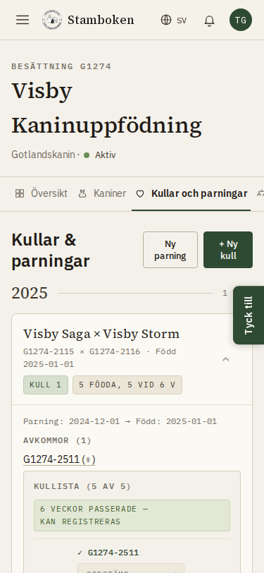

### Registrera en unge och utfärda intyg

Från sex veckors ålder registrerar du ungen, det vill säga skriver in den i stamboken
så att den får sitt individnummer. Samtidigt väljer du intyg; utan intyg går ungen inte
att registrera. **Digitalt intyg utfärdas härifrån**, från ungens rad i kullistan, eller
med **+ Lägg till kanin** för en kanin vars kull inte finns i Stamboken (se
[Lägga till en kanin utan registrerad kull](#lägga-till-en-kanin-utan-registrerad-kull)).
Knappen **Registrera kanin** på kullens kort och **Skapa genbanksintyg** på översikten
kan inte utfärda digitala intyg.

1. Öppna **Min besättning**, fliken **Kullar och parningar**, och fäll ut kullens kort
   med **Detaljer**.
2. I kullistan: klicka **Registrera** på ungens rad. Dialogen **Registrera kanin —
   G1274-2531** öppnas med ungens föreslagna individnummer i rubriken.
3. Välj **Kön** (Hona eller Hane) och **Färg** ur genbankens färglista. I listan står
   färgens nummer före namnet, och under namnet ibland en kommentar, till exempel andra
   namn på färgen. Sökningen träffar också kommentaren. Saknas färgen i listan kontaktar du genbanksansvarig. Välj **Päls**:
   **Normal** (förvalt) eller **Rex**. Fyll gärna i **Namn**; **Färganteckning**,
   **Ögonfärg**, **Klofärg**, **Bukfärg** och **Avvikande hårlag** är frivilliga.
4. Välj **Intyg**. Intyg krävs; **Digitalt** är förvalt.
   - **Digitalt** – Stamboken utfärdar en signerad PDF direkt. Under fältet står "Ditt
     namn står som intygare på intyget." Har du inte valt om ditt namn ska stå på
     intygets kontrollsida står det också, med länken **Välj under Min profil**, se
     [Uppdatera din profil](#uppdatera-din-profil).
   - **Papper** – skriv numret från det tryckta intyget i **Intygsnummer** och
     individnumret som står på pappret i **Individnummer på pappret**. Först då visar
     rubriken Stambokens individnummer. Är de olika, se
     [När pappret och Stamboken har olika individnummer](#när-pappret-och-stamboken-har-olika-individnummer).
5. Saknar kullen uppgift om antal levande vid sex veckor visas fältet **Levande i
   kullen efter 6 veckor**. Fyll i det; uppgiften sparas på kullen.
6. Klicka **Registrera**. Rutan "Namn registrerad som G1274-2531" visas.
7. Klicka **Visa intyg** för att öppna PDF:en i en ny flik, **Visa kanin** för kaninens
   sida eller **Registrera en till i kullen** för nästa unge.

Den som utfärdar ett digitalt intyg står som intygare med sitt eget namn, och intygar
att uppgifterna stämmer med kaninen. Därför kan bara de som har tillgång till kaninens
ursprungsbesättning utfärda och rätta digitala intyg. Genbanksansvarig kan inte göra
det åt dig.

Intyget går att verifiera av vem som helst genom QR-koden på PDF:en, se
[Verifiera intyg](#verifiera-intyg).

Meddelanden som stoppar registreringen:

| Text | Betyder |
| --- | --- |
| Kan registreras om N dag(ar) | Kullen är yngre än 42 dagar. |
| Fyll i hur många kaniner som var levande efter 6 veckor innan du kan utfärda intyg. | Fyll i fältet i steg 5 eller **Antal vid 6 veckor** på kullen. |
| Kullen har fler levande ungar i listan än antalet levande vid 6 veckor… | Markera de ungar som dog med öde **Död** först. Knappen **Välj kaniner att markera som döda** hjälper till. |
| Endast N intyg kan utfärdas i denna kull | Antalet intyg begränsas av antalet levande vid sex veckor. |
| Kullen är full — max 9 kaniner per kull. | Fler ungar än nio kan inte registreras i samma kull. |
| Intyget kunde inte skapas: … | Kaninen är registrerad men intyget misslyckades. Försök igen senare eller kontakta genbanksansvarig. |

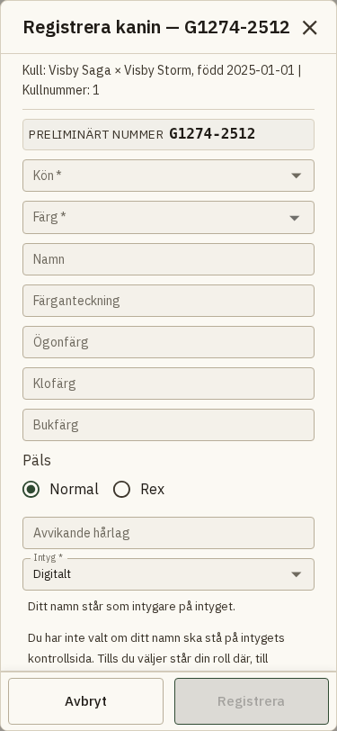

### Lägga till en kanin utan registrerad kull

Registrerar du inte parningar och kullar kan du lägga till en enda kanin, till exempel
när den ska säljas. Stamboken skapar då kullen åt dig, och väljer du digitalt intyg
utfärdas det direkt.

1. Öppna **Min besättning** och fliken **Kaniner**.
2. Klicka **+ Lägg till kanin**. Dialogen **Lägg till kanin** öppnas.
3. Välj **Mor** (honor i din besättning) och **Far** (hanar i hela genbanken). Fyll i
   **Födelsedatum**, **Antal födda** och **Levande i kullen efter 6 veckor**. Rubriken
   visar sedan kaninens individnummer, till exempel **Registrera kanin — G1274-2531**.
   Finns kullen redan, med samma mor, far och födelsedatum, står det "Kullen finns redan
   (kull N)" och kaninen läggs till i den.
4. Välj **Kön** och **Färg**, och **Päls** om kaninen är rex. Fyll gärna i **Namn**;
   övriga fält är frivilliga.
5. Välj **Intyg**. **Digitalt** är förvalt och utfärdas direkt. Väljer du **Papper**
   skriver du numret från det tryckta intyget i **Intygsnummer** och individnumret som
   står på pappret i **Individnummer på pappret**.
6. Klicka **Registrera**. Rutan "Namn registrerad som G1274-2531" visas.
7. Klicka **Visa intyg** för att öppna PDF:en, **Visa kanin** för kaninens sida eller
   **Lägg till en till i kullen** för ett syskon.

Kullen får parningsdatum 31 dagar före födseln och årets nästa kullnummer. Den syns
sedan under **Kullar och parningar** som andra kullar.

Meddelanden som stoppar registreringen:

| Text | Betyder |
| --- | --- |
| Kullen är född före en kull som redan har kullnummer det året… | Kullnumren följer födelsedatumen. Registrera kullen med **+ Ny kull** och numrera om, se [När kullnumren inte stämmer](#när-kullnumren-inte-stämmer). |
| Honan har redan en kull registrerad inom 35 dagar | Honan har en annan kull nära det datumet. Kontrollera datumet, eller registrera kaninen från den kullen under **Kullar och parningar**. |
| Fadern måste vara registrerad i samma genbank som modern. | Välj en hane av samma ras. |
| Modern finns inte i en besättning där du får registrera kaniner. | Honan har sålts eller finns i en annan besättning. |
| Kaninen måste vara minst 42 dagar gammal för att registreras. | Vänta tills kullen är sex veckor. |

### När pappret och Stamboken har olika individnummer

Stamboken räknar fram individnumret ur besättningen, kullens födelseår, kullnumret och
platsen i kullen. Ett pappersintyg skrivs för hand och kan ha en annan siffra. Skiljer
sig numret på pappret från Stambokens visas rutan **Individnumret på pappret stämmer
inte med Stamboken** när du klickar **Registrera**. Inget sparas förrän du väljer.

Rutan visar vad pappret säger, vad Stamboken säger och varför, till exempel vilken
kull som redan har kullsiffran. Inget val är förvalt: ett kullnummer följer ordningen
kullarna lades in, så vid en bortglömd kull är det ofta pappret som har rätt.

- **Pappret rättas** – kaninen registreras med Stambokens nummer. Stryk numret på
  pappret och skriv det rätta. Valet och numret du skrev in loggas för
  kaninen, så att det går att se i efterhand vad som hände.
- **Pappret stämmer** – inget sparas. Stamboken visar vad du behöver göra: en länk till
  det du kan rätta själv (till exempel kullens födelsedatum eller en kull som saknas) och,
  när kullar måste numreras om eller flyttas, ett färdigt **Meddelande till
  genbanksansvarig** som du kopierar med **Kopiera meddelandet**. Skriv i meddelandet
  varför pappret stämmer; utan det kan genbanksansvarig inte hjälpa. Du kan registrera
  kaninen igen när det är rättat.

Är besättningen eller året på pappret ett annat än kullens, eller är kullen född före en
kull som redan har nummer, går bara **Pappret stämmer**.

### När kullnumren inte stämmer

Kullnumren följer födelsedatumen. Registrerar du en kull som fötts före en redan
numrerad kull visas dialogen **Kullnumren stämmer inte** när du försöker registrera
en unge. Tabellen visar **Kullnummer**, **Mor**, **Födelsedatum** och
**Kullnummer (ny)**.

1. Kontrollera att födelsedatumen är rätt. Är de fel: klicka **Avbryt**, rätta datumet
   med **Redigera** på kortet och försök igen.
2. Är datumen rätt: klicka **Numrera om kullar automatiskt**. Därefter öppnas
   registreringsdialogen igen.

Påverkar omnumreringen kullar där kaniner redan registrerats får du
"Omnumrering som påverkar registrerade kaniner kräver genbanksansvarig". Kontakta
då genbanksansvarig, se [del 2](#numrera-om-kullar-med-registrerade-kaniner).

### Ladda upp ett foto

1. Öppna kaninens sida (klicka kaninen under **Kaniner** eller i **Alla kaniner**).
2. Klicka kameraknappen **Ladda upp foto** nere i bildens hörn. Välj en bild i JPEG,
   PNG eller WebP, högst 25 MB.
3. Beskär bilden i rutan **Beskär foto**: dra bilden och använd reglaget **Zoom**.
4. Klicka **Använd**. Bekräftelsen "Foto uppladdat!" visas.

Bilden skalas ned till högst 1600 pixlar och sparas som JPEG. Tappar du nätet mitt i
sparas bilden i webbläsaren och laddas upp när nätet är tillbaka.

### Ladda upp intyg

Har du pappersintyg som ska in i Stamboken kan du fotografera dem och skicka in
fotona. De som arbetar med inläsningen lägger in kaninerna åt dig.

1. Välj **Mina inskick** i menyn och klicka **Ladda upp intyg**.
2. Välj **Besättning**. Har du bara en är den redan vald. Arbetar du med inläsningen
   är **Besättning** ett sökfält där du kan välja vilken besättning som helst.
3. Klicka **Ta foto eller välj filer**. På telefonen kan du välja kameran eller
   bildbiblioteket. Du kan också välja en PDF. Högst 10 bilder, 25 MB per fil och 48 MB
   tillsammans per inskick; en PDF räknas sida för sida.
4. Skriv ett **Meddelande** om du vill (valfritt).
5. Klicka **Skicka**.

Bilderna förminskas i telefonen till högst 3000 pixlar på längsta sidan innan de
skickas, och fotot hålls upprätt. Bilderna skickas en gång. Ser en bild suddig, mörk eller
för liten ut sparas inget, och en varning visas, till exempel "Bilden ser suddig ut. Ta om
den?". Klicka **Ta om** för att ta ett nytt foto, eller **Skicka ändå** om bilden duger;
då skickas bilderna igen och sparas. Tappar telefonen nätet mitt i står "Uppladdningen
avbröts. Försök igen." och de valda bilderna ligger kvar. Efteråt hittar du inskicket under
**Mina inskick**. Är det klart får du en notis och, om du inte har stängt av det, ett mejl.

### Redigera en kanin

Du kan ändra färguppgifterna och anteckningarna på dina kaniner. Nummer, kön,
föräldrar och födelsedatum rättas av genbanksansvarig.

1. Öppna kaninens sida och klicka **Redigera**.
2. Ändra i **Färg**, **Ögonfärg**, **Klofärg**, **Bukfärg**, **Päls** (**Normal** eller
   **Rex**), **Hårlag**, **Färganteckning** och **Anteckningar**.
3. Klicka **Spara** i fältet "Osparade ändringar" längst ned. Bekräftelsen
   "G1274-2117 har uppdaterats." visas.

Vill du ångra: klicka **Avsluta** och sedan **Kasta bort** i frågan "Kasta bort
ändringar?". Utkast sparas i webbläsaren, så en påbörjad redigering öppnas igen
nästa gång du besöker sidan.

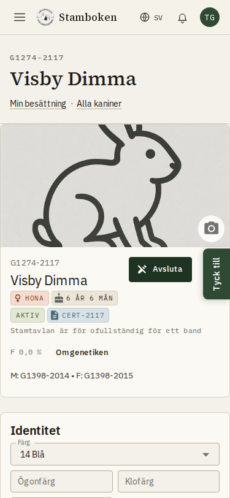

### Rapportera en kanin som död

1. Öppna kaninens sida, klicka **Fler åtgärder** (tre prickar) och välj
   **Rapportera död**.
2. Ange **Dödsdatum** (dagens datum är förvalt) och gärna **Dödsorsak**.
3. Kryssa i **Kaninen har slaktats (t.ex. för kött, pga platsbrist)** om det gäller.
4. Klicka **Bekräfta dödsrapportering**. Bekräftelsen "Namn har rapporterats som
   död." visas och kaninens status blir Död eller Slaktad.

Blev det fel: **Fler åtgärder** → **Ångra dödsrapportering**. Kaninen blir levande
igen direkt, utan fråga. Kom dödsfallet från en årsrapport står i stället **Ändra i
årsrapporten** i menyn. Det öppnar årsrapporten där dödsfallet står.

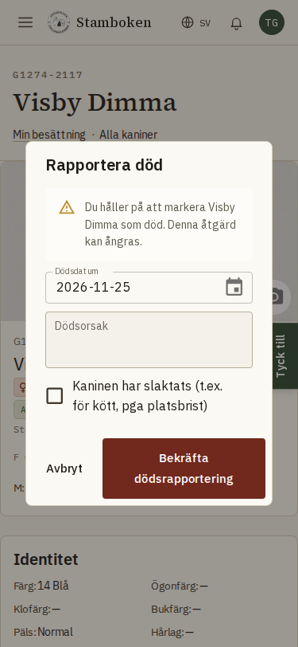

### Sälja eller flytta en kanin

När en kanin byter besättning registrerar säljaren försäljningen. Kaninen försvinner
från din besättning och dyker upp hos köparen. Efter försäljningen kan du inte längre
ändra kaninens uppgifter eller utfärda intyg för den. Samma väg används när kaninen
flyttar utan att säljas.

1. Öppna kaninens sida, klicka **Fler åtgärder** och välj **Sälj individ**.
   Dialogen **Sälj Namn** öppnas.
2. Välj **Ny besättning**. Skriv besättningsnummer eller namn och välj i listan.
   Har du sålt kaninen till någon utanför genbanken väljer du **GX1** (gotlandskanin)
   eller **MX1** (mellerudskanin), som ligger först i listan under "Utanför genbanken".
   En kanin utan intyg kan bara säljas utanför genbanken, till GX1/MX1.
   Väljer du GX1 eller MX1 frågar dialogen efter köparen:
   - Skriv **Köparens namn**, **Ort** och **Postadress**. Alla tre måste fyllas i.
   - Kryssa i **Köparen har kryssat ja: föreningen får spara e-post och telefon så länge
     köparen har kaninen** och **Köparen har kryssat ja: föreningen får kontakta köparen
     om medlemskap** bara om köparen har sagt ja. Först då visas **E-post** och
     **Telefon**. De är frivilliga.
   - Ge köparen försäljningsbeviset. Där står föreningens information till köparen.
3. Kontrollera **Säljdatum**. Dagens datum är förvalt. Datumet får inte ligga
   i framtiden och inte före "Tidigast …" som står under fältet (43 dagar efter
   födseln, eller dagen efter senaste försäljningen).
4. Läs rutan **Från / Till / Datum** och kryssa i **Jag har tagit del av informationen
   och vill ta bort kaninen från min besättning.**
5. Klicka **Bekräfta försäljning**. Knappen är grå tills allt ovan är ifyllt.
   Bekräftelsen "Namn är såld till G1398 – …" visas.

**Ångra en försäljning.** Blev det fel kan du själv ångra inom sju dagar, så länge
inget annat registrerats på kaninen efteråt. Direkt efter försäljningen finns knappen
**Ångra försäljning** i rutan högst upp på sidan; senare hittar du den under
**Fler åtgärder**. Skriv en **Anledning** (inte köparens namn eller kontaktuppgifter)
och klicka **Ångra försäljning**. Har kaninen sålts till en köpare utanför föreningen
frågar dialogen inte efter någon anledning. Bekräftelsen "Försäljningen är ångrad." visas.
Efter sju dagar hjälper genbanksansvarig dig.

Menyvalet **Sälj individ** är grått när du inte får sälja: kaninen är död, du är
skötare och inte ägare, eller kaninen står redan i GX1/MX1.

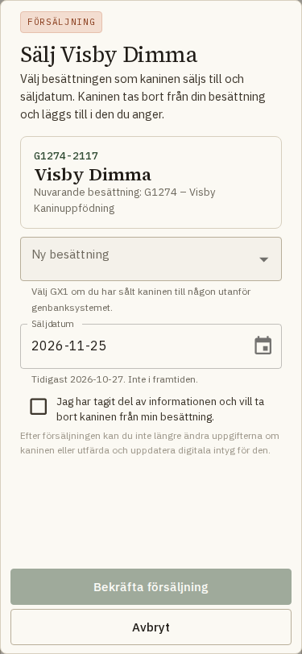

### Provpara

Innan du parar kan du se vilken inavelsgrad avkomman skulle få.

1. Klicka **Provparning** i menyn.
2. Välj **Hona** och **Hane** genom att skriva namn eller nummer. Har du fler kandidater:
   **Lägg till en hane till** (upp till tio).
3. Resultatet räknas ut direkt, ett kort per hane: avkommans **F** i procent, omdömet
   **Bra**, **Utred närmare** eller **Hög inavel**, en varning om djuren är nära släkt,
   och listan **Gemensamma förfäder**. **Visa släktträd** ritar den tänkta avkommans
   stamtavla med gemensamma förfäder markerade.

Är honan eller hanen ännu inte registrerad klickar du **Honan är inte registrerad än**
respektive **Hanen är inte registrerad än** och väljer djurets mor och far i stället.

Länken till sidan innehåller ditt val, så du kan skicka den till någon annan.
Från kaninens sida kommer du hit med **Fler åtgärder** → **Provpara**.

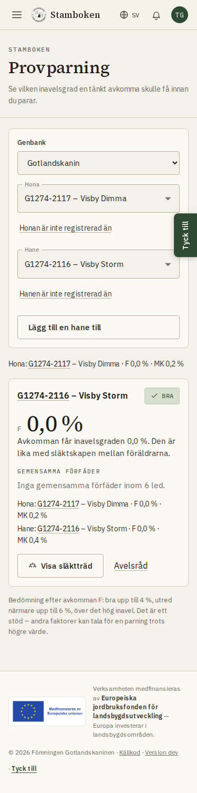

### Uppdatera besättningsuppgifter

På **Min besättning**, fliken **Översikt**, finns två kort: **Din besättning** och
**Kontakt för besättningen**. Andra uppfödare ser det du väljer att visa. För varje
uppgift väljer du **Endast genbanksansvarig** eller **Inloggade besättningar**.

**Din besättning** gäller platsen där kaninerna finns.

1. Klicka **Redigera** vid **Din besättning**.
2. Fyll i **Besättningens namn**, **Ort**, **Hemsida** och **Fast telefon**, och välj
   vem som ser orten, hemsidan och den fasta telefonen.
3. Klicka **Spara**. Bekräftelsen "Besättningsuppgifter sparade" visas.

**Kontakt för besättningen** visar kontaktpersonen och kontaktens **E-post**, **Mobil**
och **Adress**. De hämtas från medlemskapet, så en rättelse där gäller överallt. En rad
kan i stället ha en egen uppgift som bara gäller besättningen.

1. Klicka **Redigera** vid **Kontakt för besättningen**.
2. Välj **Kontaktperson** bland personerna i medlemskapet, eller **Annan kontakt, som
   inte finns i matrikeln**. Bara huvudmedlemmen, genbanksansvarig och admin byter
   kontaktperson.
3. Välj för en rad **Från medlemskapet** eller **Egen**. En egen uppgift skriver du i
   fältet.
4. Välj vem som ser varje uppgift och klicka **Spara**. Bekräftelsen "Kontaktuppgifter
   sparade" visas.

**Stämmer det?** Den frågan ställer kortet när en egen uppgift skiljer sig från
medlemskapets eller inte går att jämföra med den. Klicka **Ja, behåll** om uppgiften
stämmer för besättningen. Skiljer den sig från medlemskapets kan du i stället klicka
**Använd medlemskapets**.

En egen uppgift rättar du på kortet. En uppgift från medlemskapet rättar du där den
finns: är kontaktpersonen huvudmedlem ändrar hen e-post och mobil under
[Min profil](#min-profil), annars rättar matrikeladministratören dem. Adressen gäller hela
hushållet och ändras av huvudmedlemmen.

Har uppgifterna ändrats sedan du öppnade kortet sparas ingenting. Kortet läses om, och
du kontrollerar och sparar igen.

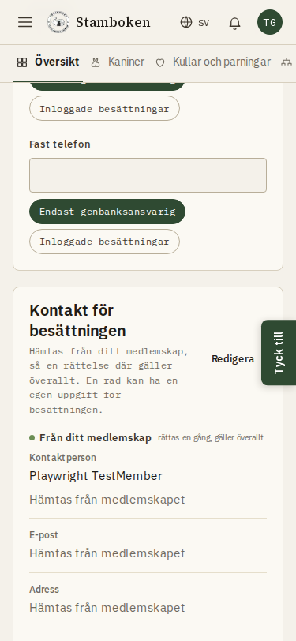

### Uppdatera din profil

Under **Profil** finns ditt konto och, om ditt konto är kopplat till en medlemspost,
medlemskapets uppgifter.

- **Profilbild**: klicka **Ladda upp bild**, välj en bild (minst 128 × 128 pixlar,
  högst 5 MB) och klicka **Spara**. Loggar du in med föreningskontot (Google) kan du i
  stället slå på **Använd Google-profilbild**.
- **Kontaktuppgifter**: fyll i **Telefon**, **E-post**, **Gatuadress**, **Postnummer**
  och **Postort**, klicka **Spara**. Uppgifterna används i medlemsmatrikeln och för
  föreningens utskick. Byter du e-postadress får den nya adressen en kod. Skriv koden
  under **Kod** och klicka **Byt adress**. Sedan loggas du ut och loggar in igen.
- **Publicering i Koharen**: slå på eller av **Namn**, **Telefon**, **E-post** och
  **Adress** för den tryckta medlemsmatrikeln, klicka **Spara**.
- **Notiser**: slå på eller av **Skicka notiser per e-post en gång om dagen**. Notiserna
  syns i Stamboken oavsett. Inställningen stänger inte av mejlet om att ditt eget inskick
  är klart; det skickas ändå.
- **Intygens kontrollsida**: välj om ditt namn ska stå som **Intygas av** på
  [kontrollsidan](#verifiera-intyg) för intyg som du har utfärdat. Annars står din roll
  där, till exempel "Uppfödaren". Har du inte valt än väljer du med **Visa mitt namn**
  eller **Visa inte mitt namn**, sedan ändrar du med **Visa mitt namn på kontrollsidan**.
  Konton som fanns före valet visar namnet tills du ändrar det. På själva intyget står
  ditt namn alltid.
- **Personer i medlemskapet**: huvudmedlemmen lägger till familjemedlemmar och skötare
  med **Lägg till person** (**Förnamn**, **Efternamn**, **Roll**), ger dem rätt att
  sköta en besättning med **Ge åtkomst**, förnyar en skötares tidsbegränsade åtkomst
  med **Förnya** och drar tillbaka den med **Återkalla**.

Bara huvudmedlemmen kan ändra medlemskapets uppgifter; familjemedlemmar och skötare
ser dem och får texten "Endast huvudmedlemmen kan ändra medlemskapets uppgifter."

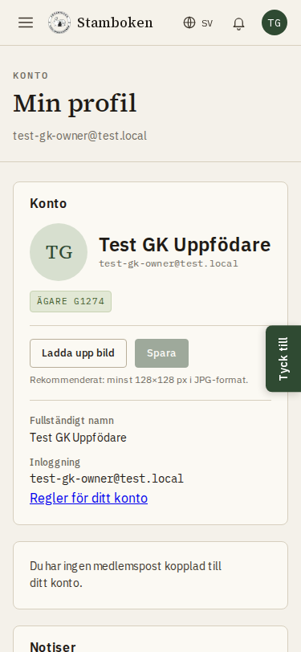

### Skärmarna – uppfödare

#### Min besättning

<!-- route: /stamboken/min-besattning -->

Din besättnings startsida. Rubriken visar besättningsnummer, namn, ras och om
besättningen är aktiv. Äger du flera besättningar väljer du mellan dem med knapparna
under rubriken. Sidan har fyra flikar.

**Översikt**

- **Kom igång med din besättning** – visas för ägaren av en aktiv besättning som ännu
  inte har någon parning: fyra steg (ta emot startdjuren, ladda upp ett foto, registrera
  den första parningen och **Prova i testmiljön**) som bockas av när de är gjorda.
  Startdjuren räknas som klara när besättningen har en levande, okastrerad hane och
  hona. Steget **Prova i testmiljön** säger "Vill du prova utan att ändra något på
  riktigt? Byt till testmiljön i menyn under din bild. Där kan du klicka runt fritt, och
  allt återställs varje natt." Länken **Om testmiljön** leder till
  [Testmiljön och riktiga stamboken](#testmiljön-och-riktiga-stamboken). Steget visas
  för konton med tillgång till riktiga stamboken, och det bockas av när du har bytt till
  testmiljön i menyn under din bild i den här webbläsaren. Knappen **Ny parning** visas
  när besättningen har en levande hona; hanen kan vara lånad. **Stäng** döljer rutan i
  den här webbläsaren, för testmiljön och riktiga stamboken var för sig.
- Fyra siffror: **Aktiva kaniner**, **Avelsdjur** (aktiva, okastrerade honor och
  hanar), **Utfärdade intyg** och **Kullar i år**.
- **Pågående dräktigheter** – parningar utan registrerad födsel, med stapel
  "dag N av 31" och beräknat datum. **Alla parningar →** öppnar fliken Kullar och parningar.
- **Senaste kaninerna** – de fem senast registrerade. **Alla kaniner →** öppnar fliken
  Kaniner.
- **Att göra** – påminnelser: årsrapporten när en runda är öppen och du inte har skickat
  den (märke **Årsrapport**, med året och sista dagen; raden öppnar rapporten), kullar
  som passerat sex veckor (märke **Kullista**) och parningar som gått mer än 35 dagar utan
  födsel (märke **Parning**).
- **Snabbåtgärder** – **+ Registrera kull**, **Ny parning**, **Skapa genbanksintyg**
  (inte klar än) och **Registrera ny kanin** (leder till kullistan).
- **Din besättning** – namn, ort, hemsida och fast telefon. **Kontakt för besättningen**
  – kontaktperson, e-post, mobil och adress, hämtade från medlemskapet eller egna för
  besättningen. Båda har knappen **Redigera**, se
  [Uppdatera besättningsuppgifter](#uppdatera-besättningsuppgifter).

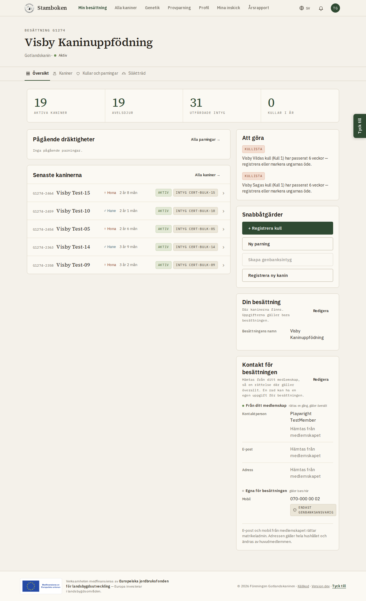

**Kaniner**

Alla dina kaniner som kort eller lista (**Kort** / **Lista**). Sök i **Sök nummer eller
namn**. Filtren **Aktiva (N)**, **Alla (N)** och **Med intyg (N)** visar antalet i
varje grupp. På varje kort står nummer, namn, kön, ålder, status (Aktiv, Inaktiv, Såld,
Död), intyg (märket **✓ Intyg** för digitalt, **Intyg** för papper), **Köpt** från
annan besättning och föräldrarnas nummer. Klicka kortet för kaninens sida.
**+ Lägg till kanin** registrerar en kanin vars kull inte finns i Stamboken, se
[Lägga till en kanin utan registrerad kull](#lägga-till-en-kanin-utan-registrerad-kull).

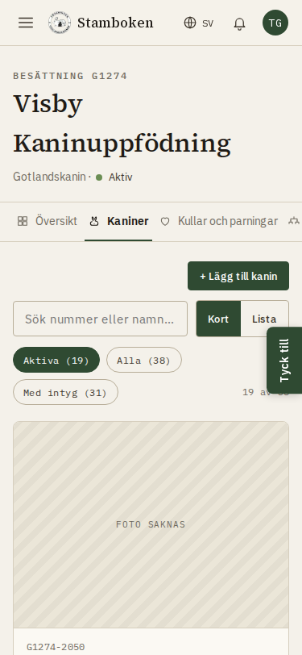

**Kullar och parningar**

Knapparna **Ny parning** och **+ Ny kull** öppnar formulären ovanför listan. Första
gången visas guiden **Så fungerar kullistan**; **Jag vet hur det fungerar** döljer den.

Listan börjar med **Pågående parningar** och fortsätter år för år, nyaste kullen först.
Varje kort visar föräldrarna, "Född datum" eller "Parning datum" och märkena
**Kull N**, **N födda, N vid 6 v** och **N dagars dräktighet**. Pilen **Detaljer** fäller
ut kortet med avkommor, kullistan och knapparna **Registrera födsel** (bara parningar),
**Registrera kanin**, **Redigera** och **Ta bort**. Ta bort går bara när inga kaniner
registrerats i kullen; annars står det "Kan inte ta bort — N registrerade individer".

En kull som lagts till i årsrapporten utan antal vid sex veckor har antalet födda som
gissning: märket visar "(preliminärt)" efter "vid 6 v". Stämmer antalet klickar du
**Bekräfta antalet** i det utfällda kortet, annars rättar du det med **Redigera**.

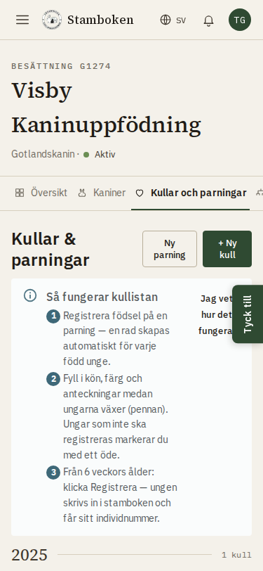

**Släktträd**

Välj en kanin i listan **Välj kanin** så visas föräldrar och far- och morföräldrar.
Länken **Fullständig stamtavla med inavelskoefficient finns på individsidan.** leder
vidare.

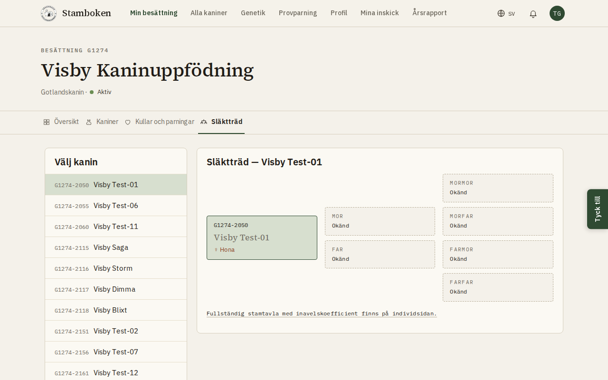

#### Kaninens sida

<!-- route: /stamboken/individ/[number] -->

Allt om en kanin. Adressen är /stamboken/individ/ följt av individnumret.

- **Kortet** till vänster (överst på mobilen): foto med kameraknappen **Ladda upp
  foto**, nummer och namn, knappen **Redigera**, menyn **Fler åtgärder** (**Redigera**,
  **Provpara**, **Rapportera död** / **Ångra dödsrapportering** eller **Ändra i
  årsrapporten**, **Sälj individ**, **Årsrapportera** – kommer snart), märken för kön, ålder, status, intyg, kastrering
  och **Köpt**, genetikbandet A–E med **F** (inavelsgrad) och knappen **Om genetiken**,
  samt föräldrarnas nummer (M och F).
- **Intyget** – under märkena i kortet, när kaninen har ett digitalt intyg. Kaninens
  ägare, uppfödaren och genbanksansvarig klickar **Visa intyg** för att öppna PDF:en i
  en ny flik. Andra ser vem som kan hämta intyget. **Kontrollera intyget** leder till
  [Verifiera intyg](#verifiera-intyg) för intyg som utfärdats i nya Stamboken.
- **Identitet** – färg, ögonfärg, klofärg, bukfärg, päls, hårlag och färganteckning.
- **Släktträd** – tre generationer med länkar till varje förfader; okända visas som
  "Okänd". Under trädet "Kullstorlek: N (vid 6v: M)".
- **Hälsa & Mått** – senaste vikt och hull om sådana registrerats.
- **Besättningshistorik** – var kaninen funnits, med **Född här**, **Flyttad hit** och
  antal årsrapporter. **Visa allt** listar varje händelse med datum; där finns också
  **Ångra** på händelser du själv får ångra. En händelse som kom från en årsrapport har i
  stället **Ändra i årsrapporten**. Vid en försäljning utanför föreningen ser
  genbanksansvarig, genbankshjälpare och administratör "Köpare:" med köparens namn och
  ort.
- **Pappersintyg** – en kopia av pappersintyget som lästs in, med säljarens och
  köparens uppgifter överstrukna. Klicka bilden för full storlek. Blocket visas bara
  om kaninen har en kopia och du får se den. Märkningen **Intyget kontrollerat** vid
  kaninens nummer ser alla: pappersintyget finns i Stamboken, och den som lade in det jämförde
  det med registret och kryssade i att de stämmer. Håll muspekaren över märkningen för att se
  datumet.
- **Anteckningar** – fritext och eventuell dödsorsak.
- **Ändringshistorik** – visas bara för genbanksansvarig och administratör.

Sidan visar bara kaniner i genbanker du har tillgång till; annars får du "Sidan kunde
inte hittas".

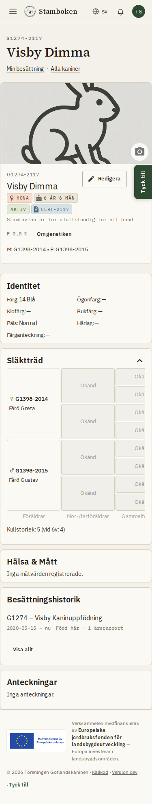

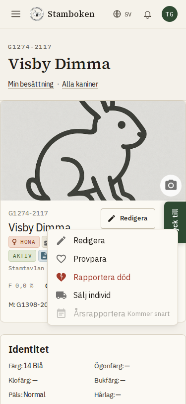

#### Alla kaniner

<!-- route: /stamboken/alla-kaniner -->

Sök bland alla kaniner i genbankerna du har tillgång till. Listan öppnas med
**Gotlandskanin** och status **Aktiv**, och den nyast födda kaninen står först. Föder du
upp mellerudskaniner, klicka **Mellerudskanin**. Välj ras med **Gotlandskanin**,
**Mellerudskanin** eller **Alla**, sök i sökfältet och filtrera på **Status** (Alla,
Aktiv, Inaktiv, Död, Slaktad, Avlivad, Försvunnen), **Kön** och **Päls** (**Alla** eller
**Rex**). Sökningen gäller bara
den ras och status du har valt. Välj **Alla** under **Status** för att hitta en kanin
som är såld, död eller inaktiv. På datorn visas en
tabell med kolumnerna **Individnummer**, **Namn**, **Kön**, **Födelsedatum**, **Status**,
**Besättning**, **Kullstorlek**, **Mor**, **Far** och **Färg**; **Kolumner** väljer
vilka som syns. På mobilen är det en lista med **Visa fler** längst ned. Klicka en rad
för kaninens sida.

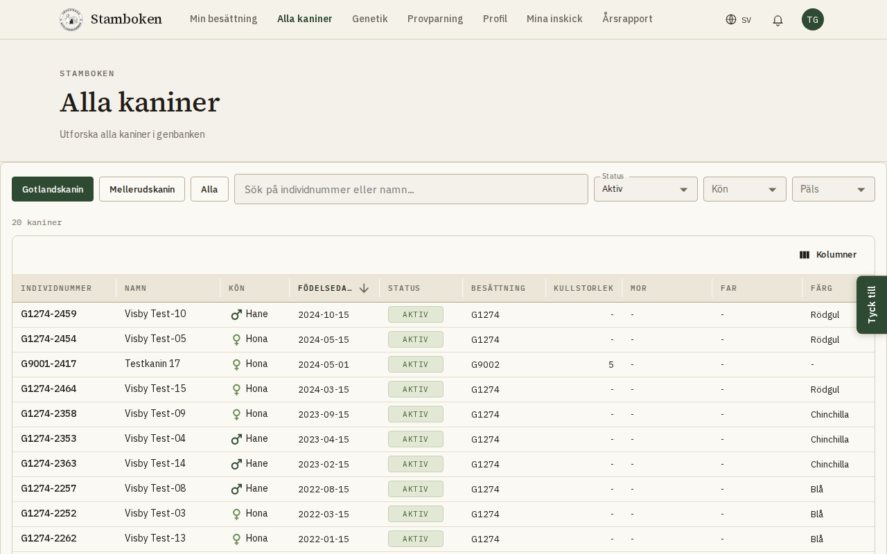

#### Provparning

<!-- route: /stamboken/provparning -->

Formuläret **Välj djur** (**Genbank**, **Hona**, **Hane**, **Lägg till en hane till**)
och ett resultatkort per hane. Under korten står gränserna: "Bedömning efter
avkomman F: bra upp till N %, utred närmare upp till M %, över det hög inavel." Länken
**Avelsråd** öppnar föreningens avelsråd. Se [Provpara](#provpara).

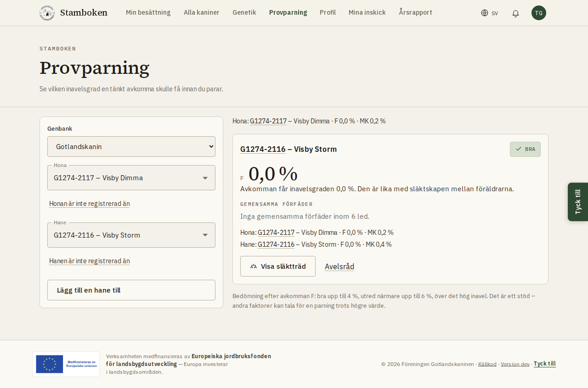

#### Färgatlas

<!-- route: /stamboken/fargatlas -->

Du hittar sidan under **Resurser** i menyn.
Föreningens färgnummer i grupper efter bestämningsnyckeln, och mellerudskaninens
nummer i en egen grupp. Varje färg har ett kort med foto, nummer, namn, beskrivning och vad
som skiljer den från närliggande färger; en färg utan foto har bara text. Klicka på
fotot för en större bild. Grupperna och **Gå till nummer** högst upp tar dig direkt till
en grupp eller en färg. **Skriv ut** ger grupperna på papper utan meny. Färgnumret
anger grundfärgen, också när pälsen är rex: välj då **Rex** vid **Päls**.

Överst på sidan finns **Hjälp mig välja**, bestämningsnyckeln för gotlandskanin. Den
ställer en fråga i taget om kaninens färg och teckning och slutar i ett färgnummer.
Dina svar står överst; klicka på ett av dem för att ändra det. **Tillbaka** går ett steg
bakåt och **Börja om** till första frågan. Efter numret svarar du **Ja** eller **Nej**
på frågorna om pälsen och ögonen. Vid utskrift kommer nyckeln med som en numrerad lista.

I färgvalet, när du registrerar eller redigerar en kanin, öppnar **Visa färgen**
kortet för den färg som är vald. För gotlandskanin finns också **Hjälp mig välja**:
**Välj** i slutet sätter färgen, och **Stäng** lämnar färgen som den var. Guiden
väljer inte päls åt dig: svarar du **Ja** på frågan om pälsen påminner färgvalet dig om
att välja **Rex** vid **Päls**.

#### Min profil

<!-- route: /stamboken/profil -->

Korten **Konto** (bild, namn, e-post, märken för dina roller, **Fullständigt namn**,
**Inloggning** och länken **Regler för ditt konto**),
**Medlemskap** (medlemsnummer, medlem sedan, huvudmedlem, din roll, besättningar),
**Kontaktuppgifter**, **Publicering i Koharen**, **Personer i medlemskapet**, **Notiser**
och **Intygens kontrollsida**. **Intygens kontrollsida** visas för den som äger en
besättning, är genbanksansvarig eller administratör, eller redan visar sitt namn.
Saknar kontot medlemspost visas **Konto** och texten "Du har ingen medlemspost
kopplad till ditt konto." Se [Uppdatera din profil](#uppdatera-din-profil).

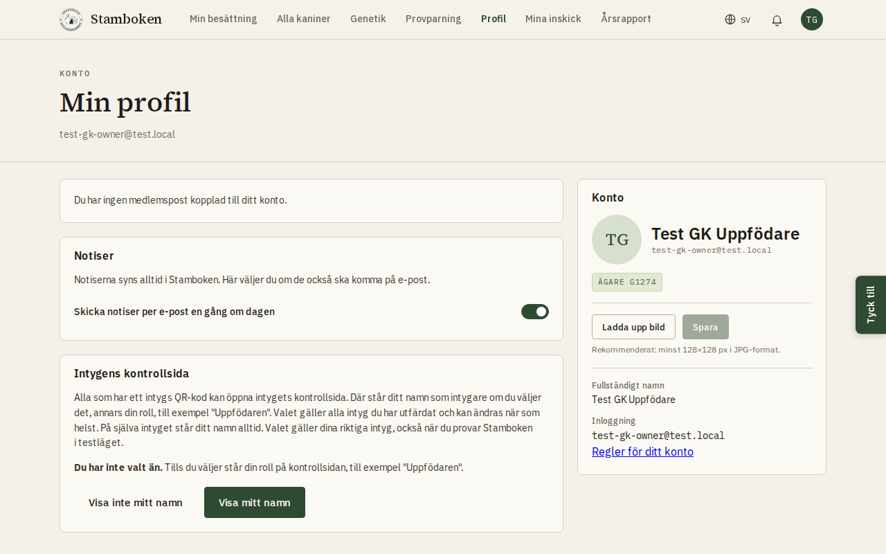

#### Mina inskick

<!-- route: /stamboken/inskick -->

Dina inskick, nyast först. Varje inskick visar "ärende" och numret, datum,
besättning, antal bilder och hur långt vi har kommit: **Mottaget**, **Under arbete**,
**Vi har frågat dig något**, **Klart** eller **Avslutat**. När inskicket är klart
länkas kaninerna som lagts in. Knappen **Ladda upp intyg** öppnar
[Ladda upp intyg](#ladda-upp-intyg). Har du inget inskick förklarar sidan vad den är
till för. Se [Ladda upp intyg](#ladda-upp-intyg).

#### Ladda upp intyg (skärmen)

<!-- route: /stamboken/inskick/ny -->

Rubriken **Ladda upp intyg** med **Besättning**, knappen **Ta foto eller välj filer**,
listan över valda filer, **Meddelande** och **Skicka**. Bilderna skickas en gång. Visas en
varning över en bild har inget sparats, **Skicka** byts mot **Skicka ändå**, och bilden har
knappen **Ta om**. Har du ingen
besättning säger sidan det. Se [Ladda upp intyg](#ladda-upp-intyg).

#### Årsrapport

<!-- route: /stamboken/arsrapport -->

Dina besättningars årsrapporter i en öppen runda, med **Inskickad** eller **Inte
inskickad** och sista dag. Har du en enda besättning och ingen roll i en genbank
kommer du direkt till rapporten. Är ingen runda öppen säger sidan det.

#### Årsrapport för en besättning

<!-- route: /stamboken/arsrapport/[herd]/[year] -->

Rapporten för ett avelsår. Dina kaniner står redan i listan; för varje kanin väljer du
**Finns kvar** (med vikt eller **Ej vägd**, och hull: mager, normal eller fet), **Död**
(med månad, och om kaninen slaktades) eller **Såld** (till en besättning i genbanken,
eller köparens namn och ort utanför genbanken). Har du 15 kaniner eller fler kan du söka
med **Hitta en kanin**. Knapparna **Inte klara** (med antal), **Finns kvar**, **Döda**,
**Sålda**, **Köpta** och **Alla** visar en del av listan. Har du fler än 30 kaniner finns
**Markera resten som finns kvar** när du har kommit till slutet av listan; vuxna kaniner
behöver ändå vikt eller **Ej vägd**. Under **Hälsa** svarar du **Inga sjukdomsfall eller
defekter** eller **Ja, fyll i**. Avslutar du besättningen kryssar du **Jag avslutar min
besättning** och väljer vad som händer med medlemskapet; då behöver kaninerna inget val.

Under listan:

- **Lägg till kanin från intyget** – för en kanin som saknas i listan. Ta foto av
  intyget och fyll i uppgifterna. Kaninen registreras i Stamboken direkt och finns kvar
  även om du drar tillbaka rapporten.
- **Saknas ett köp?** – klicka **Anmäl köpet**. I dialogen **Anmäl ett köp** skriver du
  **Kaninens nummer**, väljer **Säljarens besättning** (**Besättning i genbanken** eller
  **Utanför genbanken**) och **Datum för köpet**, och klickar **Skicka anmälan**.
  Anmälan går till genbanksansvarig, och kaninen kommer in i din besättning när köpet
  är registrerat.
- **Ärenden hos genbanksansvarig** – det som ligger i inkorgen för besättningen.
- **Kullar under** året – kullarna med **Kull**, **Född**, **Mor**, **Far**, **Födda** och
  **Levande vid 6 veckor**. **Lägg till kull** lägger till en kull. En kull som lagts
  till utan antal vid sex veckor står som "(preliminärt)" med knappen **Bekräfta
  antalet**. Minst en kull krävs för stödet.
- **Sålda under** året – försäljningarna som finns i Stamboken.

Säljer en skötare en kanin, eller den som rapporterar via länken i inbjudan, väntar
försäljningen på genbanksansvarig. Raden visar "Försäljningen väntar på genbanksansvarig.
Kaninen står kvar hos dig tills den är godkänd."

Det du fyller i sparas medan du skriver. **Skicka årsrapporten** visar ett kvitto.
Därefter kan du **Ändra** och skicka ändringarna, eller klicka **Dra tillbaka** (det
går till och med det datum som står bredvid knappen). Rutan **Dra tillbaka rapporten**
säger vad som händer: kaninerna räknas inte som levande 31 december förrän du skickar
igen, försäljningar som väntar tas bort, och det du fyllt i finns kvar. Säger rutan
**Rapporten kan inte skickas** listar den vad som saknas, med länkar till kaninerna.

**Från blankett.** Genbanksansvarig och genbankshjälpare matar in en pappersblankett
från ett ärende i inkorgen (**Mata in årsrapporten**). Sidan heter då **Från blankett**,
med fotot av blanketten bredvid formuläret (under **Visa blanketten** på en smal skärm)
och samma formulär i pappersläge. Fyll i **Mottagen** och **Blankettens datum**, och
skriv varje kanins nummer efter besättningens prefix och tryck Enter. Tangent 1, 2 och 3
väljer **Finns kvar**, **Död** och **Såld**; Enter går vidare till nästa
fält och sist till nästa rad. Kaniner som inte står på blanketten ligger under **Kvar i
Stamboken men inte på blanketten**, där **Markera som ej angivna på blanketten** tar alla
på en gång. Under **Uppgifter på blanketten** skriver du in svaret om Koharen och nya
kontouppgifter; de sparas direkt i matrikeln när du skickar, och sidan visar aldrig de
nuvarande värdena, bara de två sista siffrorna i kontot. Har medlemmen påbörjat rapporten
frågar sidan om du vill fortsätta på utkastet eller börja från blanketten. Är besättningen
redan rapporterad kan du **Arkivera blanketten** eller **Ändra rapporten** med en orsak.
Orsak krävs också när blanketten kommer efter sista dagen. **Skicka och nästa blankett**
går tillbaka till inkorgen; kvittot stannar kvar när matrikeln ändrades eller när en
ändring hoppades över för att matrikeln ändrats efter blankettens datum.

#### Status för årsrapporten

<!-- route: /stamboken/arsrapport/status/[year] -->

Genbanksansvarig, administratör och genbankshjälpare ser hur rundan går i en genbank; länken
**Status för genbanken** finns på **Årsrapport** för genbanksansvariga. Överst väljer du
genbank (om du har flera) och kan **Skriv ut tom blankett**. Är rundan inte aktiverad för
genbanken visar sidan de tre datumen (**Öppnar**, **Sista dag för stödet**, **Stänger**) och
**Aktivera**; datumen gäller alla genbanker. Under datumen står hur många besättningar
inbjudan går till och hur många som saknar e-post och får blanketten med post, och
**Skicka provmejl till mig** skickar inbjudan till din egen adress. I provmejlet finns länken
`/rapport#prov`, som bara visar att länken fungerar; den riktiga länken skapas först i det
riktiga mejlet. Inbjudningarna skickas klockan 07 på rundans första dag, med registerutdraget
som PDF. Därefter står aktiveringen på en rad, med dagen då inbjudningarna skickades, och
**Ändra datum** öppnar datumen igen. Aktivera, ändra datum och provmejl kan bara
genbanksansvarig och administratör; hjälpare ser bara listan och antalen.

**Länken i inbjudan** är personlig och ser ut som `/rapport#` följt av en kod. Medlemmen öppnar
den utan att logga in, och länken gäller bara den besättningen till rundans sista dag. Koden
står efter `#`, så den finns inte i adressen som webbläsaren ber servern om. Sidan tar
bort koden ur adressfältet och skickar den sedan för att öppna rapporten. Skriv
aldrig ut en riktig länk i ett ärende eller en rapport. Har medlemmen öppnat länkar för
flera besättningar visar sidan **Välj besättning**. En länk som inte gäller längre ger
sidan "Länken gäller inte längre. Har du fått ett nyare mejl från Stamboken? Använd
länken i det.", och under den, när de finns inlagda, namn och telefonnummer att ringa
för varje ras.

Under det står filtren med antal: **Att ringa**, ett filter för varje läge som har
besättningar (**Påbörjade**, **Ej rapporterade**, **Ingen e-post**, **Blankett inkommen**,
**Blankett väntar på svar**, **Inskickade**, **Avslutar**) och **Alla**. Valet ligger i
adressen. **Att ringa** är påbörjade rapporter från två dagar före sista dag för stödet,
besättningar vars blankett lämnade ut kaniner som avgör stödet, och besättningar där en
avvisad försäljning lämnade en sådan kanin för medlemmen att välja igen. Varje rad visar
besättningen (koden öppnar rapporten), läget, villkoren för stöd (**Hane**, **Hona**,
**Kull**, **I tid**, med bock eller kryss), flaggor, när rapporten togs emot och åtgärder.
Flaggorna är **Ingen e-post**, **Preliminärt antal**, till exempel **3 ej angivna** (med
"(påverkar stödet)" när det gäller), **Försäljning väntar**, **Försäljning avvisad,
medlemmen väljer igen**, **Köpt efter inskick** och **Köp anmält**. Under läget står
inbjudans läge: **Inbjudan skickad**, **Inbjudan studsade**, **Inbjudan misslyckades** eller
**Länken öppnad**. Studsade och misslyckade inbjudningar kommer också under **Att ringa** tills
besättningen har rapporterat. **Mata in blankett** öppnar inkorgen
för besättningen, och genbanksansvarig kan välja **I tid** (**Räknas**, **Ja** eller **Nej**)
på en rad med rapport. Väntar en försäljning från en skötare eller från länken finns
**Försäljningar**. Det öppnar **Försäljningar från** besättningen, där genbanksansvarig
klickar **Godkänn** eller **Avvisa …**. Avvisar du skriver du en **Orsak** (medlemmen får
den i ett mejl; skriv inte köparens namn) och väljer om kaninen **Finns kvar 31
december** eller **Låt medlemmen välja igen**. **Ny länk** på en besättning med e-post frågar
**Den gamla länken slutar gälla. Skicka en ny länk till huvudmedlemmen?**; svarar du ja
får huvudmedlemmen ett mejl med en ny länk, och den gamla slutar fungera. Det du eller
medlemmen redan fyllt i finns kvar, och en medlem som redan rapporterat behöver den nya
länken för att ändra eller dra tillbaka. Genbanksansvariga ser också huvudmedlemmens telefonnummer på raden, så att de kan ringa;
hjälpare ser det inte.

#### Notiser

<!-- route: /stamboken/notiser -->

Dina notiser, nyast först; olästa står med fet stil. En notis blir läst när du klickar
på den. Vart den leder beror på vad den gäller:

- en notis om en kanin leder till kaninens sida;
- en notis om köparens e-postadress leder till
  [Kontrollera köparens e-postadress](#kontrollera-köparens-e-postadress);
- en notis om att ditt inskick är klart leder till **Mina inskick**;
- övriga notiser leder till ärendet i inkorgen.

**Markera alla som lästa** läser alla. Antalet olästa visas i menyn, vid **Mina inskick** (eller **Inkorg**) och
vid **Notiser** under kontomenyn.

#### Kontrollera köparens e-postadress

<!-- route: /stamboken/notiser/koparadress/[number] -->

För genbanksansvariga. Sidan öppnas från en notis när en köpare utanför föreningen har
registrerats med en e-postadress som en annan köpare med ett annat namn redan har.
Försäljningen är sparad, men mejlen till köparen väntar tills du har kontrollerat
adressen. Kontrollera mot försäljningsbeviset. Rätta namnet eller adressen om något är
fel, eller bekräfta att adressen tillhör samma person vid båda köpen. Då skickas mejlen
till köparen. Säljaren får inget besked om detta.

#### Verifiera intyg

<!-- route: /stamboken/verifiera/[uuid] -->

Sidan som QR-koden på ett digitalt intyg leder till. Den kräver ingen inloggning och
visar ett av fyra besked:

- **Äkta genbanksintyg** – intyget är utfärdat i Stamboken och signerat av föreningen.
  Kortet visar **Individnummer**, namn, **Ras**, **Intygsnummer**, **Datum** och
  **Intygas av**: namnet på den som utfärdade intyget om hen har valt det, annars
  "Uppfödaren" eller, när föreningen utfärdade det, "Föreningen Gotlandskaninen" med
  rollen. Varje byte av besättning står som **Såld** med månad och år, aldrig dag eller
  namn.
  **Visa kaninens sida i Stamboken →** kräver inloggning.
- **Äkta, men ersatt** – ett nyare intyg har utfärdats för kaninen. Be säljaren om
  den senaste versionen.
- **Äkta, men gäller inte längre** – intyget har ersatts av ett pappersintyg. Be
  säljaren om kaninens gällande intyg.
- **Intyget hittades inte** – länken matchar inget intyg. Skanna igen eller kontakta
  föreningen med **Kontakta Föreningen Gotlandskaninen**.

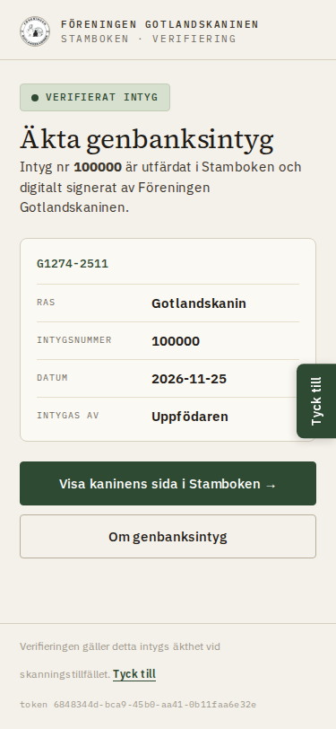

#### Ta bort köparens uppgifter

<!-- route: /kopare/ta-bort -->

Har du sålt kaninen till någon utanför föreningen och skrivit köparens e-post får köparen
ett mejl från föreningen. Det säger vad föreningen sparar om köparen och har kaninens
intyg som bilaga, om kaninen har ett digitalt intyg. Mejlet har en länk till den här
sidan, som inte kräver inloggning.

Sidan säger "Vi tar bort ditt namn, din postadress eller ort och dina övriga
kontaktuppgifter. Det går inte att ångra." och har knappen **Ta bort mina uppgifter**.
Inget tas bort förrän köparen trycker på knappen. Försäljningen står kvar i kaninens
historik, utan köparen. Sedan visar sidan ett av tre besked:

- **Dina uppgifter är borttagna.**
- **Köparuppgifterna för den här försäljningen är redan borttagna.** – har köparen köpt
  fler kaniner använder hen länken i mejlet om den kaninen, eller skriver till
  `dataskydd@gotlandskaninen.se`.
- **Länken gäller inte längre.** – länken är fel eller ofullständig, eller sidan har
  laddats om. Köparen kan klicka på länken i mejlet igen eller skriva till
  `dataskydd@gotlandskaninen.se`.

Blir det fel på vägen står det "Något gick fel. Försök igen om en stund."

---

## Del 2 – Genbanksansvarig

Som genbanksansvarig har du allt i del 1 för alla besättningar i din genbank, plus
rättelser, ändringshistorik, genetiksidan och delar av adminpanelen.

### Rätta en kanin i en annan besättning

1. Sök upp kaninen i **Alla kaniner** och öppna dess sida. Är kaninen inte aktiv,
   välj **Alla** under **Status** först.
2. Klicka **Redigera**, ändra och klicka **Spara**.

Samma knappar som uppfödaren har: **Fler åtgärder** ger dig **Rapportera död** och
**Sälj individ** för alla kaniner i din genbank, även de i GX1/MX1. En kanin i GX1/MX1
kan du också sälja vidare till GX1/MX1, när en köpare utanför föreningen säljer den till
en annan. När du säljer till GX1/MX1 är **Postadress** frivillig, till exempel för
gamla papper utan adress.

### Korrigera besättningshistorik

När en flytt registrerats fel eller saknas rättar du historiken på kaninens sida.

1. Öppna kaninens sida och klicka **Visa allt** under **Besättningshistorik**.
   Kryssrutan **Visa ångrade** visar även ångrade händelser.
2. **Ångra en händelse**: klicka **Ångra** på raden, skriv **Anledning** och bekräfta
   med **Ångra**. Hör raden till en större åtgärd finns **Ångra hela åtgärden**.
   En födelserad kan inte ångras; genbanksbyten ångras bara av administratör.
3. **Lägg till eller ersätt händelser**: klicka **Korrigera historik**. Kryssa i
   **Händelser att ångra**, lägg till **Nya händelser (i tidsordning)** med
   **Lägg till händelse** (**Datum**, **Besättning**, **Typ**: Flytt, Korrigering,
   Årsrapport, Född, och **Anteckning**), skriv **Anledning** om något ångras och
   klicka **Spara korrigering**. Bekräftelsen "Historiken är korrigerad." visas.
   En ny händelse av typen Flytt till GX1 eller MX1 frågar efter köparen med samma fält
   som när du säljer (**Köparens namn**, **Ort**, **Postadress** och de två rutorna).
   Ångrar du samtidigt en försäljning till samma besättning följer köparen med, och då
   frågar dialogen inte.

Skriv aldrig köparens namn eller kontaktuppgifter i anledningen; Stamboken stoppar
text som innehåller e-postadress eller telefonnummer.

### Läsa och ångra i ändringshistoriken

Längst ned på kaninens sida finns **Ändringshistorik**: varje ändring med tidpunkt,
vem som gjorde den och vilka fält som ändrades (gammalt värde överstruket, nytt
värde bredvid). Poster från gamla Stamboken är märkta "Gamla Stamboken".

- **Ångra** på en post tar tillbaka just de fält som ändrades då. Bekräfta i rutan
  "Ångra ändring?".
- **Återställ** sätter hela posten till läget före ändringen. Bekräfta i rutan
  "Återställ till före denna ändring?".

Ungarnas ändringar ser du på samma sätt i dialogen **Redigera unge** under
**Ändringshistorik (N)**.

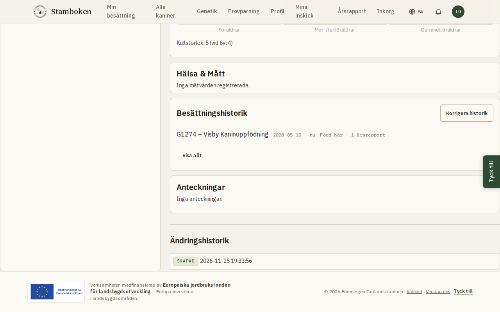

### Numrera om kullar med registrerade kaniner

En uppfödare som får "Omnumrering som påverkar registrerade kaniner kräver
genbanksansvarig" behöver din hjälp. Öppna samma kull under **Kullar och parningar** på
uppfödarens besättning (välj besättningen via **Alla kaniner** eller adressen
/stamboken/min-besattning?herd=G1274), klicka **Registrera kanin** så att dialogen
**Kullnumren stämmer inte** öppnas, och klicka **Numrera om kullar automatiskt**.
Kontrollera sedan att individnumren på de berörda kaninerna stämmer med eventuella
pappersintyg; de byts ut för hand.

### Använda genetiksidan

**Genetik** i menyn visar populationsgenetiken för din genbank. Sidan räknar om vid
första anropet och kan ta upp till en minut.

1. Välj **Genbank** om du ansvarar för flera. Genbanken och fliken står i adressen, så
   du kan spara en länk till en flik, och webbläsarens bakåtknapp tar dig till fliken du
   var på innan.
2. **Översikt** – överst står **Läget**: några korta rader om Ne jämfört med FAO:s gräns
   50 och målet 100, om inavelsökningen per generation (ΔF) jämfört med FAO:s gräns
   1 %, och om hur många founderdjur som har bara 1 bärare kvar. Finns det founderdjur
   utan bärare i beräkningen men med möjliga bärare att leta upp, får de en egen rad. En
   bock betyder att läget är bra, en varningstriangel att du ska hålla ögonen på det och
   ett utropstecken att något behöver göras. **Se vilka** går till tabellen
   Founderdjurens läge. Sedan kommer nyckeltalen **Kaniner i beräkningen** (med datumet
   som räkningen börjar från), **Effektiv populationsstorlek (Ne)** (målet är minst 50,
   helst 100), **Effektivt antal founderdjur (FE)** och **Medelsläktskap (MK)**. Det
   finns ingen gräns för vad som är ett högt medelsläktskap, så kortet visar i stället
   de två senaste stängda åren under dagens tal; de räknas på varje års kaniner och
   jämförs med varandra, inte med dagens tal. Sedan kommer diagrammet **Founderdjur med
   störst andel av generna**, rutan **Inavel** med genomsnittlig inavel (F) och
   inavelsökning per generation (ΔF), **Genetiska trender** med ett mått i taget och
   tabellen **Founderdjurens läge**. Tabellen visar först founderdjuren med 1 bärare
   kvar, sedan de utan bärare som har kaniner att leta efter (kaniner utan dödsdatum som
   inte är med i beräkningen), sedan 2–3 bärare och Liten andel. Knappen **Visa N till**
   visar resten: Ok och de utan bärare där det inte finns någon kanin att leta efter.
   Numren på founderdjuren och bärarna är länkar till kaninernas sidor. Founderdjur är
   rasens ursprungsdjur, kaniner utan kända föräldrar i stamboken. Korten visar läget i
   dag; trenden har ett värde per stängd årsrapportering. I trenden för Ne är en ihålig
   punkt en osäker skattning, från färre än 30 kaniner; för musen över punkten så syns
   Ne med osäkerheten och antalet kaniner. **Visa som tabell** under diagrammet visar
   samma värden år för år, också med tangentbord och skärmläsare.
3. **Avelsprioritet** – kaninerna sorterade efter hur viktiga de är för aveln:
   **Högsta**, **Hög** eller **Övriga**. Tabellen har **Individnummer** (en länk till
   kaninens sida), **Namn**, **Besättning** (en länk till besättningens sida, med
   uppfödarens kontaktuppgifter), **Kön**, **Född**, **Ovanliga gener (0–100)**, **Unika
   gener** och **Skäl**, som står i sin helhet. Knapparna **Högsta (N)**, **Hög (N)** och
   **Övriga (N)** slår av och på nivåerna; en bock visar vilka som är på. **Sortera per
   besättning** samlar varje besättnings kaniner inom varje nivå, så att du ser vilka
   uppfödare du ska kontakta om kaninerna med högsta prioritet. **Ladda ner CSV** sparar listan med de nivåer som är
   på och i den ordning som Sortera per besättning ger, med svenska rubriker, i en fil
   som Excel öppnar. Både att öppna listan och varje nedladdning loggas i
   aktivitetsloggen: vem, när och vilka kaniner som visades eller fanns i filen. I
   testmiljön går listan inte att ladda ner. På en smal
   skärm drar du tabellerna i sidled för att se alla kolumner.
4. **Parningsförslag** – ange **Max antal par**, **Max inavel (F)** och **Max per hane**
   och klicka **Beräkna**. Tabellen visar paren med **Förväntad F**, **ΔGD**, **MSI**
   (1 = utmärkt, 6 = dålig) och **Skäl**.

Panelen **Förklaringar** på varje flik förklarar förkortningarna och vilka kaniner som är
med i beräkningen. Regeln för vilka kaniner som räknas är preliminär tills styrelsen har
beslutat. Frågetecknen vid rubrikerna ger samma text som verktygstips; du når
dem också med tabbtangenten. Står det under Genetiska trender att värdena för Ne räknas
fram, laddar du om sidan om en stund.

### Skapa och redigera besättningar i din genbank

Via avatarmenyn **Adminpanel** når du **Besättningar i Gotlandskanin** (eller din
genbank) och **Genbanker**. Här skapar du nya besättningar och rättar
kontaktuppgifter; stegen är samma som för administratör, se
[Skapa en besättning](#skapa-en-besättning) och [Besättning – redigera](#besättning--redigera).
En besättning kan ha flera ägare: huvudmedlemmen i medlemskapet som besättningen hör
till, och konton med rollen Besättningsägare. Administratören eller
matrikeladministratören kopplar besättningen till ett medlemskap i matrikeln med
**Koppla besättning**. Rollen ger administratören, se
[Byta ägare på en besättning](#byta-ägare-på-en-besättning).

### Arbeta i inkorgen

Medlemmarna fotograferar sina pappersintyg och bevis och laddar upp fotona eller mejlar
dem till föreningens Stamboken-adress. Varje uppladdning och varje mejl blir ett ärende i
**Inkorg**: typen **Uppladdning**, **Mejl** med bilagor och **Meddelande** utan. Ärenden av
typen **Kontroll** kommer från årsrapporten, till exempel ett anmält köp. Inkorgen är för
administratörer, genbanksansvariga och genbankshjälpare, och alla tre kan se hela kön.

1. Öppna **Inkorg** i menyn och klicka på ett ärende i listan. Ärendet visas bredvid
   listan. Klicka **Börja registrera**: då tar du ärendet och kommer till registreringen.
   Har någon annan ärendet står det **Ta över från** och personens förnamn; klicka det
   om du ska ta över. I registreringen heter knapparna **Jag tar den** och **Ta över**.
2. Välj ett dokument i listan till vänster. Vrid fotot med **Vrid vänster** eller
   **Vrid höger** tills intyget står rätt. Vridningen sparas bara medan du har ärendet och
   innan kopian finns; den följer också med när du bekräftar maskningen, och kopian görs
   efter den. Har du vridit fotot utan att ha ärendet börjar du om från den sparade
   vridningen när du tar det.
   Zoom, **Kontrast** och **Förstärk blyerts** ändrar bara hur fotot visas. Med musens
   rullhjul zoomar du in och ut där pekaren står. Ange **Typ**
   (Intyg, Bevis, Årsblankett eller Annat) och **Format**.
3. Ett intyg: välj **Ny kanin** eller **Pappersintyg på en kanin som finns** och skriv av
   fälten. Under **Mor** och **Far** visar Stamboken registrets uppgifter, så att du kan
   jämföra dem med fotot. Klicka **Spara och nästa**. Ett fel visas vid fältet det gäller.
   Stämmer inte individnumret på pappret med Stambokens öppnas samma ruta som för
   uppfödaren, se [När pappret och Stamboken har olika individnummer](#när-pappret-och-stamboken-har-olika-individnummer).
   Stämmer pappret lämnar du ärendet till genbanksansvarig.
   Har kaninen redan samma intygsnummer i Stamboken, som de flesta kaniner från det gamla
   registret, ändras ingenting i registret: fotot kopplas till kaninen så att kopian kan läggas
   på den. Det får också en genbankshjälpare göra.

   Är bildtolkningen på har Stamboken redan läst fotot, och formuläret är ifyllt med ett förslag.
   Varje fält är märkt med varifrån värdet kommer: **läst** (läst på intyget; mor, far och
   individnumret är dessutom kontrollerade mot registret, men namn, kön, färg och intygsnummer, och
   för en ny kull födelsedatum och antal, är bara lästa), **härlett** (hämtat ur registret),
   **avviker** (intyget och registret säger olika) eller **osäker**. Fält som avviker eller är osäkra är tomma, med det som lästes bredvid: skriv av
   dem från fotot. Under fälten står kontrollerna, till exempel "Mor och far finns i Stamboken med
   intyg", "Numret stämmer med kullen" och "Intygsnumret är ledigt". Jämför alltid förslaget med
   fotot innan du sparar; inget sparas förrän du klickar **Spara och nästa**. Har du vridit fotot
   rätt efteråt klickar du **Tolka igen**, så kommer ett nytt förslag några minuter senare.
   Ett foto som är för litet (under 1000 bildpunkter på kortsidan) tolkas inte av sig självt:
   be uppfödaren om ett större foto, skriv av fälten, eller klicka **Tolka igen** för att tolka det
   ändå.
   Det du har skrivit skrivs aldrig över: har du redan börjat fylla i när förslaget kommer står
   "Det finns ett förslag från tolkningen", och först när du klickar **Fyll i förslaget** läggs
   det in.
4. Dölj säljaren och köparen. En svart ruta täcker intygets nedre tredjedel. Dra rutan
   eller dess hörn, eller välj den och använd piltangenterna (Skift ändrar storleken,
   Delete tar bort den). **Lägg till ruta** ger fler. Klicka **Bekräfta maskningen och
   nästa**. Rutorna och fotots vridning skickas tillsammans, så kopian görs som du ser fotot.
   Visar intyget ingen säljare eller köpare tar du bort rutorna, kryssar i **Fotot visar inga
   säljar- eller köparuppgifter** och klickar **Bekräfta maskningen och nästa**. Har du
   jämfört intyget med registret och de stämmer, kryssa i **Jag har jämfört intyget med
   registret och de stämmer** innan du bekräftar. När tolkningen hittade kaninen och alla
   kontroller gick igenom står "Förslag: stämmer" under rutan, men det är du som avgör och
   kryssar. Kaninen får då märkningen **Intyget kontrollerat**. Kopian läggs
   på kaninen som pappersintyg. Därefter går vridning och typ inte att ändra. Blev maskningen
   fel klickar du **Gör om maskningen** på det klara dokumentet: handläggaren kan det medan
   ärendet är öppet, genbanksansvarig för kaninens genbank och administratör när som helst.
   Kopian på kaninen ersätts. Är kaninen i en genbank där du inte är hjälpare lämnar du ärendet
   till genbanksansvarig. Har kaninen fått ett annat intygsnummer sedan fotot sparades kan du
   inte kryssa i att intyget stämmer.
5. Visar intyget en försäljning registrerar du den innan du bekräftar maskningen: öppna
   **Visar intyget en försäljning?** och fyll i **Individnummer**, **Köparens besättning**
   eller **Köparen är utanför föreningen** (sparas på GX1 eller MX1) och **Säljdatum**.
   Är köparen utanför föreningen fyller du i köparen med samma fält som när du säljer,
   se [Sälja eller flytta en kanin](#sälja-eller-flytta-en-kanin).
   Utan bevis märks ärendet "bevis saknas".
6. Ett bevis: välj typen **Bevis** och fyll i försäljningen. Beviset blir klart med den.
7. Ett foto som inte ska sparas: **Avfärda**. **Hoppa över** går till nästa dokument utan
   att spara.
8. När alla dokument är klara eller avfärdade blir ärendet klart, och den som skickade
   in får besked. Ett ärende utan dokument, till exempel ett meddelande, stänger du som
   handläggare med **Klar** (**Besvarat** för typen Meddelande) när det är besvarat.

Behöver du fråga uppfödaren, till exempel om en siffra som är svår att läsa: klicka
**Fråga uppfödaren**, skriv frågan och klicka **Skicka frågan**. Frågan går per mejl till
besättningens innehavare enligt matrikeln. Med **Bifoga utsnitt** lägger sig en streckad
ram på fotot; dra ramen runt det frågan gäller, så följer den delen av fotot med mejlet.
Ärendet väntar på uppfödaren tills svaret kommer. Svaret syns i **Historik**, ärendet blir
ditt och taget igen, och du får en notis. Ett svar från någon annan, eller från en
avsändare som inte gick att bekräfta, blir ett eget ärende med raden **Gäller kanske**
och en länk till ditt ärende.

Går ärendet inte att avsluta väljer du **Väntar på förälder** (ange förälderns
individnummer; ärendet blir taget igen när föräldern läggs in), **Ofullständig** (skriv
vad som saknas), **Lämna till genbanksansvarig** (för en korrigering eller ett beslut),
**Dubblett** (ange numret på det andra ärendet) eller **Skräp**. **Arbeta vidare** tar
upp ett väntande ärende igen. I ärendet bredvid listan lämnar **Lägg tillbaka** ett
ärende du har tagit, så att någon annan kan ta det. Genbanksansvarig och administratör kan också **Öppna igen** ett
stängt ärende och tilldela ärenden:

- ett ärende: i registreringen, under **Tilldela ärende** och numret, välj person och
  klicka **Tilldela**;
- alla öppna ärenden i en besättning: i inkorgen, under **Ge en hel besättning till en
  person**, skriv **Besättning**, välj **Till** och klicka knappen med antalet, till
  exempel **Tilldela 3 ärenden**.

När du har tagit, tagit över, lagt tillbaka eller tilldelat ett ärende visas en rad längst
ned med knappen **Ångra**. Klickar du den står det "Ändringen har ångrats."

Sparades en bild i ett mejl inte, till exempel för att filen var för stor, kan du klicka
**Be avsändaren bifoga bilden** i ärendet bredvid listan och skriva ett **Meddelande till
avsändaren**. Det går när ärendet är ditt och avsändaren är känd. När du
klickar **Skicka** blir ärendet Ofullständig, och avsändaren kan svara på mejlet med
bilden.

En genbankshjälpare sparar bara det en uppfödare får spara: en ny kanin, pappersintyget
på en kanin som saknar intyg och en försäljning med datum efter kaninens senaste
händelse. En korrigering lämnar hjälparen till genbanksansvarig.

### Skärmarna – genbanksansvarig

#### Genetik

<!-- route: /stamboken/genetik -->

Rubriken **Genetik** med rullgardinen **Genbank** och flikarna **Översikt**,
**Avelsprioritet** och **Parningsförslag**. Uppfödare utan ansvar för någon genbank ser
sidan men får ingen genbank att välja. Se [Använda genetiksidan](#använda-genetiksidan).

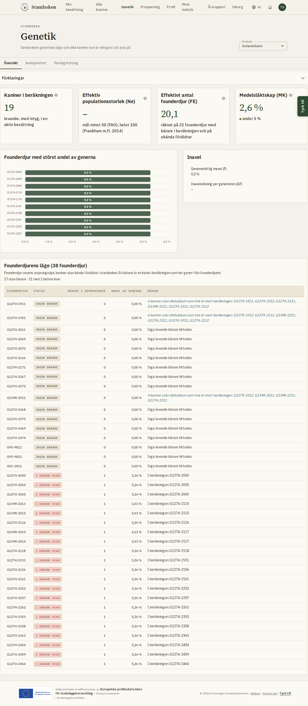

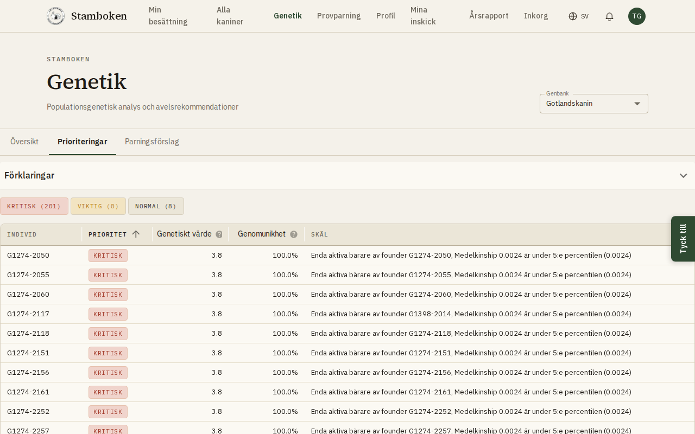

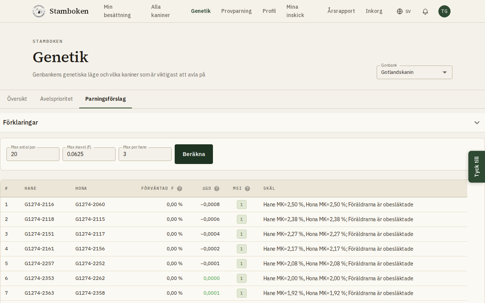

#### Adminpanelen för genbanksansvarig

Samma panel som administratörens men med färre flikar: **Översikt**, **Besättningar i
din genbank**, **Genbanker** och **Utskick**. Rollraden lyder "Inloggad som genbanksansvarig ·
Gotlandskanin". Besättningslistan visar bara besättningarna i dina genbanker. Den har
sökfältet "Sök besättningsnummer eller namn…" och filtren **Status** och **Ägare**, och
**Genbank** om du ansvarar för fler än en. På genbankssidan kan du bara ändra **Namn**. Flikarna **Användare** och **System** finns
bara för administratör.

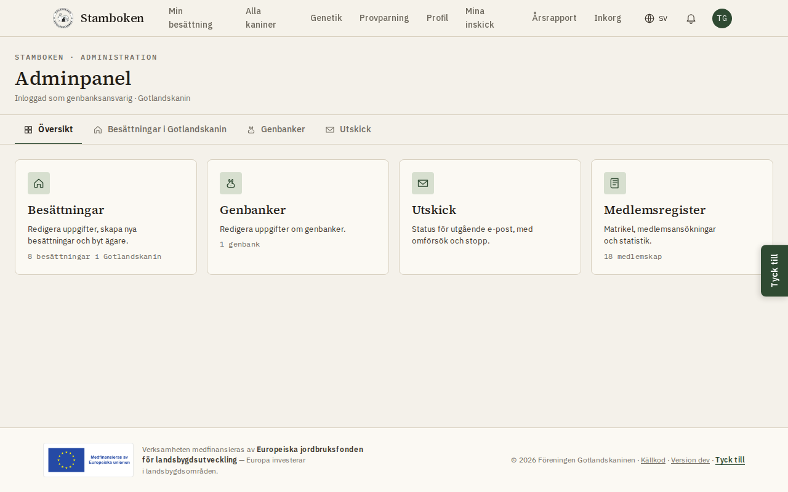

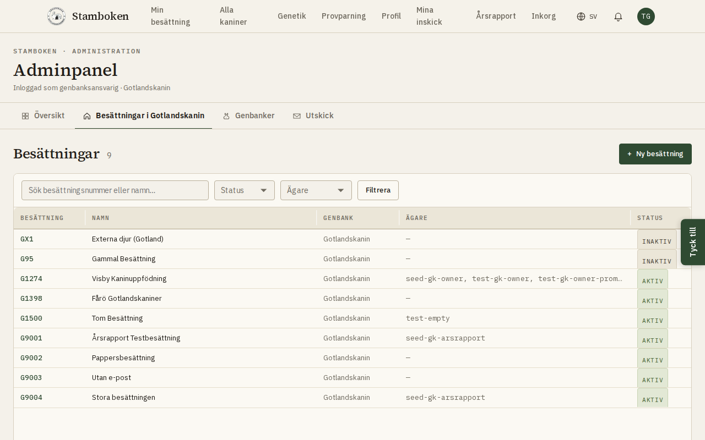

#### Inkorg

<!-- route: /stamboken/inkorg -->

På en bred skärm har sidan tre delar: lägena, listan och det valda ärendet. På en mindre
skärm ser du listan eller ärendet, och **Tillbaka till listan** går tillbaka. Den som inte
arbetar i kön får "sidan finns inte".

**Lägena** till vänster, med antal: **Nya** (ingen har tagit ärendet), **Mina** (ärenden
du har tagit, också de som väntar på svar), **Alla öppna** (allt som inte är klart) och
**Klara**. **Vad betyder lägena?** förklarar dem. Utan val visas **Alla öppna**. Där
finns också **Ge en hel besättning till en person** för genbanksansvarig och
administratör.

**Listan** i mitten. Överst väljer du **Mina genbanker** (ärenden i genbanker där du är
genbanksansvarig eller hjälpare, och ärenden utan genbank) eller **Alla**. Utan val visas
**Mina genbanker** för genbanksansvariga och hjälpare och **Alla** för administratörer.
Sedan **Sök besättning**, **Ordning** (**Äldst först** eller **Nyast först**) och antalet
ärenden. Valen ligger i adressen, så en lista går att länka. Varje rad visar numret och
ämnet, avsändaren, besättningen, typen, antalet foton och vem som har ärendet ("Hos" och
namnet, eller "Ingen har tagit det"). Till höger står läget (till exempel **Ny**,
**Taget**, **Ditt** eller **Väntar på svar**) och hur länge ärendet har väntat. Märkena
"kan vara oskarp", "bevis saknas", "står still", "bilden sparades inte" och "har väntat
länge" visar vad som behöver ses över. Upp- och nedpil flyttar markeringen, och Enter
öppnar ärendet. Är listan tom står det "Inga ärenden här." med länken **Visa alla öppna**.

**Det valda ärendet** till höger ("Välj ett ärende i listan." tills du väljer): ämnet,
läget, vem som har det, besättningen och hur länge sedan det kom in. Knapparna
**Börja registrera**, **Ta över från** och ett namn, **Lägg tillbaka** och **Nästa
ärende**. Sedan fotona, mejlet, **Nämnda kaniner** (länkar till kaninerna som mejlet
nämner) och **Om ärendet** med **Skickat av**, **Typ** och **Inkommet**. Länken **Visa
registrering och historik** öppnar [Inkorg – ärende](#inkorg--ärende). En administratör
kan klicka på kontonamnen och kommer då till kontot i adminpanelen.

När bildtolkningen är på står det överst hur många foton som väntar på tolkning och när
den senaste blev klar, och en röd ruta visas om tre foton i rad inte gick att tolka. Har
mejlen till inkorgen inte lästs in på länge visas också en röd rad, till exempel "Mejlen
har inte lästs in sedan" och en tid. Se [Arbeta i inkorgen](#arbeta-i-inkorgen).

#### Inkorg – ärende

<!-- route: /stamboken/inkorg/[id] -->

Tre kolumner på en dator, under varandra på en telefon. Till vänster dokumenten med sin
status (Att lägga in, Väntar på förälder, Inlagt, maskning kvar, Klart eller Avfärdat),
ärendets läge, handläggare, avsändare och meddelande, knapparna som ärendets läge och din
roll tillåter, och **Historik**, som är hopfälld tills du öppnar den. I mitten fotot med
verktygen, varningar som "kan vara oskarp" och "samma bild i ärende 12", och **Typ**,
**Format**, **Avfärda** och, när bildtolkningen är på, **Tolka igen**. Till höger formuläret för
dokumentet: intyget, försäljningen eller maskningen. Ett intyg som tolkats har fälten ifyllda och
färgade efter varifrån värdet kommer, far- och morföräldrarna och kontrollerna under fälten; medan
fotot tolkas står det "Fotot tolkas". Gäller ärendet en genbank där du inte har rollen står det "Du kan läsa det här ärendet men inte
spara: du har inte rollen för den här genbanken." överst, och knapparna för att ta, byta läge och
spara finns inte. Har du inte ärendet står det vem som har det, med **Jag tar
den** eller **Ta över**; du kan bara spara när ärendet är ditt och taget. Ett mejlat ärende visar
avsändarens adress (med "Avsändaren är inte bekräftad" när den inte gick att bekräfta; inget
mejl skickas då till adressen), **Gäller kanske** när det kan höra till ett annat ärende, och
**Sparades inte** med namnen på bilagor som inte är foton eller PDF, är större än 25 MB
eller kom efter de tio första bilderna. På ett klart intyg finns **Gör om maskningen** för dem som
får. **Fråga uppfödaren** finns när ärendet är ditt
och taget, se [Arbeta i inkorgen](#arbeta-i-inkorgen).

På ett dokument av typen Årsblankett finns **Mata in årsrapporten**, som öppnar blanketten
bredvid rapportformuläret, se [Årsrapport för en besättning](#årsrapport-för-en-besättning).

Ärenden av typen Kontroll ser lite annorlunda ut:

- **Anmält köp** – en medlem har anmält ett köp i årsrapporten. Kortet visar **Kanin**,
  **Säljare**, **Köpare** och **Datum**. **Registrera försäljningen** öppnar kaninens sida
  med säljdialogen ifylld. Väntar säljarens egen försäljning står det i stället att du
  godkänner den i årsrapportens statusvy, med länken **Öppna statusvyn**.
- **Intyget mot registreringen** – uppfödaren har registrerat en kanin från ett foto i
  årsrapporten. Jämför fotot och tolkningen med det som registrerades och klicka
  **Stämmer**, eller **Rättat** när du har ändrat kaninen så att den stämmer med intyget.
  Båda stänger ärendet.
- En försäljning från en skötare eller från länken i inbjudan – ärendet säger "Avgörs i
  årsrapportens statusvy." med länken **Öppna statusvyn**, där du godkänner eller
  avvisar den, se [Status för årsrapporten](#status-för-årsrapporten).

En administratör kan klicka på kontonamnen i ärendet och kommer då till kontot i
adminpanelen.

---

## Del 3 – Administratör

Adminpanelen öppnas från avatarmenyn **Adminpanel** och finns bara i riktiga stamboken.
Flikarna är **Översikt**, **Användare**, **Besättningar**, **Genbanker**, **Utskick** och
**System**.
Ändringar sparas när du klickar **Spara** eller slår om ett reglage. Det kommer inget
bekräftelsemeddelande, utan listan visas igen. Fel visas som en röd ruta högst
upp på sidan.

### Hitta en användare

1. Klicka fliken **Användare**.
2. Skriv i sökfältet (kontonummer, användarnamn, e-post eller namn) och klicka **Filtrera**.
   Rullgardinerna **Roll**, **Konto**, **Riktiga stamboken** och **Webbkurs** avgränsar
   listan.
3. Klicka användarnamnet för att öppna kontot.

Kolumnen **Status och åtkomst** visar märkena **Webbkurs** (validerad),
**Riktiga stamboken**, **Google** (kontot har en Google-inloggning) och **Inaktiv**.

### Ge eller ta bort en roll

1. Öppna användaren och gå till kortet **Roller**.
2. Välj **Roll**: Administratör, Matrikeladministratör, Genbanksansvarig,
   Genbankshjälpare, Läsrätt eller Besättningsägare. För Genbanksansvarig,
   Genbankshjälpare och Läsrätt väljer du **Genbank**;
   för Besättningsägare söker du besättningen i **Besättning**.
3. Klicka **Lägg till roll**.
4. Ta bort en roll med **Ta bort** på raden.

Administratör, Matrikeladministratör, Genbanksansvarig och Genbankshjälpare kan bara ges
till ett konto som loggar in med föreningskontot (Google, en adress som slutar på
@gotlandskaninen.se). Annars står det "En roll kan bara ges till ett konto som loggar in
med föreningens Google-konto. Kontot kopplar sitt Google-konto först." Kontot loggar
sedan bara in med föreningskontot; kod och lösenord fungerar inte för det. Läsrätt och
Besättningsägare kräver inget föreningskonto. Besättningsägare kräver i stället att
kontot är kopplat till en person i besättningens medlemskap, se
[Byta ägare på en besättning](#byta-ägare-på-en-besättning).

Tar du bort din egen administratörsroll frågar Stamboken "Ta bort din
administratörsroll?" och loggar ut dig ur panelen. Den sista administratörsrollen går
inte att ta bort.

### Återställa ett lösenord

1. Öppna användaren och klicka **Återställ lösenord** i kortet **Lösenord**.
2. Det nya lösenordet visas en enda gång. Klicka **Kopiera** och skicka det via en
   säker kanal, till exempel Signal eller telefon, aldrig sms eller e-post.
3. Klicka **Klar**.

Högst tio återställningar per timme och administratör.

En medlem kan också logga in med en kod i stället för lösenord, se
[Logga in med kod](#logga-in-med-kod). Ett konto med en roll loggar bara in med
föreningskontot, så där hjälper ett nytt lösenord inte för inloggningen. Lösenordet
behövs däremot när Google-inloggningen ska bytas, se
[Användare – redigera](#användare--redigera).

### Ge tillgång till riktiga stamboken

I kortet **Status och åtkomst** på användarens sida:

- **Tillgång till den riktiga stamboken i den nya versionen** – är på för alla aktiva
  konton, och ett konto som en medlem skapar själv får den direkt. Med tillgång hamnar
  användaren i riktiga stamboken vid inloggningen och byter till testmiljön i
  avatarmenyn. Utan tillgång hamnar kontot i testmiljön och har inget val **Byt till
  riktiga stamboken**.
- **Webbkurs genomförd (validerad)** – i produktion frågar nya Stamboken inte efter den.
  Gamla Stamboken kräver den, både vid Google-inloggning och för att visa kaninerna
  efter en lösenordsinloggning, och en redaktör behöver den för hemsidans redigering
  (`/admin`). Stäng därför inte av den för någon som använder gamla Stamboken eller
  redigerar hemsidan.

Reglagen sparas direkt.

### Inaktivera eller aktivera ett konto

1. Öppna användaren och slå av **Kontot är aktivt** i kortet **Status och åtkomst**.
2. Bekräfta "Inaktivera kontot?" med **Inaktivera**. Alla användarens sessioner
   avslutas.

Aktivera igen med samma reglage och **Aktivera**.

### Radera kontots uppgifter

Gäller ett konto som inte har någon annan roll än läsrätt och inte är kopplat till
någon person i matrikeln. En person i matrikeln anonymiseras i stället där, och då töms
kontot också. Ditt eget konto kan du inte radera.

1. Öppna användaren och klicka **Radera kontots uppgifter** i kortet med samma namn.
2. Bekräfta "Radera kontots uppgifter?" med **Radera**.

Namn, e-post, inloggningar och profilbild raderas, och kontot maskeras i
ändringsloggen. Det går inte att ångra. Raden finns kvar som raderad-*nummer*, eftersom
andra uppgifter pekar på den, och sidan visar en gul ruta om det.

### Skapa en besättning

1. Klicka fliken **Besättningar** och sedan **Ny besättning**.
2. Välj **Genbank** och skriv **Besättningsnummer** med enbart siffror; bokstaven G
   eller M läggs till automatiskt. Numret väljer du själv, vanligen medlemsnumret.
3. Fyll i **Besättningsnamn**, **Startdatum** och om **Besättningen är aktiv**.
4. Under **Kontaktperson**: **Namn**, **E-post**, **Mobiltelefon**, **Fast
   telefonnummer**, **Hemsida** och **Gatuadress**, var och en med **Synlighet**
   (Inte offentligt, Synligt för inloggade, Synligt för alla).
5. Klicka **Skapa besättning**.

"Besättningsnumret finns redan. Välj ett annat nummer." betyder att numret är upptaget.
Koppla sedan ägaren, se nästa avsnitt.

### Byta ägare på en besättning

En besättning kan ha flera ägare: huvudmedlemmen i medlemskapet som besättningen hör
till, och konton med rollen Besättningsägare. Huvudmedlemmen ändras i matrikeln, och där
kopplar du också besättningen till ett medlemskap med **Koppla besättning**. Rollen
Besättningsägare byter du så här:

1. Öppna besättningen under **Besättningar**. Under **Ägare** står nuvarande ägare som
   länkar.
2. Klicka ägaren som ska tas bort, och på användarens sida **Ta bort** vid rollen
   **Besättningsägare G1274**.
3. Öppna den nya ägaren under **Användare**, välj **Roll** Besättningsägare, sök
   besättningen i **Besättning** och klicka **Lägg till roll**.

Rollen går bara att ge när besättningen är kopplad till ett aktivt medlemskap och kontot
är kopplat till en person i det (huvudmedlem, familjemedlem eller skötare). Annars
står det "Besättningen är inte kopplad till något medlemskap. Koppla den i matrikeln
innan du ger rollen besättningsägare." eller att kontot först ska kopplas till en
person i medlemskapet. Båda kopplingarna görs i matrikeln. Roller som redan finns
ligger kvar.

### Utse genbanksansvarig

1. Klicka fliken **Genbanker** och **Redigera** vid genbanken.
2. Sök användaren i **Ny genbanksansvarig** och klicka **Lägg till genbanksansvarig**.
3. Ta bort ansvar med **Ta bort ansvar** på raden.

Samma sak går att göra från användarens sida med rollen Genbanksansvarig. Rollen kan
bara ges till ett konto som loggar in med föreningskontot, se
[Ge eller ta bort en roll](#ge-eller-ta-bort-en-roll).

### Söka i aktivitetsloggen

1. Klicka fliken **System** och kortet **Aktivitetslogg**.
2. Filtrera på **Område** (Kaniner, Parningar, Ungar, Besättningar, Användare …),
   **Postens id**, **Utförd av**, **Från**, **Till** och **Åtgärd** (Skapad, Ändrad,
   Borttagen, Systemhändelse, Gallring) och klicka **Filtrera**.
3. Klicka en rad för tabellen **Fält / Före / Efter**. **Visa rådata** visar hela
   posten före och efter.

Matrikelns ändringar (medlemskap, personer, konton och åtkomster) finns under
**Matrikeln** överst på sidan. Där filtrerar du på **Åtgärd**, **Utförd av**,
**Medlemsnummer**, **Från** och **Till**. Uppgifter om en anonymiserad person
står som [borttagen].

### Logga ut alla användare

Använd detta om du misstänker att någon obehörig kommit åt ett konto.

1. Klicka fliken **System** och kortet **Aktiva användare**.
2. Klicka **Logga ut alla användare** under **Massutloggning**.
3. Skriv LOGGA UT ALLA i fältet och klicka **Logga ut alla**. Alla loggas ut, du också,
   och händelsen loggas som "Massutloggning — alla sessioner".

### Skärmarna – administratör

#### Adminpanel

<!-- route: /stamboken/admin -->

Startsidan med ett kort per avsnitt och antal: **Användare**, **Besättningar**,
**Genbanker**, **Utskick** ("Status för utgående e-post, med omförsök och stopp."),
**Medlemsregister** (leder till matrikeln under /medlem) och **System**.
Rollraden visar "Inloggad som administratör". Uppfödare som skriver adressen själva
får "Sidan kunde inte hittas".

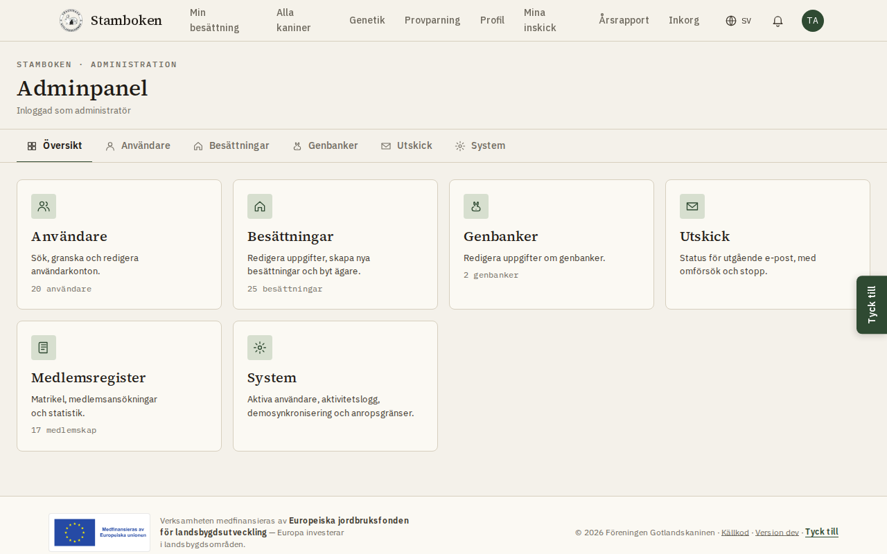

#### Användare

<!-- route: /stamboken/admin/anvandare -->

Sökfält, filtren **Roll**, **Konto**, **Riktiga stamboken** och **Webbkurs**, knappen
**Filtrera** och tabellen **Nr** (kontonumret), **Användarnamn**, **Namn**, **E-post**,
**Roller**, **Status och åtkomst** och **Senast aktiv**. Saknar ett konto med en roll
namn står det "Namn saknas". Sidstorlek väljs längst ned.

Nya konton skapas inte här. Huvudmedlemmar, familjemedlemmar och skötare skapar
sitt konto själva med en kod, se
[Skapa ditt konto första gången](#skapa-ditt-konto-första-gången). En godkänd
medlemsansökan lägger in medlemmen i matrikeln men skapar inget konto.

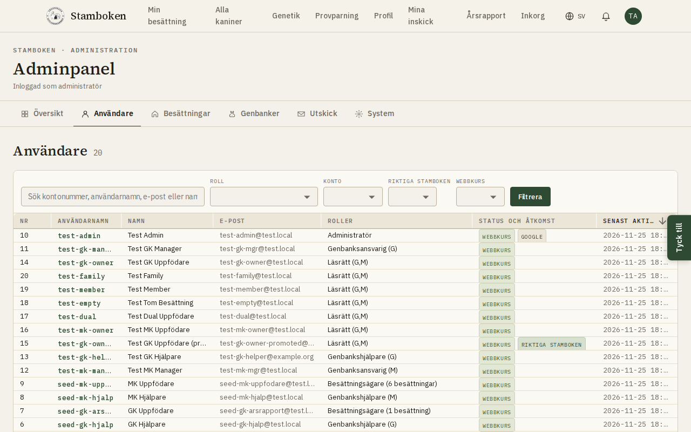

#### Användare – redigera

<!-- route: /stamboken/admin/anvandare/[userId] -->

Överst användarnamnet och raden "Konto" med kontonumret, namnet och e-posten. Korten
**Profil** (**Användarnamn** låst, **Fullständigt namn**, **E-post**, **Spara**),
**Roller**, **Lösenord**, **Sessioner**, **Status och åtkomst**, **Google-konto länkat**
(om det finns), **Radera kontots uppgifter** och **Senaste aktivitet** (de tio senaste
ändringarna användaren gjort). En gul ruta varnar om en annan administratör ändrat kontot
de senaste fem minuterna. På ett raderat konto visas bara **Status och åtkomst** och
**Senaste aktivitet**, se [Radera kontots uppgifter](#radera-kontots-uppgifter).

Under **Roller** länkar en Besättningsägare-roll till besättningen och visar **Aktiv**
eller **Inaktiv**. Kortet **Sessioner** har två knappar:

- **Logga ut överallt** – avslutar kontots alla sessioner, i riktiga stamboken och i
  testmiljön. Bekräfta i rutan "Logga ut överallt?". Användaren kan logga in igen direkt.
- **Ta bort Google-inloggningen** – bekräfta i rutan "Ta bort Google-inloggningen?".
  Kontot loggas ut överallt och kan inte logga in med Google förrän en ny
  Google-inloggning har kopplats. Har kontot inget lösenord behöver det ett först
  (**Återställ lösenord**). Har kontot en roll går Google-inloggningen inte att ta bort.

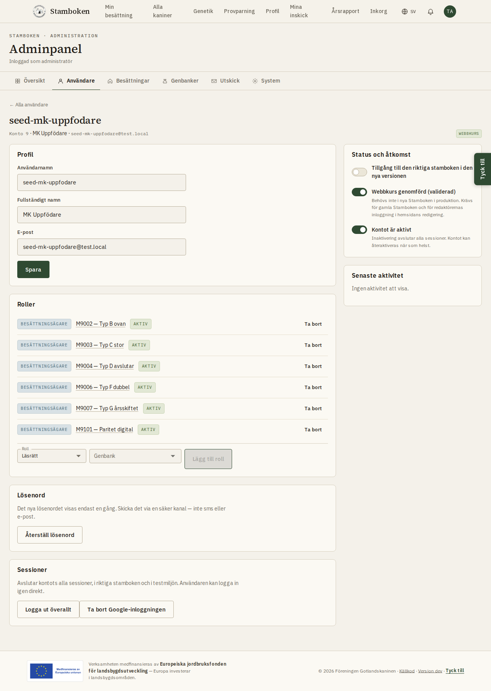

#### Besättningar

<!-- route: /stamboken/admin/besattningar -->

Knappen **Ny besättning**, sökfält, filtren **Genbank**, **Status** och **Ägare**, och
tabellen **Besättning**, **Namn**, **Genbank**, **Ägare**, **Status**. Klicka
besättningsnumret för att redigera.

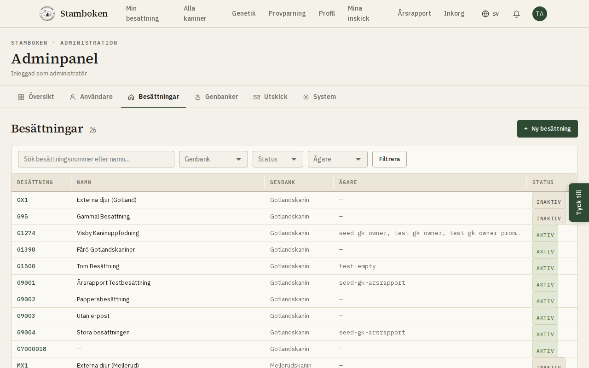

#### Besättning – redigera

<!-- route: /stamboken/admin/besattningar/[herdId] -->

Kortet **Kontakt för besättningen** med **Redigera**: samma kontaktuppgifter och samma
redigering som på Min besättning, se
[Uppdatera besättningsuppgifter](#uppdatera-besättningsuppgifter). Under det
**Fast telefonnummer**, **Hemsida**, reglaget **Besättningen är aktiv** och **Spara**.
Under **Ägare** länkar till ägarnas användarsidor, och texten "En besättning kan ha flera
ägare: huvudmedlemmen i medlemskapet som besättningen hör till, och konton med rollen
Ägare för besättningen. Huvudmedlemmen ändras i matrikeln."
Besättningsnummer och namn kan inte ändras; en inaktiverad besättning behåller sin
historik och kan inte tas bort.

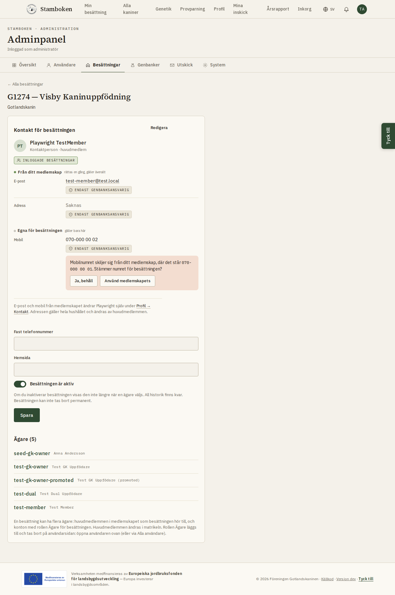

#### Ny besättning

<!-- route: /stamboken/admin/besattningar/ny -->

Formuläret i [Skapa en besättning](#skapa-en-besättning). **Skapa besättning** är grå
tills genbank och nummer är ifyllda.

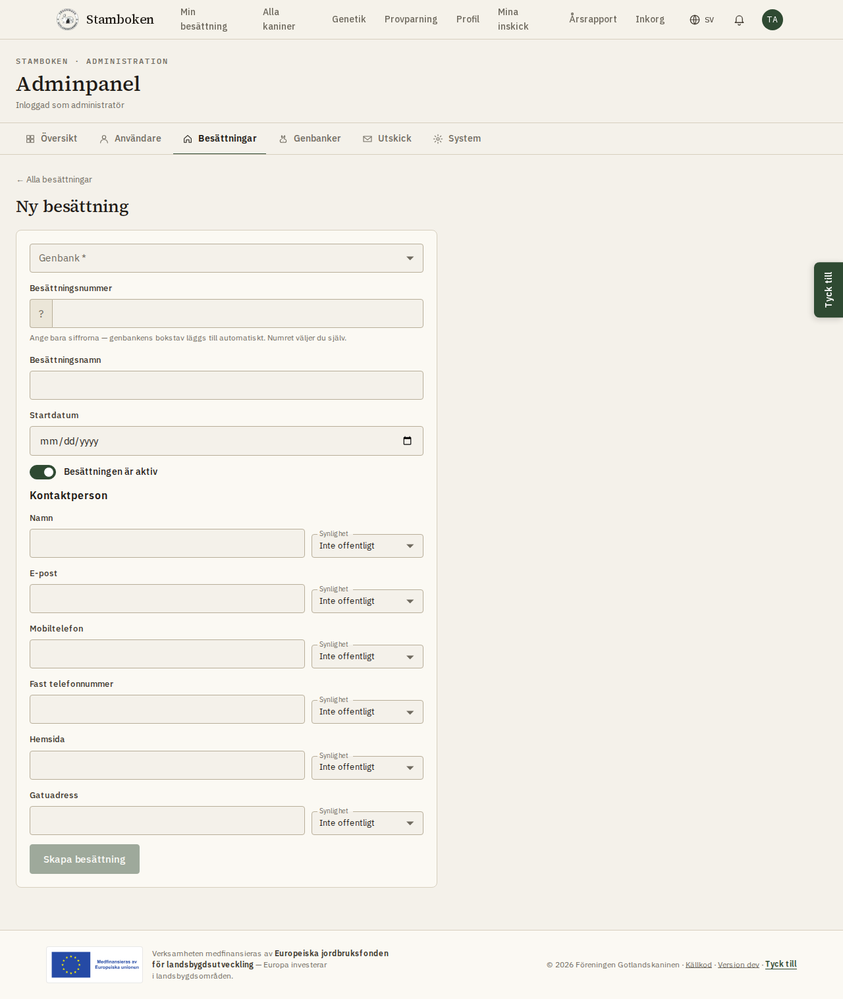

#### Genbanker

<!-- route: /stamboken/admin/genbanker -->

Ett kort per genbank med antal aktiva besättningar och knappen **Redigera**.

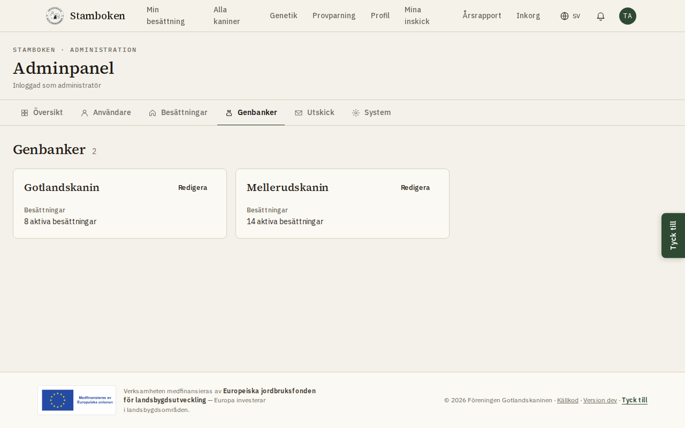

#### Genbank – redigera

<!-- route: /stamboken/admin/genbanker/[gbId] -->

Fältet **Namn** med **Spara**, listan **Genbanksansvariga** med **Ta bort ansvar**,
sökfältet **Ny genbanksansvarig** och **Lägg till genbanksansvarig**.

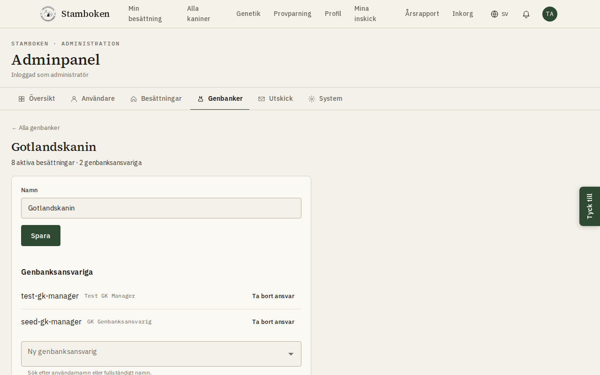

#### Utskick

<!-- route: /stamboken/admin/utskick -->

Status för utgående e-post. Överst står larmen när något är fel ("Reläet tar inte emot
e-post från servern" och "Kön står still"), **Senaste utskick** och, när utskicken är
pausade, **Pausad till**. Filtren **Status** (Köad, Skickas, Skickad, Misslyckades,
Studsade, Spärrad, Loggad, Stoppad), **Typ**, **Från** och **Till** ligger i adressen,
så en filtrerad lista går att länka. Tabellen visar **Skapad**, **Typ**, **Mottagare**
(namn, aldrig adress), **Status**, **Försök** och **Senaste fel**, med **Föregående** och
**Nästa** för fler rader. På en telefon blir varje rad ett kort. **Försök igen** finns
på misslyckade, studsade och loggade utskick (ett loggat utskick skickades aldrig) och
**Stoppa** på köade. Har utskicket hunnit
ändra status visas felet från servern. Genbanksansvariga ser bara sin genbanks utskick.

#### System

<!-- route: /stamboken/admin/system -->

Korten **Aktiva användare**, **Aktivitetslogg**, **Demosynkronisering** och
**Anropsgränser**. Undersidorna har raden **Systemsidor** för att hoppa mellan dem.

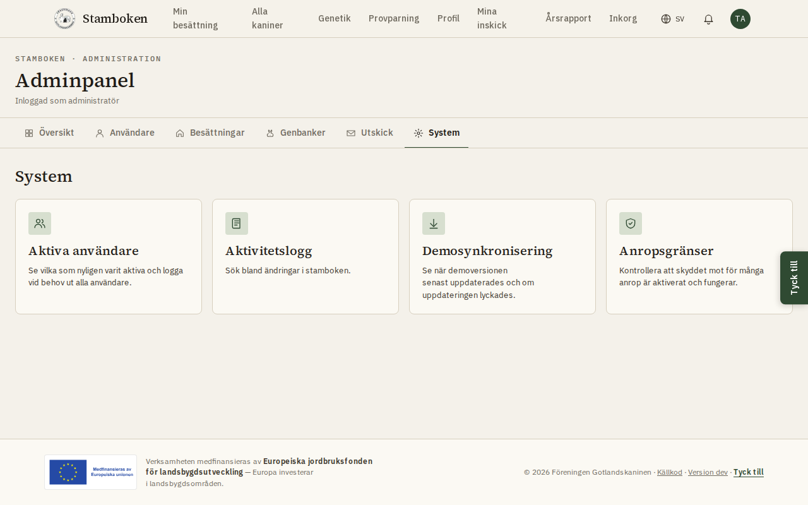

#### Aktiva användare

<!-- route: /stamboken/admin/system/online -->

Vilka som varit aktiva de senaste **1 min**, **5 min** eller **15 min**; uppdateras
var 30:e sekund. Under listan **Massutloggning** med knappen **Logga ut alla användare**.

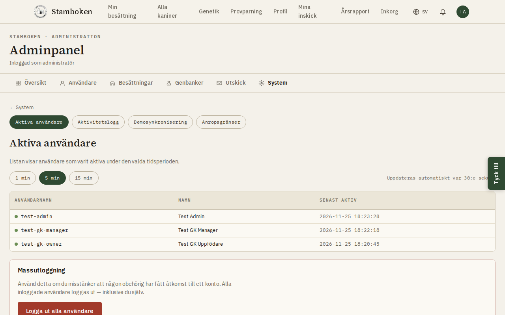

#### Aktivitetslogg

<!-- route: /stamboken/admin/system/audit -->

Ändringarna i Stamboken och, under **Matrikeln**, i matrikeln, med filter och
detaljer per rad, se [Söka i aktivitetsloggen](#söka-i-aktivitetsloggen). Kan loggen inte läsas visas
"Kunde inte läsa aktivitetsloggen just nu." med **Försök igen**.

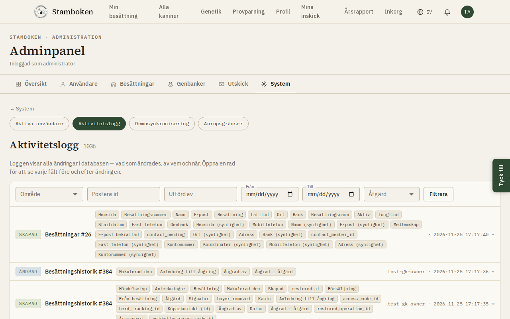

#### Demosynkronisering

<!-- route: /stamboken/admin/system/synk -->

Status för nattens kopiering till testmiljön: **Startad**, **Avslutad**, **Resultat**
och **Synkroniserade användare**. Bara läsning; synkroniseringen startar automatiskt.

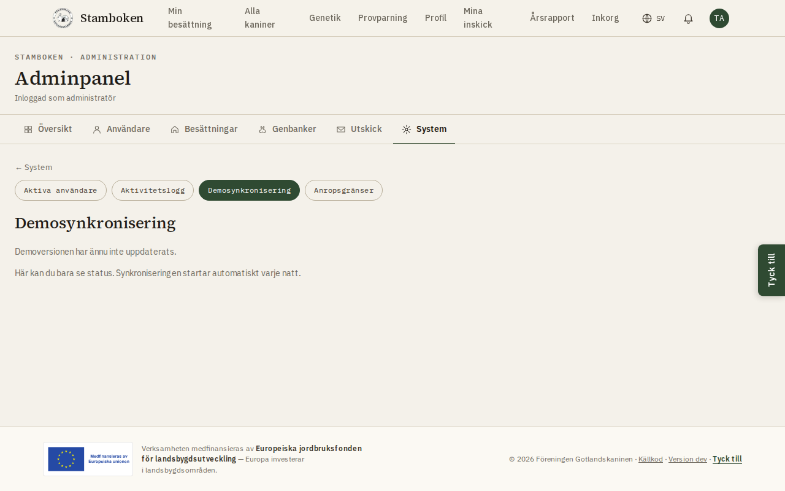

#### Anropsgränser

<!-- route: /stamboken/admin/system/ratelimit -->

Om skyddet mot för många anrop är på, vilken lagring som används och gränserna per
funktion (inloggning, lösenordsåterställning, redigera kanin med flera). Bara läsning.

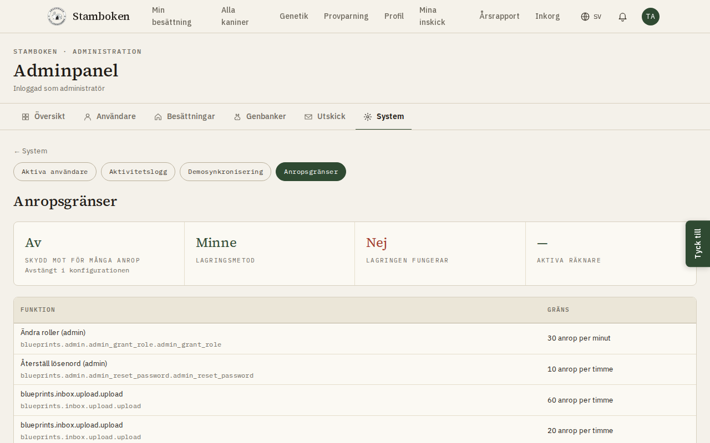

---

## Bilagor

### Felmeddelanden och vad de betyder

| Text | Var | Gör så här |
| --- | --- | --- |
| Sessionen har gått ut | Överallt | Klicka **Logga in igen**. |
| Ditt konto finns inte i testmiljön ännu | Testmiljön | Kontot är nyare än nattens kopia. Vänta till i morgon eller byt till riktiga stamboken. |
| Du har inte behörighet | Parning, kull | Du äger inte besättningen. Kontakta genbanksansvarig. |
| Parningen är redan registrerad | Ny parning | Samma par och datum finns redan. |
| Honan är redan dräktig under detta datum | Ny parning, ny kull | Registrera födsel på den tidigare parningen eller ta bort den. |
| Födseln är redan registrerad | Registrera födsel | Kullen finns redan på kortet. |
| Måste registreras i ordning | Registrera kanin | Registrera ungarna i kullistans ordning. |
| Datumet får inte vara tidigare än … | Sälj individ | Kaninen är yngre än 43 dagar eller såldes nyligen. |
| Försäljningen registrerades för mer än 7 dagar sedan | Ångra försäljning | Kontakta genbanksansvarig. |
| Texten innehåller en e-postadress eller ett telefonnummer | Ångra, korrigera | Ta bort personuppgiften ur anledningen. |
| Kunde inte ladda kaniner. Försök igen senare. | Alla kaniner | Tillfälligt fel; ladda om sidan. |
| Du har inte behörighet att se genetiken för den här genbanken. | Genetik | Du är inte genbanksansvarig för vald genbank. |
| Beräkningen gick inte att hämta. Försök igen om en stund. | Genetik | Tillfälligt fel; klicka **Försök igen** eller ladda om sidan om en stund. |
| Du är utloggad. Logga in igen för att se beräkningen. | Genetik | Logga in igen. |

### Kontakt

Frågor om ditt konto, inloggning och roller: <admin@gotlandskaninen.se>.
Frågor om registrering, färger och intyg: din genbanksansvarig.

### Vad är på gång?

Vad föreningen arbetar med i Stamboken syns på
[projekttavlan för Stamboken](https://github.com/orgs/gotlandskaninen/projects/1/views/3) på GitHub, i kolumnerna
**Att göra**, **Pågår** och **Klart**. Kort med ett hänglås hör till föreningens interna
arbete och går inte att öppna.

Fel och önskemål lämnar du med **Tyck till** i Stamboken, se [Tyck till](#tyck-till).
Väljer du **Alla** läggs texten ut öppet som ett ärende (issue) i
[gotlandskaninen/stamboken](https://github.com/gotlandskaninen/stamboken/issues) på GitHub,
och då syns den på projekttavlan. Väljer du **Bara föreningen** läser bara föreningen den.
Du kan också mejla <admin@gotlandskaninen.se>. Allt på GitHub är offentligt, så skriv
inga personuppgifter där: inga namn, adresser eller besättningsnummer.

### Om manualen

Manualen beskriver gränssnittet som det ser ut i källkoden; varje sida i Stamboken har
ett avsnitt här, och ett skript i kodrepot stoppar ändringar som lägger till en sida
utan avsnitt. Stegen i [Registrera en kull](#registrera-en-kull), [Registrera en unge
och utfärda intyg](#registrera-en-unge-och-utfärda-intyg) och [Sälja eller flytta en
kanin](#sälja-eller-flytta-en-kanin) körs som automatiska tester mot en testdatabas.
Längst ned på varje sida i Stamboken står **Version** och numret på den version du
använder; länken leder till versionens beskrivning på GitHub.
Hur skärmbilder och tester uppdateras står i
[docs/manual/README.md](https://github.com/gotlandskaninen/stamboken/blob/main/docs/manual/README.md)
i kodrepot på GitHub.
